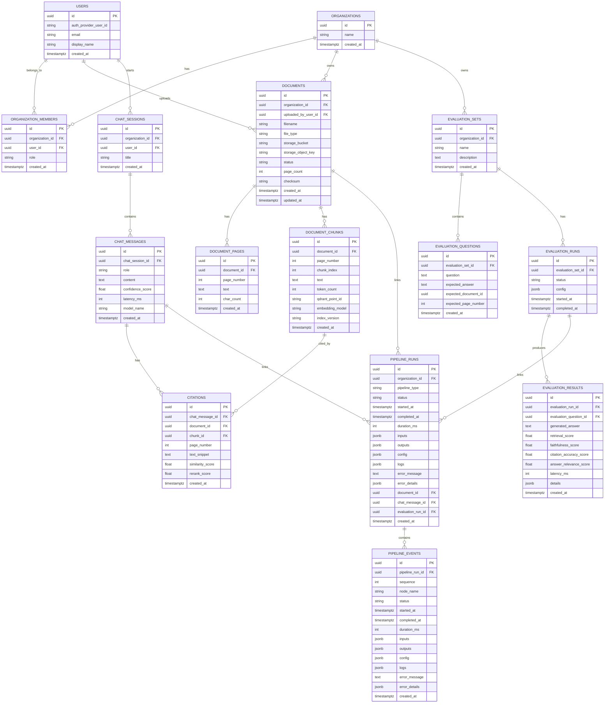

# 06 — Database Schema

PostgreSQL is the source of truth for application state.

Qdrant stores vector embeddings, but PostgreSQL stores document and chunk metadata.

## Migration baseline

- Alembic baseline revision: `20260507_0001` (`backend/alembic/versions/20260507_0001_initial_schema.py`)
- SQLAlchemy async models are defined in `backend/app/models/`.
- Repositories for core CRUD flows are in `backend/app/repositories/`.
- Local commands:
  - `cd backend && make migrate`
  - `cd backend && make downgrade`
  - `cd backend && make seed-dev`

## Entity relationship diagram



## Main tables

### users

Stores internal user mapping.

```sql
CREATE TABLE users (
    id UUID PRIMARY KEY,
    auth_provider_user_id TEXT UNIQUE NOT NULL,
    email TEXT UNIQUE NOT NULL,
    display_name TEXT,
    created_at TIMESTAMPTZ NOT NULL DEFAULT now()
);
```

### organizations

```sql
CREATE TABLE organizations (
    id UUID PRIMARY KEY,
    name TEXT NOT NULL,
    created_at TIMESTAMPTZ NOT NULL DEFAULT now()
);
```

### organization_members

```sql
CREATE TABLE organization_members (
    id UUID PRIMARY KEY,
    organization_id UUID NOT NULL REFERENCES organizations(id),
    user_id UUID NOT NULL REFERENCES users(id),
    role TEXT NOT NULL CHECK (role IN ('owner', 'admin', 'member', 'viewer')),
    created_at TIMESTAMPTZ NOT NULL DEFAULT now(),
    UNIQUE (organization_id, user_id)
);
```

### documents

```sql
CREATE TABLE documents (
    id UUID PRIMARY KEY,
    organization_id UUID NOT NULL REFERENCES organizations(id),
    uploaded_by_user_id UUID NOT NULL REFERENCES users(id),
    filename TEXT NOT NULL,
    file_type TEXT NOT NULL CHECK (file_type IN ('pdf', 'txt', 'docx')),
    storage_bucket TEXT NOT NULL,
    storage_object_key TEXT NOT NULL,
    status TEXT NOT NULL CHECK (
        status IN ('uploaded', 'processing', 'indexed', 'failed', 'deleting', 'deleted')
    ),
    page_count INTEGER,
    checksum TEXT,
    error_message TEXT,
    created_at TIMESTAMPTZ NOT NULL DEFAULT now(),
    updated_at TIMESTAMPTZ NOT NULL DEFAULT now()
);
```

### document_pages

```sql
CREATE TABLE document_pages (
    id UUID PRIMARY KEY,
    document_id UUID NOT NULL REFERENCES documents(id) ON DELETE CASCADE,
    page_number INTEGER NOT NULL,
    text TEXT NOT NULL,
    char_count INTEGER NOT NULL,
    created_at TIMESTAMPTZ NOT NULL DEFAULT now(),
    UNIQUE (document_id, page_number)
);
```

### document_chunks

```sql
CREATE TABLE document_chunks (
    id UUID PRIMARY KEY,
    document_id UUID NOT NULL REFERENCES documents(id) ON DELETE CASCADE,
    page_number INTEGER,
    chunk_index INTEGER NOT NULL,
    text TEXT NOT NULL,
    token_count INTEGER NOT NULL,
    qdrant_point_id TEXT UNIQUE,
    embedding_model TEXT NOT NULL,
    index_version TEXT NOT NULL,
    created_at TIMESTAMPTZ NOT NULL DEFAULT now(),
    UNIQUE (document_id, chunk_index, index_version)
);
```

### chat_sessions

```sql
CREATE TABLE chat_sessions (
    id UUID PRIMARY KEY,
    organization_id UUID NOT NULL REFERENCES organizations(id),
    user_id UUID NOT NULL REFERENCES users(id),
    title TEXT,
    created_at TIMESTAMPTZ NOT NULL DEFAULT now()
);
```

### chat_messages

```sql
CREATE TABLE chat_messages (
    id UUID PRIMARY KEY,
    chat_session_id UUID NOT NULL REFERENCES chat_sessions(id) ON DELETE CASCADE,
    role TEXT NOT NULL CHECK (role IN ('user', 'assistant', 'system')),
    content TEXT NOT NULL,
    confidence_score DOUBLE PRECISION,
    latency_ms INTEGER,
    model_name TEXT,
    token_input_count INTEGER,
    token_output_count INTEGER,
    cost_usd NUMERIC(12, 6),
    created_at TIMESTAMPTZ NOT NULL DEFAULT now()
);
```

### citations

```sql
CREATE TABLE citations (
    id UUID PRIMARY KEY,
    chat_message_id UUID NOT NULL REFERENCES chat_messages(id) ON DELETE CASCADE,
    document_id UUID NOT NULL REFERENCES documents(id),
    chunk_id UUID NOT NULL REFERENCES document_chunks(id),
    page_number INTEGER,
    text_snippet TEXT NOT NULL,
    similarity_score DOUBLE PRECISION,
    rerank_score DOUBLE PRECISION,
    created_at TIMESTAMPTZ NOT NULL DEFAULT now()
);
```

## Evaluation tables

### evaluation_sets

```sql
CREATE TABLE evaluation_sets (
    id UUID PRIMARY KEY,
    organization_id UUID NOT NULL REFERENCES organizations(id),
    name TEXT NOT NULL,
    description TEXT,
    created_at TIMESTAMPTZ NOT NULL DEFAULT now()
);
```

### evaluation_questions

```sql
CREATE TABLE evaluation_questions (
    id UUID PRIMARY KEY,
    evaluation_set_id UUID NOT NULL REFERENCES evaluation_sets(id) ON DELETE CASCADE,
    question TEXT NOT NULL,
    expected_answer TEXT,
    expected_document_id UUID REFERENCES documents(id),
    expected_page_number INTEGER,
    metadata JSONB NOT NULL DEFAULT '{}',
    created_at TIMESTAMPTZ NOT NULL DEFAULT now()
);
```

### evaluation_runs

```sql
CREATE TABLE evaluation_runs (
    id UUID PRIMARY KEY,
    evaluation_set_id UUID NOT NULL REFERENCES evaluation_sets(id),
    status TEXT NOT NULL CHECK (status IN ('queued', 'running', 'completed', 'failed')),
    config JSONB NOT NULL DEFAULT '{}',
    started_at TIMESTAMPTZ,
    completed_at TIMESTAMPTZ,
    created_at TIMESTAMPTZ NOT NULL DEFAULT now()
);
```

### evaluation_results

```sql
CREATE TABLE evaluation_results (
    id UUID PRIMARY KEY,
    evaluation_run_id UUID NOT NULL REFERENCES evaluation_runs(id) ON DELETE CASCADE,
    evaluation_question_id UUID NOT NULL REFERENCES evaluation_questions(id),
    generated_answer TEXT,
    retrieval_score DOUBLE PRECISION,
    faithfulness_score DOUBLE PRECISION,
    citation_accuracy_score DOUBLE PRECISION,
    answer_relevance_score DOUBLE PRECISION,
    latency_ms INTEGER,
    details JSONB NOT NULL DEFAULT '{}',
    created_at TIMESTAMPTZ NOT NULL DEFAULT now()
);
```

## Pipeline observability tables

### pipeline_runs

```sql
CREATE TABLE pipeline_runs (
    id UUID PRIMARY KEY,
    organization_id UUID NOT NULL REFERENCES organizations(id) ON DELETE CASCADE,
    pipeline_type TEXT NOT NULL CHECK (
        pipeline_type IN ('document.process', 'document.reindex', 'document.delete', 'chat.query', 'evaluation.run')
    ),
    status TEXT NOT NULL CHECK (status IN ('queued', 'running', 'completed', 'failed')),
    started_at TIMESTAMPTZ,
    completed_at TIMESTAMPTZ,
    duration_ms INTEGER CHECK (duration_ms >= 0),
    inputs JSONB NOT NULL DEFAULT '{}',
    outputs JSONB NOT NULL DEFAULT '{}',
    config JSONB NOT NULL DEFAULT '{}',
    logs JSONB NOT NULL DEFAULT '[]',
    error_message TEXT,
    error_details JSONB NOT NULL DEFAULT '{}',
    document_id UUID REFERENCES documents(id) ON DELETE CASCADE,
    chat_message_id UUID REFERENCES chat_messages(id) ON DELETE SET NULL,
    evaluation_run_id UUID REFERENCES evaluation_runs(id) ON DELETE SET NULL,
    created_at TIMESTAMPTZ NOT NULL DEFAULT now()
);
```

### pipeline_events

```sql
CREATE TABLE pipeline_events (
    id UUID PRIMARY KEY,
    pipeline_run_id UUID NOT NULL REFERENCES pipeline_runs(id) ON DELETE CASCADE,
    sequence INTEGER NOT NULL CHECK (sequence >= 0),
    node_name TEXT NOT NULL,
    status TEXT NOT NULL CHECK (status IN ('started', 'completed', 'failed', 'skipped')),
    started_at TIMESTAMPTZ,
    completed_at TIMESTAMPTZ,
    duration_ms INTEGER CHECK (duration_ms >= 0),
    inputs JSONB NOT NULL DEFAULT '{}',
    outputs JSONB NOT NULL DEFAULT '{}',
    config JSONB NOT NULL DEFAULT '{}',
    logs JSONB NOT NULL DEFAULT '[]',
    error_message TEXT,
    error_details JSONB NOT NULL DEFAULT '{}',
    created_at TIMESTAMPTZ NOT NULL DEFAULT now(),
    UNIQUE (pipeline_run_id, sequence)
);
```

## Additional production tables

### usage_events

Track cost, tokens, and feature usage.

```sql
CREATE TABLE usage_events (
    id UUID PRIMARY KEY,
    organization_id UUID NOT NULL REFERENCES organizations(id),
    user_id UUID REFERENCES users(id),
    event_type TEXT NOT NULL,
    model_name TEXT,
    input_tokens INTEGER,
    output_tokens INTEGER,
    cost_usd NUMERIC(12, 6),
    metadata JSONB NOT NULL DEFAULT '{}',
    created_at TIMESTAMPTZ NOT NULL DEFAULT now()
);
```

### audit_logs

```sql
CREATE TABLE audit_logs (
    id UUID PRIMARY KEY,
    organization_id UUID NOT NULL REFERENCES organizations(id),
    user_id UUID REFERENCES users(id),
    action TEXT NOT NULL,
    resource_type TEXT NOT NULL,
    resource_id UUID,
    metadata JSONB NOT NULL DEFAULT '{}',
    created_at TIMESTAMPTZ NOT NULL DEFAULT now()
);
```

## Recommended indexes

```sql
CREATE INDEX idx_documents_org_status ON documents(organization_id, status);
CREATE INDEX idx_documents_uploaded_by ON documents(uploaded_by_user_id);
CREATE INDEX idx_chunks_document_id ON document_chunks(document_id);
CREATE INDEX idx_chunks_qdrant_point_id ON document_chunks(qdrant_point_id);
CREATE INDEX idx_chat_sessions_user ON chat_sessions(user_id, created_at DESC);
CREATE INDEX idx_chat_messages_session ON chat_messages(chat_session_id, created_at);
CREATE INDEX idx_citations_message ON citations(chat_message_id);
CREATE INDEX idx_eval_runs_set ON evaluation_runs(evaluation_set_id, created_at DESC);
CREATE INDEX idx_pipeline_runs_org_created ON pipeline_runs(organization_id, created_at DESC);
CREATE INDEX idx_pipeline_events_run_sequence ON pipeline_events(pipeline_run_id, sequence);
CREATE INDEX idx_usage_org_created ON usage_events(organization_id, created_at DESC);
```

### Hot-path and foreign-key indexes (0.4.0, R04-02)

Revisions `20261127_0001`, `20261127_0002`, and `20261127_0003` add these indexes. Each one
has a matching `Index(...)` entry (same name, column order, and direction) in the model's
`__table_args__`.

```sql
-- 20261127_0001
CREATE INDEX idx_chat_sessions_org_created ON chat_sessions(organization_id, created_at DESC);
CREATE INDEX idx_chat_sessions_org_user_updated
    ON chat_sessions(organization_id, user_id, updated_at DESC, id DESC);  -- session list sort
CREATE INDEX idx_activity_timeline_events_org_created
    ON activity_timeline_events(organization_id, created_at DESC);
CREATE INDEX idx_chat_shares_org_created ON chat_shares(organization_id, created_at DESC);
CREATE INDEX idx_notifications_org_created ON notifications(organization_id, created_at DESC);
CREATE INDEX idx_citations_document ON citations(document_id);
CREATE INDEX idx_citations_chunk ON citations(chunk_id);
-- 20261127_0002
CREATE INDEX idx_documents_org_created
    ON documents(organization_id, created_at DESC, id DESC);  -- default document list sort
CREATE INDEX idx_external_items_connection ON external_items(connection_id);
CREATE INDEX idx_source_documents_document ON source_documents(document_id);
CREATE INDEX idx_evaluation_results_question ON evaluation_results(evaluation_question_id);
CREATE INDEX idx_webhook_deliveries_webhook_created
    ON webhook_deliveries(webhook_id, created_at DESC);
CREATE INDEX idx_webhook_deliveries_org_created ON webhook_deliveries(organization_id, created_at);
-- 20261127_0003
CREATE INDEX idx_organization_members_user ON organization_members(user_id);
CREATE INDEX idx_usage_events_user_created ON usage_events(user_id, created_at);
CREATE INDEX idx_audit_logs_user_created ON audit_logs(user_id, created_at);
```

Not added because an index already leads with the column: `citations(chat_message_id)`
(`idx_citations_message`) and `connector_sync_runs(connection_id)`
(`idx_connector_sync_runs_connection_status`).

**Building and rolling back.** On PostgreSQL the migrations build each index with
`CREATE INDEX CONCURRENTLY ... IF NOT EXISTS` inside an autocommit block, with
`statement_timeout = 0` and `lock_timeout = '10s'`, so reads and writes continue during the
build. A failed concurrent build leaves an `INVALID` index; rerunning the upgrade drops an
index of the same name only when `pg_index.indisvalid` is false and builds it again, and it
never rebuilds a valid index. Downgrade drops the indexes with `DROP INDEX CONCURRENTLY IF
EXISTS`. The migrations change no data, and old application code does not depend on the
indexes, so an application rollback without a schema downgrade is safe. Because the build
runs outside a transaction, run these upgrades on their own rather than with other
migrations in a single maintenance window that expects all-or-nothing behaviour.

**Foreign-key index guard.** `backend/tests/test_fk_index_guard.py` fails when a
single-column foreign key is not the leading column of a non-partial index, unique
constraint, or primary key. The foreign keys that were unindexed at 0.4.0 are listed in
`backend/tests/fixtures/fk_index_exemptions.txt`; the list may only shrink (a stale entry
also fails). A new foreign key needs an index, or an exemption line with a justification.
The SQLite test checks the model metadata; a PostgreSQL twin (`requires_postgres`) reads
`pg_constraint` and `pg_index` from the migrated schema, so drift between models and
migrations also fails. Known drift at 0.4.0 is tagged in the file: `@db-only` for
`authorization_conflicts.grant_id`, `deny_id`, and `decision_log_id` (foreign keys only in
the migrations) and `@model-only` for `org_model_provider_change_log.org_model_provider_settings_id`
(declared by the model, not created by any migration).

**Query plans.** `backend/tests/test_query_plans_pg.py` runs `EXPLAIN (FORMAT JSON)` for ten
hot queries (document list, session list, message list, citations by message IDs,
notification list, audit and usage ranges, memberships by user, API key by hash, auth
session by ID) under `SET LOCAL enable_seqscan = off` and fails on a `Seq Scan` of the
target table. The test tables are empty, so this shows each index is usable for the query
shape, not that the planner picks it on production data.

## Row-level security

PostgreSQL row-level security is defense in depth under the application's own
`organization_id` filters (`R04-08`). Migration `20261127_0004` puts one policy,
`tenant_isolation_policy`, on the tables with an `organization_id` column (87 of 90; the
three identity tables below get none). The lists live in `backend/app/db/rls.py`;
`tests/test_rls_coverage.py` fails when a new tenant table is in no list or when the
migration's literal copy differs.

| List | Tables | Unset tenant (`app.current_organization_id` empty) | Bound tenant |
|---|---|---|---|
| `RLS_STRICT_TABLES` | 72, everything not listed below | all rows, unless `app.rls_mode = 'strict'`: then no rows and no writes | own rows only |
| `RLS_LOOKUP_TABLES` | 15: `api_keys`, `service_accounts`, `service_account_tokens`, `organization_invitations`, `chat_shares`, `answer_shares`, `agent_trace_share_tokens`, `org_sso_configs`, `org_domain_verifications`, `org_scim_configs`, `bot_installations`, `bot_user_mappings`, `connector_oauth_states`, `incidents`, `incident_notes` | all rows (needed before the tenant is known: credential and token lookups, SSO/SCIM discovery, OAuth state, bot inbound, public status) | own rows only |
| `RLS_IDENTITY_TABLES` | 3: `users`, `organization_members`, `auth_refresh_sessions` | no policy, RLS stays disabled | all rows: one user spans organizations, so a request bound to organization B must still read the user (home organization A), list every membership (workspace switcher), and revoke the user's sessions in every organization (logout-all, password change) |

Both conditions apply to `USING` and `WITH CHECK`, so a bound tenant cannot insert or move
a row into another organization. The two settings are transaction-local
(`set_config(..., true)`); the application sets them in one statement per transaction
(marked `/* rudix:session-context */`). See `docs/22_AUTHORIZATION_SYSTEM.md` section 11
for the modes and the roles.

Notes:

- Policies do not apply to the table owner, to superusers, or to roles with `BYPASSRLS`.
  `FORCE ROW LEVEL SECURITY` is not used before `0.5.0`, so isolation takes effect only
  when the application connects as the non-owner `rudix_app` role
  (`deploy/sql/provision_roles.sql`).
- `chat_messages`, `citations`, `document_chunks`, and `document_pages` have no
  `organization_id` and are not covered; they are reached through covered parent rows.
- The policy keeps index use: under the policy the document list still uses
  `idx_documents_org_created` (`tests/test_rls_enforcement_pg.py`).
- Migration safety: `ENABLE ROW LEVEL SECURITY` and `CREATE POLICY` take a brief ACCESS
  EXCLUSIVE lock per table and rewrite nothing. The migration sets `lock_timeout = '5s'`
  and fails instead of queueing behind long transactions; run it at low traffic and rerun
  on a lock timeout. Downgrade to `20261127_0003` restores the 12-table policy of
  `20260715_0001` and disables RLS on the other tables.

## Qdrant payload schema

Qdrant payload should duplicate important metadata for fast filtering.

```json
{
  "organization_id": "uuid",
  "user_id": "uuid",
  "document_id": "uuid",
  "chunk_id": "uuid",
  "filename": "employee_policy.pdf",
  "file_type": "pdf",
  "page_number": 4,
  "chunk_index": 12,
  "text": "Employees are entitled to...",
  "embedding_model": "text-embedding-3-small",
  "index_version": "v1",
  "created_at": "2026-05-07T10:00:00Z"
}
```
