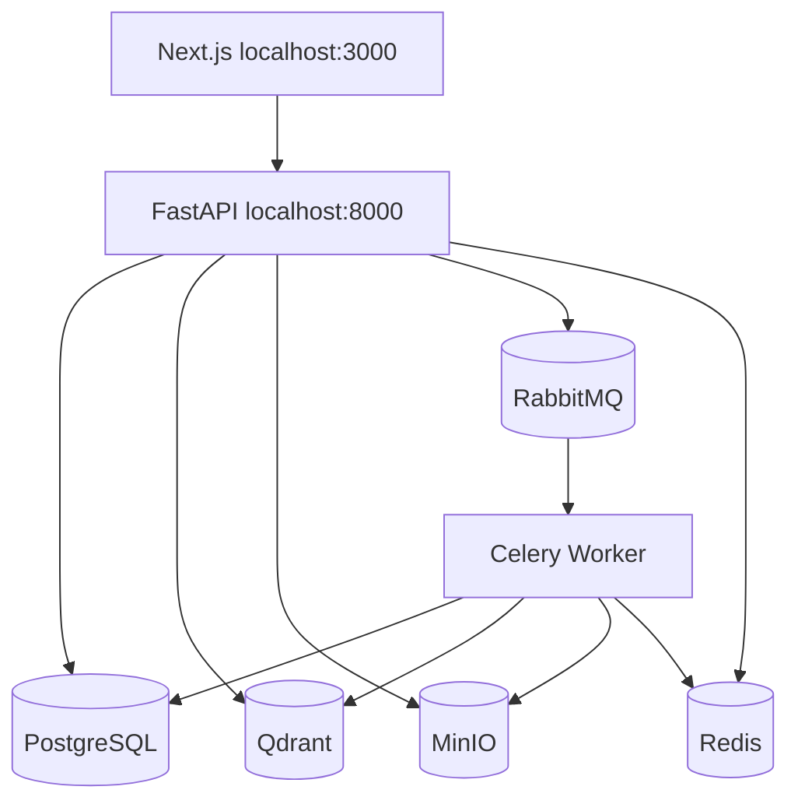
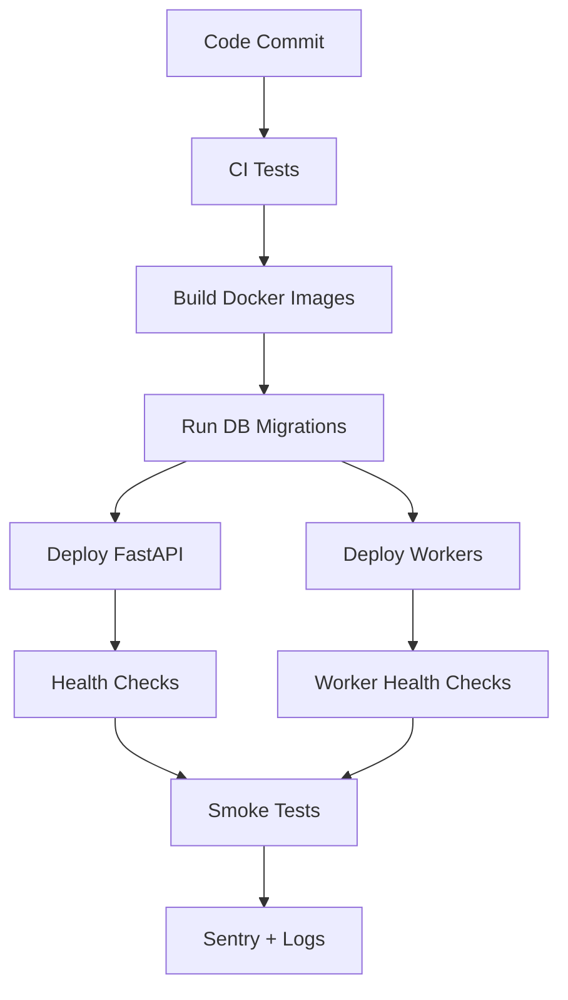

# 10 — Deployment and Docker

## Local development architecture



## Recommended services

```text
frontend       Next.js dev server or containerized Next.js service
api            FastAPI container
worker         Celery worker container
beat           Celery beat scheduler (exactly one instance; also schedules the stale-document reaper)
postgres       PostgreSQL
qdrant         Qdrant vector database
minio          MinIO object storage
rabbitmq       RabbitMQ broker
redis          Redis cache
```

## Example Docker Compose

```yaml
version: "3.9"

services:
  api:
    build:
      context: ./backend
    command: uvicorn app.main:app --host 0.0.0.0 --port 8000 --reload
    ports:
      - "8000:8000"
    env_file:
      - .env
    depends_on:
      - postgres
      - qdrant
      - minio
      - rabbitmq
      - redis
    volumes:
      - ./backend:/app

  worker:
    build:
      context: ./backend
    command: celery -A app.workers.celery_app:celery_app worker --loglevel=INFO
    env_file:
      - .env
    depends_on:
      - postgres
      - qdrant
      - minio
      - rabbitmq
      - redis
    volumes:
      - ./backend:/app

  postgres:
    image: postgres:16
    environment:
      POSTGRES_DB: rag_app
      POSTGRES_USER: postgres
      POSTGRES_PASSWORD: postgres
    ports:
      - "5432:5432"
    volumes:
      - postgres_data:/var/lib/postgresql/data

  qdrant:
    image: qdrant/qdrant:latest
    ports:
      - "6333:6333"
      - "6334:6334"
    volumes:
      - qdrant_data:/qdrant/storage

  minio:
    image: cgr.dev/chainguard/minio:latest
    command: server /data --console-address ":9001"
    environment:
      MINIO_ROOT_USER: minioadmin
      MINIO_ROOT_PASSWORD: minioadmin
    ports:
      - "9000:9000"
      - "9001:9001"
    volumes:
      - minio_data:/data

  rabbitmq:
    image: rabbitmq:3-management
    ports:
      - "5672:5672"
      - "15672:15672"

  redis:
    image: redis:7
    ports:
      - "6379:6379"

volumes:
  postgres_data:
  qdrant_data:
  minio_data:
```

## Current compose baseline in this repository

The active `docker-compose.yml` in repository root includes:

- Services: `api`, `worker`, `beat`, `postgres`, `qdrant`, `minio`, `minio-init`, `rabbitmq`, `redis`
- Healthchecks:
  - `api` via `GET /api/v1/health`
  - `postgres` via `pg_isready`
  - `qdrant` via TCP probe on `6333`
  - `minio` via `/minio/health/live`
  - `rabbitmq` via `rabbitmq-diagnostics ping`
  - `redis` via `redis-cli ping`
- Persistent volumes:
  - `postgres_data`
  - `qdrant_data`
  - `minio_data`

The staging and production files in `deploy/compose/` add on top of this:

- A `clamav` service (no host ports, `clamav_data` volume, `start_period: 300s`
  for the first signature download). `MALWARE_SCAN_CLAMAV_HOST: clamav` is set
  on `api`, `worker`, `beat`, and `mcp`; `api` and `worker` wait only for
  `service_started`, so a slow first download does not block the API.
- Redis with `--appendonly yes`, a `redis_data` volume, and `--requirepass`
  when `REDIS_PASSWORD` is set. `REDIS_URL` is
  `redis://:${REDIS_PASSWORD:-}@redis:6379/0`, so env files without the
  password keep working. The healthcheck requires `PONG`, so it fails on `NOAUTH`.
- RabbitMQ with `hostname: rabbitmq` (fixed node name) and a `rabbitmq_data`
  volume, so queued messages survive a recreate.
- Image variables with the previous tags as defaults: `QDRANT_IMAGE`,
  `MINIO_IMAGE`, `RABBITMQ_IMAGE`, `REDIS_IMAGE`, `CLAMAV_IMAGE`. Pin the first
  three to the digests running today (`docker compose images` or
  `docker inspect --format '{{index .RepoDigests 0}}' <container>`);
  `deploy/scripts/check_deploy_env.sh` fails a production deploy when they are
  unset or `:latest` and when `REDIS_PASSWORD` is missing or not URL-safe.
- Terraform starts `infra_services` (default
  `postgres rabbitmq redis minio qdrant`; staging adds `neo4j`) with `--wait`
  before migrations. The integration smoke checks that each default service runs.

Adding the Redis password and volumes recreates `redis` and `rabbitmq`: deploy
it in a maintenance window. In-flight Celery results and rate-limit counters are
lost, and queued RabbitMQ messages are lost once. See `DEPLOYMENT.md` for the
backup freshness gate (`DEPLOY_BACKUP_MAX_AGE_HOURS`, default 26) and the
rollout steps.

Use repo root Make targets for lifecycle:

```bash
make up
make up-d
make down
make logs
make ps
```

## Backend Dockerfile

Production images use a multi-stage build (`backend/Dockerfile`). Base images are pinned by
digest (`python:3.12-slim@sha256:...`, tag kept for readability); refresh the digest with
`docker buildx imagetools inspect python:3.12-slim` and rebuild.

| Stage | Contents |
|---|---|
| `builder` | `build-essential` and uv; `uv sync --frozen --no-dev` into `/opt/venv` |
| `base-runtime` | `apt-get upgrade`, user `rudix` (uid/gid 10001, no login shell), `/opt/venv`, `alembic.ini`, `alembic/`, `scripts/`. No OCR packages, no compiler. |
| `api` | `USER 10001`, `EXPOSE 8000`, `HEALTHCHECK` on `GET /api/v1/health`, `CMD uvicorn`. Also used for `alembic upgrade head` and the `mcp` service. |
| `worker` (last) | Adds `tesseract-ocr` (eng, ara, fas) and `poppler-utils`, then `USER 10001`; `HEALTHCHECK` runs `celery inspect ping -d celery@$HOSTNAME`; `CMD celery ... worker`. |

Build a stage with `docker build --target api backend` or `--target worker`. An untargeted build
produces the full `worker` image. The root `docker-compose.yml` builds `api` and `mcp` from the
`api` target and `worker` and `beat` from the `worker` target. `beat` runs from the worker image
but has no worker node to ping, so compose sets `healthcheck: disable: true` for it.

The virtualenv lives in `/opt/venv`, outside `/app`, so the development bind mount
`./backend:/app` does not hide it. Application files are root-owned and read-only for uid
10001. The app writes nothing under `/app` at runtime: MinIO objects are read into memory,
multipart uploads spool to the system temp directory (`/tmp`), the beat schedule is written to
`/tmp/celerybeat-schedule`, and libraries that cache files (for example tiktoken) use the
system temp directory.

Compose healthchecks for `api` and `mcp` probe health endpoints with `python` +
`urllib.request`, not `curl`.

### Resource limits, shutdown, and log rotation

`deploy/compose/docker-compose.staging.yml` and `docker-compose.production.yml` set, for the
application services:

| Service | `stop_grace_period` | CPU limit | Memory limit | Healthcheck |
|---|---|---|---|---|
| `frontend` | 30s | 1.0 | 1g | `wget /login` |
| `api` | 30s | 2.0 | 2g | `GET /api/v1/health` |
| `worker` | 120s (finish acknowledged Celery tasks) | 2.0 | 4g | `celery inspect ping` |
| `beat` | 10s | 0.5 | 512m | disabled |
| `mcp` | 30s | 1.0 | 1g | `GET /health` |

The limits are conservative starting points, not measured values. Tune them after the R03-09
load baseline (`docs/roadmap/V0_3_0_LOAD_BASELINE.md`). Every service, including the data
services, uses the shared `x-logging` anchor: `json-file` driver, `max-size: 10m`,
`max-file: 5`.

### Upgrading an existing host to non-root images

The images now run as uid 10001 (backend) and `node` (frontend). The application services
mount no named volumes in staging or production, so no ownership change is needed for them.
If you added a local volume or bind mount to `api`, `worker`, or `beat` (for example a shared
`/tmp` or a data directory), give it to uid 10001 once before the first deploy:

```bash
docker run --rm -v <volume>:/data alpine chown -R 10001:10001 /data
```

Data-service volumes (`postgres_data`, `minio_data`, and so on) are unchanged.

## Backend requirements

Direct dependency ranges live in `backend/pyproject.toml`. The exact, hash-verified set that is
installed everywhere (local `make install`, CI, and the Docker image) is `backend/uv.lock`. The
image builder copies uv from a tag- and digest-pinned image, runs `uv sync --frozen --no-dev`
into `/opt/venv`, and the runtime stage copies that virtualenv. Change dependencies with
`make lock` (see `backend/README.md`). The list below is illustrative only.

```text
fastapi
uvicorn[standard]
pydantic
pydantic-settings
sqlalchemy
asyncpg
alembic
celery
redis
pika
boto3
qdrant-client
pymupdf
python-docx
openai
sentry-sdk
python-multipart
tenacity
tiktoken
```

## Frontend deployment

Recommended:

```text
Self-hosted Next.js container behind Nginx or Traefik
```

Frontend env vars:

```env
NEXT_PUBLIC_DEPLOYMENT_ENV=production
NEXT_PUBLIC_APP_URL=https://getrudix.com
NEXT_PUBLIC_API_URL=https://api.getrudix.com/api/v1
NEXT_PUBLIC_AUTH_PROVIDER=clerk
NEXT_PUBLIC_CLERK_PUBLISHABLE_KEY=
```

For staging, use the staging domains at frontend build time:

```env
NEXT_PUBLIC_DEPLOYMENT_ENV=staging
NEXT_PUBLIC_APP_URL=https://staging.getrudix.com
NEXT_PUBLIC_API_URL=https://api-staging.getrudix.com/api/v1
```

`NEXT_PUBLIC_*` values are compiled into the Next.js browser bundle during
`npm run build`. Changing container runtime environment variables after the
frontend image has been built does not change the API host used by the browser.
Always rebuild and redeploy the frontend image after changing
`NEXT_PUBLIC_API_URL`, `NEXT_PUBLIC_APP_URL`, auth URLs, or other public
frontend settings. The app includes a safety fallback for `staging.getrudix.com`
and `getrudix.com` that replaces stale loopback API URLs with the matching
public HTTPS API endpoint, but the deployment should still set correct
build-time values.

### Frontend image

`next.config.ts` sets `output: "standalone"`. `frontend/Dockerfile` pins `node:24-alpine` by
digest and builds in three stages (`deps`, `build`, `runtime`). The runtime stage copies only
`.next/standalone`, `.next/static`, and `public`; it does not run `npm ci`. It runs as the
`node` user with `HOSTNAME=0.0.0.0`, `PORT=3000`, and `CMD ["node", "server.js"]`, and its
`HEALTHCHECK` fetches `/login` with busybox `wget`. Only `.next/cache` is writable by the
runtime user. The runtime stage removes the base image's bundled `npm`, `npx`, and `corepack`,
which the standalone server does not use; do not `docker exec` npm commands in it.

In standalone mode `next.config.ts` is evaluated once at `next build`: `headers()` (the
security headers from `config/security-headers.mjs`) and `rewrites()` are baked into the
output. Security headers, HSTS, and the CSP therefore come from the **build** environment
(`.env.production` written by CI), like the `NEXT_PUBLIC_*` values. Changing
`NEXT_PUBLIC_CSP_*` or `NEXT_PUBLIC_DEPLOYMENT_ENV` on a running container has no effect;
rebuild the image.

## Backend deployment options

### Option A: Single VM with Docker Compose

Best for first production launch.

- Deploy API, workers, PostgreSQL, Qdrant, MinIO, RabbitMQ, Redis on one VM.
- Use Traefik or Nginx as reverse proxy.
- Use Let's Encrypt TLS.
- Back up PostgreSQL and MinIO.

### Option B: Managed services

Better for serious production.

```text
API:        AWS ECS / Fly.io / Render / Railway
Workers:    ECS worker service / Fly worker
Postgres:   Managed Postgres
Qdrant:     Qdrant Cloud
MinIO:      Managed S3-compatible object storage or AWS S3
RabbitMQ:   CloudAMQP
Redis:      Upstash / Redis Cloud
Frontend:   Container platform (ECS / Fly.io / Render / Railway / Kubernetes)
```

## Production environment variables

```env
ENVIRONMENT=production
API_BASE_URL=https://api.getrudix.com
FRONTEND_BASE_URL=https://getrudix.com
CORS_ORIGINS=https://getrudix.com
APP_AUTH_AUTO_PROVISION_USERS=false
DATABASE_URL=
QDRANT_URL=
QDRANT_API_KEY=
MINIO_ENDPOINT=
MINIO_ACCESS_KEY=
MINIO_SECRET_KEY=
MINIO_BUCKET=documents
RABBITMQ_URL=
REDIS_URL=
OPENAI_API_KEY=
OPENAI_EMBEDDING_MODEL=text-embedding-3-small
OPENAI_LLM_MODEL=gpt-5.4-mini
LLM_RETRY_MAX_ATTEMPTS=2
LLM_RETRY_BASE_SECONDS=0.4
LLM_RETRY_MAX_SECONDS=3
OPENAI_LLM_INPUT_COST_PER_MILLION_TOKENS_USD=0.0
OPENAI_LLM_OUTPUT_COST_PER_MILLION_TOKENS_USD=0.0
SENTRY_DSN=
```

For staging and production, the public URL variables must be HTTPS and must not
point to `localhost` or other loopback addresses. The backend uses `API_BASE_URL`
and `FRONTEND_BASE_URL` for redirects, callbacks, email links, and generated
resource URLs. The frontend uses `NEXT_PUBLIC_API_URL` and `NEXT_PUBLIC_APP_URL`
at build time, so rebuild the frontend image after changing them.

For Rudix-hosted deployments, keep the URL pairs aligned:

| Environment | Frontend URL                   | API URL                                   |
| ----------- | ------------------------------ | ----------------------------------------- |
| Staging     | `https://staging.getrudix.com` | `https://api-staging.getrudix.com/api/v1` |
| Production  | `https://getrudix.com`         | `https://api.getrudix.com/api/v1`         |

## Release checklist

Before deployment:

- Run unit tests.
- Run API integration tests.
- Run database migrations (`alembic upgrade head`). When `ENTERPRISE_GRAPH_ENABLED=true`, the migrate step also runs the Neo4j graph migrations (`python scripts/run_graph_migrations.py`, or `make migrate-graph` from `backend/`); `deploy/scripts/deploy_compose_remote.sh` does this automatically. The API only runs graph migrations at startup in development/test unless `GRAPH_MIGRATIONS_ON_STARTUP=true`.
- Redis, RabbitMQ, and Qdrant outages no longer abort API boot: the API logs `startup.dependency_unavailable` and `/ready` reports the dependency as down, so verify `/ready` after deploy.
- Verify Qdrant collection exists.
- Verify MinIO bucket exists.
- Verify RabbitMQ and worker connectivity.
- Verify Redis connectivity.
- Verify staging/production public URLs use the HTTPS frontend and API domains.
- Verify auth token validation.
- Verify file upload size limits.
- Verify Sentry events.
- Verify structured logs.
- Run sample RAG evaluation set.

## Backup strategy

Back up:

- PostgreSQL database.
- MinIO object storage.
- Qdrant snapshots.
- Environment secret store.

Minimum schedule:

```text
PostgreSQL: daily backup
MinIO: daily bucket replication or backup
Qdrant: daily snapshot
```

## Scaling strategy

Scale these independently:

| Component      | Scaling method                  |
| -------------- | ------------------------------- |
| FastAPI        | More API containers             |
| Celery workers | More worker containers          |
| PostgreSQL     | Managed DB, read replicas later |
| Qdrant         | Dedicated node/cluster          |
| MinIO          | Distributed MinIO or managed S3 |
| RabbitMQ       | Managed RabbitMQ                |
| Redis          | Managed Redis                   |

## Production readiness diagram


