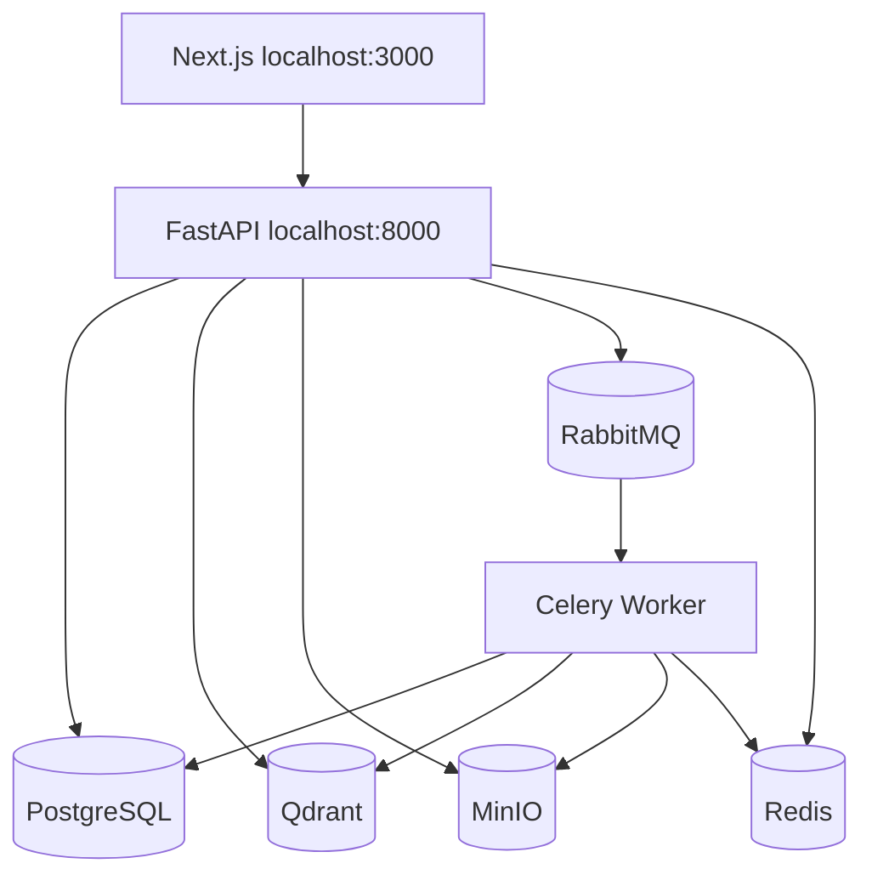
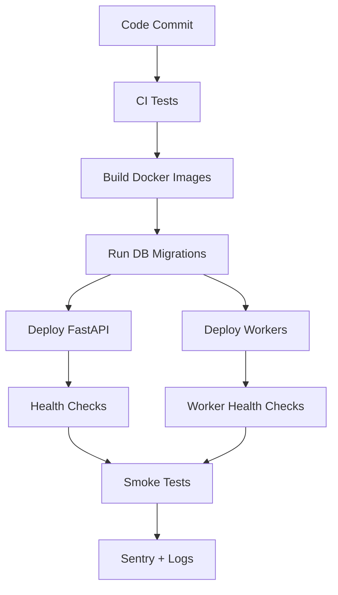

# 10 — Deployment and Docker

## Local development architecture



## Recommended services

```text
frontend       Next.js dev server or containerized Next.js service
api            FastAPI container
worker         Celery worker container
beat           Celery beat scheduler (exactly one instance; also schedules the stale-document reaper)
postgres       PostgreSQL
qdrant         Qdrant vector database
minio          MinIO object storage
rabbitmq       RabbitMQ broker
redis          Redis cache
```

## Example Docker Compose

```yaml
version: "3.9"

services:
  api:
    build:
      context: ./backend
    command: uvicorn app.main:app --host 0.0.0.0 --port 8000 --reload
    ports:
      - "8000:8000"
    env_file:
      - .env
    depends_on:
      - postgres
      - qdrant
      - minio
      - rabbitmq
      - redis
    volumes:
      - ./backend:/app

  worker:
    build:
      context: ./backend
    command: celery -A app.workers.celery_app:celery_app worker --loglevel=INFO
    env_file:
      - .env
    depends_on:
      - postgres
      - qdrant
      - minio
      - rabbitmq
      - redis
    volumes:
      - ./backend:/app

  postgres:
    image: postgres:16
    environment:
      POSTGRES_DB: rag_app
      POSTGRES_USER: postgres
      POSTGRES_PASSWORD: postgres
    ports:
      - "5432:5432"
    volumes:
      - postgres_data:/var/lib/postgresql/data

  qdrant:
    image: qdrant/qdrant:latest
    ports:
      - "6333:6333"
      - "6334:6334"
    volumes:
      - qdrant_data:/qdrant/storage

  minio:
    image: cgr.dev/chainguard/minio:latest
    command: server /data --console-address ":9001"
    environment:
      MINIO_ROOT_USER: minioadmin
      MINIO_ROOT_PASSWORD: minioadmin
    ports:
      - "9000:9000"
      - "9001:9001"
    volumes:
      - minio_data:/data

  rabbitmq:
    image: rabbitmq:3-management
    ports:
      - "5672:5672"
      - "15672:15672"

  redis:
    image: redis:7
    ports:
      - "6379:6379"

volumes:
  postgres_data:
  qdrant_data:
  minio_data:
```

## Current compose baseline in this repository

The active `docker-compose.yml` in repository root includes:

- Services: `api`, `worker`, `beat`, `postgres`, `qdrant`, `minio`, `minio-init`, `rabbitmq`, `redis`
  (plus `worker-ingest`, `worker-graph`, `worker-sync`, `worker-eval`, `worker-default` under the
  `pools` profile; staging and production run those five instead of `worker`)
- Healthchecks:
  - `api` via `GET /api/v1/health`
  - `postgres` via `pg_isready`
  - `qdrant` via TCP probe on `6333`
  - `minio` via `/minio/health/live`
  - `rabbitmq` via `rabbitmq-diagnostics ping`
  - `redis` via `redis-cli ping`
- Persistent volumes:
  - `postgres_data`
  - `qdrant_data`
  - `minio_data`

The staging and production files in `deploy/compose/` add on top of this:

- A `clamav` service (no host ports, `clamav_data` volume, `start_period: 300s`
  for the first signature download). `MALWARE_SCAN_CLAMAV_HOST: clamav` is set
  on `api`, `worker`, `beat`, and `mcp`; `api` and `worker` wait only for
  `service_started`, so a slow first download does not block the API.
- Redis with `--appendonly yes`, a `redis_data` volume, and `--requirepass`
  when `REDIS_PASSWORD` is set. `REDIS_URL` is
  `redis://:${REDIS_PASSWORD:-}@redis:6379/0`, so env files without the
  password keep working. The healthcheck requires `PONG`, so it fails on `NOAUTH`.
- RabbitMQ with `hostname: rabbitmq` (fixed node name) and a `rabbitmq_data`
  volume, so queued messages survive a recreate.
- Image variables with the previous tags as defaults: `QDRANT_IMAGE`,
  `MINIO_IMAGE`, `RABBITMQ_IMAGE`, `REDIS_IMAGE`, `CLAMAV_IMAGE`. Pin the first
  three to the digests running today (`docker compose images` or
  `docker inspect --format '{{index .RepoDigests 0}}' <container>`);
  `deploy/scripts/check_deploy_env.sh` fails a production deploy when they are
  unset or `:latest` and when `REDIS_PASSWORD` is missing or not URL-safe.
- Terraform starts `infra_services` (default
  `postgres rabbitmq redis minio qdrant`; staging adds `neo4j`) with `--wait`
  before migrations. The integration smoke checks that each default service runs.

Adding the Redis password and volumes recreates `redis` and `rabbitmq`: deploy
it in a maintenance window. In-flight Celery results and rate-limit counters are
lost, and queued RabbitMQ messages are lost once. See `DEPLOYMENT.md` for the
backup freshness gate (`DEPLOY_BACKUP_MAX_AGE_HOURS`, default 26) and the
rollout steps.

Use repo root Make targets for lifecycle:

```bash
make up
make up-d
make down
make logs
make ps
```

## Backend Dockerfile

Production images use a multi-stage build (`backend/Dockerfile`). Base images are pinned by
digest (`python:3.12-slim@sha256:...`, tag kept for readability); refresh the digest with
`docker buildx imagetools inspect python:3.12-slim` and rebuild.

| Stage | Contents |
|---|---|
| `builder` | `build-essential` and uv; `uv sync --frozen --no-dev` into `/opt/venv` |
| `base-runtime` | `apt-get upgrade`, user `rudix` (uid/gid 10001, no login shell), `/opt/venv`, `alembic.ini`, `alembic/`, `scripts/`. No OCR packages, no compiler. |
| `api` | `USER 10001`, `EXPOSE 8000`, `HEALTHCHECK` on `GET /api/v1/health`, `CMD uvicorn`. Also used for `alembic upgrade head` and the `mcp` service. |
| `worker` (last) | Adds `tesseract-ocr` (eng, ara, fas) and `poppler-utils`, then `USER 10001`; `HEALTHCHECK` runs `celery inspect ping -d celery@$HOSTNAME`; `CMD celery ... worker`. |

Build a stage with `docker build --target api backend` or `--target worker`. An untargeted build
produces the full `worker` image. The root `docker-compose.yml` builds `api` and `mcp` from the
`api` target and `worker` and `beat` from the `worker` target. `beat` runs from the worker image
but has no worker node to ping, so compose sets `healthcheck: disable: true` for it.

The virtualenv lives in `/opt/venv`, outside `/app`, so the development bind mount
`./backend:/app` does not hide it. Application files are root-owned and read-only for uid
10001. The app writes nothing under `/app` at runtime: MinIO objects are read into memory,
multipart uploads spool to the system temp directory (`/tmp`), the beat schedule is written to
`/tmp/celerybeat-schedule`, and libraries that cache files (for example tiktoken) use the
system temp directory.

Compose healthchecks for `api` and `mcp` probe health endpoints with `python` +
`urllib.request`, not `curl`.

### Resource limits, shutdown, and log rotation

`deploy/compose/docker-compose.staging.yml` and `docker-compose.production.yml` set, for the
application services:

| Service | `stop_grace_period` | CPU limit | Memory limit | Healthcheck |
|---|---|---|---|---|
| `frontend` | 30s | 1.0 | 1g | `wget /login` |
| `api` | 30s | 2.0 | 2g | `GET /api/v1/health` |
| `worker-ingest`, `worker-graph`, `worker-sync`, `worker-eval`, `worker-default` (0.6.0; one shared `x-worker` anchor) | 120s (finish acknowledged Celery tasks) | 2.0 each | 4g each | `celery inspect ping -d <pool>@$HOSTNAME` |
| `beat` | 10s | 0.5 | 512m | disabled |
| `mcp` | 30s | 1.0 | 1g | `GET /health` |

The limits are conservative starting points, not measured values. Tune them after the R03-09
load baseline (`docs/roadmap/V0_3_0_LOAD_BASELINE.md`). Every service, including the data
services, uses the shared `x-logging` anchor: `json-file` driver, `max-size: 10m`,
`max-file: 5`.

### Upgrading an existing host to non-root images

The images now run as uid 10001 (backend) and `node` (frontend). The application services
mount no named volumes in staging or production, so no ownership change is needed for them.
If you added a local volume or bind mount to `api`, `worker`, or `beat` (for example a shared
`/tmp` or a data directory), give it to uid 10001 once before the first deploy:

```bash
docker run --rm -v <volume>:/data alpine chown -R 10001:10001 /data
```

Data-service volumes (`postgres_data`, `minio_data`, and so on) are unchanged.

## Worker pools and RabbitMQ (0.6.0)

### Pools (R06-04)

Staging and production run one service per pool instead of the single `worker`. Each runs
`python -m app.workers.pools <name>`, which builds the Celery command from settings and
replaces itself with `celery -A app.workers.celery_app:celery_app worker -Q <queues>
--concurrency <n> --pool <pool> -n <name>@%h [--max-tasks-per-child <n>]`. Compose never
names queues, so renaming a queue (for the quorum cut-over) is an environment change only.
Both deploy paths run `docker compose up -d --remove-orphans`, so the first 0.6.0 deploy
stops the 0.5.0 `worker` container; a host updated by hand needs the same flag, or that
container keeps consuming every queue with the previous image.

| Service | Queues (default) | Load | Default concurrency |
|---|---|---|---|
| `worker-ingest` | `documents.processing` (also embed, index, finalize), `documents.deletion`, `documents.reindex` | **CPU-bound**: PDF parsing, OCR (Tesseract), chunking; memory peaks on large files | 2 |
| `worker-graph` | `documents.graph` | **I/O-bound**: LLM entity and relation extraction, Neo4j writes | 2 |
| `worker-sync` | `connectors.sync` | **I/O-bound**: provider API pages, rate-limit waits | 2 |
| `worker-eval` | `evaluations` (also `safety_evals.run`) | Mixed (LLM calls plus re-ingest); isolated so a full evaluation queue never takes the slots that uploads need | 1 |
| `worker-default` | `default`, `email`, `agents` (C2, default `default`) | Light, I/O-bound; also runs the dead-letter consumer and the queue depth sampler | 2 |

Settings per pool (`<NAME>` = `INGEST`, `GRAPH`, `SYNC`, `EVAL`, `DEFAULT`):
`WORKER_POOL_<NAME>_QUEUES` (comma separated; unset derives them from `CELERY_QUEUE_*`),
`WORKER_POOL_<NAME>_CONCURRENCY`, `WORKER_POOL_<NAME>_POOL` (`prefork`, the default, or
`threads`), and `WORKER_POOL_<NAME>_MAX_TASKS_PER_CHILD` (unset uses
`CELERY_WORKER_MAX_TASKS_PER_CHILD`). Only the default pool sets
`WORKER_CONSUME_DEAD_LETTER=true` and `WORKER_SAMPLE_QUEUE_DEPTH=true` (an explicit value
in the environment wins).

Sizing:

- CPU-bound (`worker-ingest`): concurrency at most the CPU limit of the container (2 by
  default). OCR and large PDFs dominate memory, so also keep concurrency x peak child memory
  under the memory limit; set `CELERY_WORKER_MAX_MEMORY_PER_CHILD_KB` below
  `memory limit / concurrency` so a bloated child is replaced after its task.
- I/O-bound (`worker-graph`, `worker-sync`, `worker-default`): processes mostly wait on the
  network, so concurrency can exceed the CPU count; the limit is memory per child and the
  provider's rate limits (connector sync has its own provider back-off). Raise it in small
  steps while watching `rudix_celery_queue_wait_seconds` and provider 429s.
- `threads` is accepted only with concurrency 1: worker tasks drive one asyncio event loop per
  process (`app/workers/async_runtime.py`) and Celery enforces time limits only in the
  prefork pool. Scale I/O-bound pools with more prefork processes or replicas
  (`docker compose up -d --scale worker-graph=2`; node names include the container hostname).
- The five pools share the 2.0 CPU / 4g limits of the old single worker each; these are
  limits, not reservations. Lower them for small hosts.

Dev: `docker-compose.yml` keeps `worker` (all queues, `make run-worker` locally) and adds the
five pools under the `pools` profile (`docker compose --profile pools up`, then stop
`worker`). Locally: `cd backend && make run-worker-pool POOL=ingest`. The integration compose
keeps one worker. Keep exactly one `beat` everywhere.

### Time limits and recycling (R06-03)

Every task gets a soft and a hard time limit (`CELERY_TASK_TIME_LIMITS`, defaults in
`app/core/settings/worker_platform.py`; other tasks 300 s / 360 s). Children are replaced
after `CELERY_WORKER_MAX_TASKS_PER_CHILD` tasks (default 200; 0 turns it off) and after a
task that leaves them above `CELERY_WORKER_MAX_MEMORY_PER_CHILD_KB` (default 0, off). Details
and failure codes: [27_INGESTION_AND_WORKERS_RUNBOOK.md](./27_INGESTION_AND_WORKERS_RUNBOOK.md#time-limits).

### RabbitMQ configuration

`infra/rabbitmq/rabbitmq.conf` is mounted read-only at
`/etc/rabbitmq/conf.d/20-rudix.conf` and `infra/rabbitmq/enabled_plugins` at
`/etc/rabbitmq/enabled_plugins` in every compose file:

- `consumer_timeout = 1800000` (30 minutes, RabbitMQ's default, now explicit). With
  `acks_late` a task is acknowledged after it returns, so every hard time limit must stay below
  it. `CELERY_BROKER_CONSUMER_TIMEOUT_SECONDS` (default 1800) must equal it; a worker in
  staging or production refuses to start when a hard limit is not below it.
- `prometheus.return_per_object_metrics = true`, so `rabbitmq_queue_messages_ready{queue}`
  on `:15692` is per queue (the 0.5.0 backlog alert needed this).
- Plugins `rabbitmq_management` and `rabbitmq_prometheus`.

The staging and production compose files mount them from `./rabbitmq/` next to the compose
file; `deploy/scripts/deploy_compose_remote.sh` and the Terraform rollout
(`deploy/terraform/main.tf`, used by the release workflow) copy `infra/rabbitmq/` there on
every deploy, and the script stops if the files are missing (Docker would otherwise create
empty directories at the mount paths and RabbitMQ would not start). A host deployed by hand needs the same two files
in `<app path>/rabbitmq/`. Applying the files recreates the `rabbitmq` container once.

### Quorum queues and dead-lettering (R06-05)

`CELERY_QUEUE_TYPE=classic` (default) declares the queues exactly as in 0.5.0.
`CELERY_QUEUE_TYPE=quorum` declares every task queue as a quorum queue with
`x-delivery-limit` (`CELERY_DELIVERY_LIMIT`, default 5) and dead-lettering to
`CELERY_DEAD_LETTER_EXCHANGE` / `CELERY_DEAD_LETTER_QUEUE` (`rudix.dlx` /
`rudix.dead_letter`), published through the topic exchange `CELERY_QUORUM_EXCHANGE`
(`rudix.tasks`) because Celery's native delayed delivery for countdown and ETA retries does
not support direct exchanges. An existing classic queue cannot be redeclared as quorum, so the
switch uses new queue names and drains the old queues: follow the cut-over in
[27_INGESTION_AND_WORKERS_RUNBOOK.md](./27_INGESTION_AND_WORKERS_RUNBOOK.md#dead-letter-queue-and-quorum-cut-over).

### Checking the compose files

`deploy/scripts/check_compose_config.sh` copies every compose file to a temporary directory
with placeholder env files and `RUDIX_*_IMAGE` values and runs `docker compose config -q` on
`docker-compose.yml` (with and without the `pools` profile), staging, production, integration,
and integration plus the stub overlay. It also checks that staging and production define the
five pools, no `worker`, and exactly one `beat`. It exits non-zero on any failure and never
reads a real env file.

## Backend requirements

Direct dependency ranges live in `backend/pyproject.toml`. The exact, hash-verified set that is
installed everywhere (local `make install`, CI, and the Docker image) is `backend/uv.lock`. The
image builder copies uv from a tag- and digest-pinned image, runs `uv sync --frozen --no-dev`
into `/opt/venv`, and the runtime stage copies that virtualenv. Change dependencies with
`make lock` (see `backend/README.md`). The list below is illustrative only.

```text
fastapi
uvicorn[standard]
pydantic
pydantic-settings
sqlalchemy
asyncpg
alembic
celery
redis
pika
boto3
qdrant-client
pymupdf
python-docx
openai
sentry-sdk
python-multipart
tenacity
tiktoken
```

## Frontend deployment

Recommended:

```text
Self-hosted Next.js container behind Nginx or Traefik
```

Frontend env vars:

```env
NEXT_PUBLIC_DEPLOYMENT_ENV=production
NEXT_PUBLIC_APP_URL=https://getrudix.com
NEXT_PUBLIC_API_URL=https://api.getrudix.com/api/v1
NEXT_PUBLIC_AUTH_PROVIDER=clerk
NEXT_PUBLIC_CLERK_PUBLISHABLE_KEY=
```

For staging, use the staging domains at frontend build time:

```env
NEXT_PUBLIC_DEPLOYMENT_ENV=staging
NEXT_PUBLIC_APP_URL=https://staging.getrudix.com
NEXT_PUBLIC_API_URL=https://api-staging.getrudix.com/api/v1
```

`NEXT_PUBLIC_*` values are compiled into the Next.js browser bundle during
`npm run build`. Changing container runtime environment variables after the
frontend image has been built does not change the API host used by the browser.
Always rebuild and redeploy the frontend image after changing
`NEXT_PUBLIC_API_URL`, `NEXT_PUBLIC_APP_URL`, auth URLs, or other public
frontend settings. The app includes a safety fallback for `staging.getrudix.com`
and `getrudix.com` that replaces stale loopback API URLs with the matching
public HTTPS API endpoint, but the deployment should still set correct
build-time values.

### Frontend image

`next.config.ts` sets `output: "standalone"`. `frontend/Dockerfile` pins `node:24-alpine` by
digest and builds in three stages (`deps`, `build`, `runtime`). The runtime stage copies only
`.next/standalone`, `.next/static`, and `public`; it does not run `npm ci`. It runs as the
`node` user with `HOSTNAME=0.0.0.0`, `PORT=3000`, and `CMD ["node", "server.js"]`, and its
`HEALTHCHECK` fetches `/login` with busybox `wget`. Only `.next/cache` is writable by the
runtime user. The runtime stage removes the base image's bundled `npm`, `npx`, and `corepack`,
which the standalone server does not use; do not `docker exec` npm commands in it.

In standalone mode `next.config.ts` is evaluated once at `next build`: `headers()` (the
security headers from `config/security-headers.mjs`) and `rewrites()` are baked into the
output. Security headers, HSTS, and the CSP therefore come from the **build** environment
(`.env.production` written by CI), like the `NEXT_PUBLIC_*` values. Changing
`NEXT_PUBLIC_CSP_*` or `NEXT_PUBLIC_DEPLOYMENT_ENV` on a running container has no effect;
rebuild the image.

## Backend deployment options

### Option A: Single VM with Docker Compose

Best for first production launch.

- Deploy API, workers, PostgreSQL, Qdrant, MinIO, RabbitMQ, Redis on one VM.
- Use Traefik or Nginx as reverse proxy.
- Use Let's Encrypt TLS.
- Back up PostgreSQL and MinIO.

### Option B: Managed services

Better for serious production.

```text
API:        AWS ECS / Fly.io / Render / Railway
Workers:    ECS worker service / Fly worker
Postgres:   Managed Postgres
Qdrant:     Qdrant Cloud
MinIO:      Managed S3-compatible object storage or AWS S3
RabbitMQ:   CloudAMQP
Redis:      Upstash / Redis Cloud
Frontend:   Container platform (ECS / Fly.io / Render / Railway / Kubernetes)
```

## Production environment variables

```env
ENVIRONMENT=production
API_BASE_URL=https://api.getrudix.com
FRONTEND_BASE_URL=https://getrudix.com
CORS_ORIGINS=https://getrudix.com
APP_AUTH_AUTO_PROVISION_USERS=false
DATABASE_URL=
QDRANT_URL=
QDRANT_API_KEY=
MINIO_ENDPOINT=
MINIO_ACCESS_KEY=
MINIO_SECRET_KEY=
MINIO_BUCKET=documents
RABBITMQ_URL=
REDIS_URL=
OPENAI_API_KEY=
OPENAI_EMBEDDING_MODEL=text-embedding-3-small
OPENAI_LLM_MODEL=gpt-5.4-mini
LLM_RETRY_MAX_ATTEMPTS=2
LLM_RETRY_BASE_SECONDS=0.4
LLM_RETRY_MAX_SECONDS=3
OPENAI_LLM_INPUT_COST_PER_MILLION_TOKENS_USD=0.0
OPENAI_LLM_OUTPUT_COST_PER_MILLION_TOKENS_USD=0.0
SENTRY_DSN=
```

For staging and production, the public URL variables must be HTTPS and must not
point to `localhost` or other loopback addresses. The backend uses `API_BASE_URL`
and `FRONTEND_BASE_URL` for redirects, callbacks, email links, and generated
resource URLs. The frontend uses `NEXT_PUBLIC_API_URL` and `NEXT_PUBLIC_APP_URL`
at build time, so rebuild the frontend image after changing them.

For Rudix-hosted deployments, keep the URL pairs aligned:

| Environment | Frontend URL                   | API URL                                   |
| ----------- | ------------------------------ | ----------------------------------------- |
| Staging     | `https://staging.getrudix.com` | `https://api-staging.getrudix.com/api/v1` |
| Production  | `https://getrudix.com`         | `https://api.getrudix.com/api/v1`         |

### Database roles, pool, and PgBouncer (0.4.0)

Row-level security only constrains a role that does not own the tables and has no
`BYPASSRLS` (`R04-08`). Provision the roles once per database, as the migration owner:

```bash
psql "<owner connection string>" -v ON_ERROR_STOP=1 -f deploy/sql/provision_roles.sql
psql "<owner connection string>" -c "ALTER ROLE rudix_app PASSWORD '<from secret store>'"
psql "<owner connection string>" -c "ALTER ROLE rudix_maintenance PASSWORD '<from secret store>'"
```

The script is idempotent and is not run by the deploy scripts. Then set:

```env
DATABASE_URL=postgresql+asyncpg://rudix_app:...@db:5432/rudix               # API and workers
DATABASE_MIGRATION_URL=postgresql+asyncpg://<owner>:...@db:5432/rudix       # Alembic only
DATABASE_MAINTENANCE_URL=postgresql+asyncpg://rudix_maintenance:...@db:5432/rudix
RLS_ENFORCEMENT=soft            # unset = soft in staging/production; strict is planned for 0.5.0
DB_POOL_SIZE=5
DB_MAX_OVERFLOW=10
DB_POOL_TIMEOUT=30              # seconds a request waits for a pooled connection
DB_STATEMENT_TIMEOUT_MS=30000   # API; 0 = off (default)
DB_IDLE_IN_TRANSACTION_TIMEOUT_MS=60000
```

Each API and worker process opens up to `DB_POOL_SIZE + DB_MAX_OVERFLOW` connections; keep
the sum over all processes below the server's `max_connections`. Alembic uses
`DATABASE_MIGRATION_URL` when set, otherwise `DATABASE_URL`.

PgBouncer in transaction pooling mode: set `DB_PGBOUNCER_MODE=true`. The engine then
disables asyncpg's prepared-statement caches and uses unique prepared-statement names, and
the timeouts are sent with `set_config(..., true)` at the start of every transaction
(PgBouncer ignores startup parameters). Session pooling needs no change.

## Release checklist

Before deployment:

- Run unit tests.
- Run API integration tests.
- Run database migrations (`alembic upgrade head`). When `ENTERPRISE_GRAPH_ENABLED=true`, the migrate step also runs the Neo4j graph migrations (`python scripts/run_graph_migrations.py`, or `make migrate-graph` from `backend/`); `deploy/scripts/deploy_compose_remote.sh` and the Terraform rollout (`deploy/terraform/main.tf`) do this automatically. The API only runs graph migrations at startup in development/test unless `GRAPH_MIGRATIONS_ON_STARTUP=true`.
- Redis, RabbitMQ, and Qdrant outages no longer abort API boot: the API logs `startup.dependency_unavailable` and `/ready` reports the dependency as down (each `/ready` call retries the Redis and Qdrant connection, so the API recovers without a restart), so verify `/ready` after deploy.
- Verify Qdrant collection exists.
- Verify MinIO bucket exists.
- Verify RabbitMQ and worker connectivity.
- Verify Redis connectivity.
- Verify staging/production public URLs use the HTTPS frontend and API domains.
- Verify auth token validation.
- Verify file upload size limits.
- Verify Sentry events.
- Verify structured logs.
- Run sample RAG evaluation set.

## Backup strategy

Back up:

- PostgreSQL database.
- MinIO object storage.
- Qdrant snapshots.
- Environment secret store.

Minimum schedule:

```text
PostgreSQL: daily backup
MinIO: daily bucket replication or backup
Qdrant: daily snapshot
```

## Scaling strategy

Scale these independently:

| Component      | Scaling method                  |
| -------------- | ------------------------------- |
| FastAPI        | More API containers             |
| Celery workers | Per pool: `WORKER_POOL_<NAME>_CONCURRENCY` or more `worker-<pool>` replicas |
| PostgreSQL     | Managed DB, read replicas later |
| Qdrant         | Dedicated node/cluster          |
| MinIO          | Distributed MinIO or managed S3 |
| RabbitMQ       | Managed RabbitMQ                |
| Redis          | Managed Redis                   |

## Production readiness diagram


