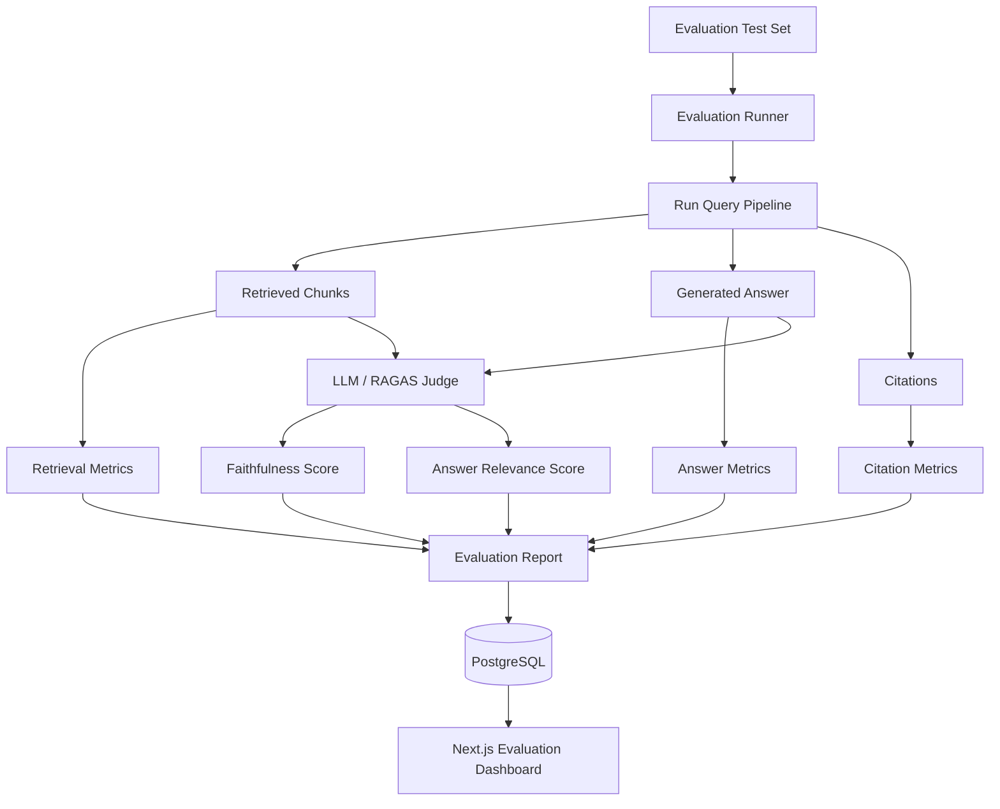
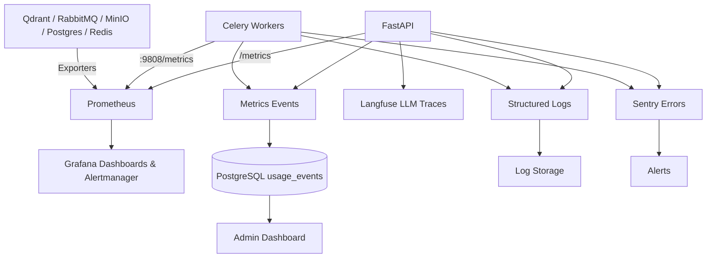

# 12 — Evaluation and Monitoring

## Why evaluation matters

A RAG system can fail in several ways:

1. Retrieval returns wrong chunks.
2. Retrieval returns incomplete context.
3. The LLM ignores context.
4. The answer is unsupported.
5. The citations are wrong.
6. The system answers when it should say "not found".
7. Latency or cost is too high.

Evaluation should test each part separately.

## Evaluation architecture



## Evaluation dataset format

```json
[
  {
    "question": "How many paid leave days are available?",
    "expected_answer": "20 paid leave days",
    "expected_document_id": "uuid",
    "expected_filename": "employee_policy.pdf",
    "expected_page_number": 4,
    "tags": ["hr", "leave"]
  }
]
```

## Metrics

### Retrieval hit rate

Checks whether expected document/page appears in top-k.

```text
hit = expected_source in retrieved_sources
```

### Context precision

Measures whether retrieved chunks are relevant.

### Context recall

Measures whether enough relevant context was retrieved.

### Faithfulness

Checks whether the generated answer is supported by retrieved context.

### Answer relevance

Checks whether the answer addresses the user question.

### Citation accuracy

Checks whether cited chunks support the answer.

### Refusal accuracy

Checks whether the system says "not found" when the answer is absent.

### Latency

Track:

```text
embedding latency
Qdrant retrieval latency
reranking latency
LLM latency
total latency
```

### Cost

Track:

```text
embedding tokens
LLM input tokens
LLM output tokens
estimated cost
```

## Custom evaluation example

```python
def retrieval_hit_rate(results, expected_document_id, expected_page_number):
    for item in results:
        if (
            item["document_id"] == expected_document_id
            and item["page_number"] == expected_page_number
        ):
            return 1.0
    return 0.0
```

## RAGAS evaluation

Use RAGAS for:

- Faithfulness.
- Answer relevancy.
- Context precision.
- Context recall.

Keep custom metrics too because production systems need business-specific checks.

## Evaluation dashboard

Show:

```text
Overall Score
Retrieval Hit Rate
Faithfulness
Citation Accuracy
Average Confidence
Average Latency
Average Cost
Failed Questions
Low-Confidence Questions
Regression Compared to Last Run
Prompt Version Impact
```

Prompt-version impact:

- Evaluation runs store the prompt template version resolved at queue time.
- Prompt template detail views list recent evaluation runs for each version.
- Regression review should compare current published prompt versions against previous published versions on a fixed evaluation set before rollout.

## Monitoring architecture



Observability layers in Rudix:

- **Structured logs (`structlog`)**: JSON/console request, worker, and domain event logs with automatic secret redaction.
- **Sentry**: Exception and performance trace capture across API, Celery workers, and frontend (`NEXT_PUBLIC_SENTRY_DSN`).
- **Langfuse**: Optional self-hosted LLM/RAG trace inspection with input/output redaction and sampling ([18_LANGFUSE_OBSERVABILITY.md](./18_LANGFUSE_OBSERVABILITY.md)).
- **PostgreSQL `usage_events` & `audit_logs`**: Tenant-isolated operational analytics exposed via `GET /api/v1/admin/observability` and `GET /api/v1/admin/provider-observability`.
- **Prometheus & Grafana**: Real-time time-series RED metrics, RAG stage latency histograms, Celery worker metrics, exporters, and 5 pre-provisioned Grafana dashboards ([25_PROMETHEUS_GRAFANA_OBSERVABILITY_PLAN.md](./25_PROMETHEUS_GRAFANA_OBSERVABILITY_PLAN.md) and [`infra/observability/README.md`](../infra/observability/README.md)). Zero-config defaults allow local startup via `make up-observability` without requiring manual variable configuration.

## Structured logging events

## Base structured log schema

All API and worker logs should follow the same base schema:

```json
{
  "event": "api.request | task.start | task.success | task.retry | task.failure | domain_event_name",
  "timestamp": "ISO-8601 UTC",
  "level": "debug|info|warning|error|critical",
  "logger": "api.access | api.exception | worker.tasks | events.*",
  "request_id": "optional request correlation id",
  "user_id": "optional user id",
  "organization_id": "optional organization id",
  "document_id": "optional document id",
  "job_id": "optional job/evaluation/task id",
  "endpoint": "optional HTTP path",
  "status_code": "optional HTTP or task status",
  "latency_ms": "optional request/task duration",
  "error": "optional short error name/message",
  "exception": "optional stack trace for exceptions"
}
```

Notes:

- `request_id` should be echoed as `X-Request-ID` in API responses.
- `latency_ms` is always emitted for API access logs.
- Secret values must be redacted (API keys, tokens, passwords, secrets).

### document_uploaded

```json
{
  "event": "document_uploaded",
  "document_id": "uuid",
  "organization_id": "uuid",
  "filename": "policy.pdf",
  "file_type": "pdf",
  "size_bytes": 1234567
}
```

### document_indexed

```json
{
  "event": "document_indexed",
  "document_id": "uuid",
  "organization_id": "uuid",
  "page_count": 24,
  "chunk_count": 92,
  "duration_ms": 18400
}
```

### document_processing_reaped

Emitted by the `documents.reap_stale` beat task as `document.processing.reaped` (re-queued),
`document.processing.reap_exhausted` (marked `failed` with `PROCESSING_STALLED`), or
`document.processing.reap_enqueue_failed` (broker error; retried after the next stale window).
No document text is logged.

```json
{
  "event": "document.processing.reaped",
  "document_id": "uuid",
  "organization_id": "uuid",
  "outcome": "requeued",
  "reap_count": 1
}
```

### query_answered

```json
{
  "event": "query_answered",
  "organization_id": "uuid",
  "chat_session_id": "uuid",
  "message_id": "uuid",
  "top_similarity": 0.91,
  "confidence_score": 0.87,
  "latency_ms": 1450,
  "model_name": "gpt-5.4-mini"
}
```

### evaluation_completed

```json
{
  "event": "evaluation_completed",
  "evaluation_run_id": "uuid",
  "retrieval_hit_rate": 0.86,
  "faithfulness": 0.82,
  "citation_accuracy": 0.79,
  "average_latency_ms": 1520
}
```

## Sentry alerts

Create alerts for:

- API error rate above threshold.
- Celery task failure spike.
- LLM API failures.
- Qdrant connection errors.
- MinIO upload failures.
- Database connection pool exhaustion.
- High latency.
- High cost.

## Frontend observability notes

- Frontend monitoring is opt-in via `NEXT_PUBLIC_SENTRY_DSN`.
- When enabled, the UI emits sanitized breadcrumbs for:
  - document upload/delete/re-index actions
  - chat question submissions
  - evaluation run requests
  - pipeline graph loads
  - admin data views
- Route-level rendering errors are captured with safe context, including request/trace IDs when available from backend error responses.
- Redaction rules remove secrets and high-risk content fields (tokens, passwords, prompt/question/answer/content text) before transport.
- If DSN is not configured, monitoring calls are no-op and do not affect user flows.

## Production SLOs

Suggested targets:

| Metric                    | Target            |
| ------------------------- | ----------------- |
| API availability          | 99.5%+            |
| Chat p95 latency          | < 5 seconds       |
| Document indexing success | > 98%             |
| Retrieval hit rate        | > 85% on eval set |
| Citation accuracy         | > 80%             |
| Failed task rate          | < 2%              |
| Not-found correctness     | > 90%             |

## Evaluation index cleanup

Chunking comparison runs re-ingest the corpus under `eval-<run hex10>-<n>` index
versions in the shared Qdrant collection and `document_chunks` table. Production
retrieval never serves these versions (see `docs/03_RAG_WORKFLOW.md`, Index version
filter), but they must still be removed:

- The evaluation worker cleans up each target's eval version in a `finally` block,
  so cleanup also runs when re-ingest or scoring fails partway. It deletes the
  target's Qdrant points and chunk rows for each corpus document. Live-index targets
  (`DOCUMENT_INDEX_VERSION`) are never cleaned up.
- Cleanup never fails the run. `metrics_summary["eval_index_cleanup"]` holds one entry
  per eval target: `index_version`, `documents_attempted`, `chunks_deleted`,
  `qdrant_failures` and `chunk_failures`, or `index_version` and `error` (exception
  class name) when the cleanup call itself failed.
- Logs: `evaluation.index_cleanup.completed` (counts only), and
  `evaluation.index_cleanup.qdrant_failed` / `evaluation.index_cleanup.chunks_failed`
  per document. Metric: `rudix_eval_index_cleanup_failures_total{store}` with
  `store` set to `qdrant` or `postgres`.

### Purging legacy eval versions

Runs from before 0.2.0, and runs whose cleanup failed, leave eval versions behind.
`backend/scripts/purge_eval_index_versions.py` reports and purges them:

```bash
cd backend
.venv/bin/python scripts/purge_eval_index_versions.py              # dry run (default)
.venv/bin/python scripts/purge_eval_index_versions.py --apply      # delete eval versions
.venv/bin/python scripts/purge_eval_index_versions.py --organization-id <uuid> --batch-size 256
```

- It prints counts per organization and index version for chunk rows and Qdrant
  points, never text.
- It skips eval versions that belong to a queued or running evaluation run.
- It never deletes non-eval versions. Non-eval versions outside the active set are
  reported as `inactive: hidden from retrieval`, and the script exits with code `2`
  when any exist. Otherwise it exits with `0`.

### Required pre-deploy check for 0.2.0

Run this on staging and on production before deploying 0.2.0. It cannot be run from
a development checkout:

1. `SELECT index_version, count(*) FROM document_chunks GROUP BY 1 ORDER BY 1;`
2. Run the purge script as a dry run.
3. If a non-eval version other than `DOCUMENT_INDEX_VERSION` is reported, add it to
   `DOCUMENT_ACTIVE_INDEX_VERSIONS` or reindex those documents before deploying.
   Otherwise their documents stop returning chunks.
4. Record the counts in the merge request.

## Continuous evaluation

Run evaluations:

```text
On every major prompt change
On every retrieval setting change
On every chunking profile or chunking strategy change
On every embedding model change
Nightly on a fixed test set
Before production deployment
```

## Regression policy

Do not deploy if:

- Retrieval hit rate drops more than 5%.
- Citation accuracy drops more than 5%.
- Faithfulness drops below threshold.
- A chunking comparison target fails a configured regression threshold for retrieval, citation accuracy, faithfulness, or not-found rate.
- A newly published prompt version underperforms the prior published version on the fixed eval set.
- Average latency doubles.
- Cost per answer increases unexpectedly.

## Feedback loop

Allow users to rate answers:

```text
👍 helpful
👎 not helpful
Wrong answer
Bad citation
Missing citation
Missing source
Outdated source
Hallucination risk
Conflict not detected
Should have said not found
Unclear answer
```

Store feedback in PostgreSQL, surface it in a reviewer queue, and use it to improve:

The F351 Answer Quality report combines trust telemetry with permission-checked answer records.
Reviewers can inspect confidence/citation trends and problematic answers, then open the existing
review task or convert linked bad-answer feedback into an evaluation case.

- Test questions.
- Prompts.
- Chunking.
- Retrieval filters.
- Reranking.

Reviewers can triage, assign, resolve, and convert accepted feedback into evaluation cases while redacted diagnostics keep sensitive context out of the broad review flow.
