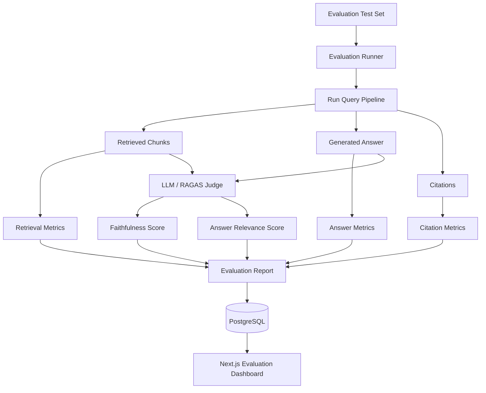
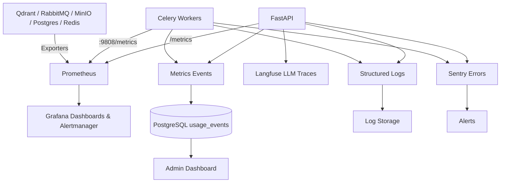

# 12 — Evaluation and Monitoring

## Why evaluation matters

A RAG system can fail in several ways:

1. Retrieval returns wrong chunks.
2. Retrieval returns incomplete context.
3. The LLM ignores context.
4. The answer is unsupported.
5. The citations are wrong.
6. The system answers when it should say "not found".
7. Latency or cost is too high.

Evaluation should test each part separately.

## Evaluation architecture



## Evaluation dataset format

```json
[
  {
    "question": "How many paid leave days are available?",
    "expected_answer": "20 paid leave days",
    "expected_document_id": "uuid",
    "expected_filename": "employee_policy.pdf",
    "expected_page_number": 4,
    "tags": ["hr", "leave"]
  }
]
```

## Metrics

### Retrieval hit rate

Checks whether expected document/page appears in top-k.

```text
hit = expected_source in retrieved_sources
```

### Context precision

Measures whether retrieved chunks are relevant.

### Context recall

Measures whether enough relevant context was retrieved.

### Faithfulness

Checks whether the generated answer is supported by retrieved context.

### Answer relevance

Checks whether the answer addresses the user question.

### Citation accuracy

Checks whether cited chunks support the answer.

### Refusal accuracy

Checks whether the system says "not found" when the answer is absent.

### Latency

Track:

```text
embedding latency
Qdrant retrieval latency
reranking latency
LLM latency
total latency
```

### Cost

Track:

```text
embedding tokens
LLM input tokens
LLM output tokens
estimated cost
```

## Custom evaluation example

```python
def retrieval_hit_rate(results, expected_document_id, expected_page_number):
    for item in results:
        if (
            item["document_id"] == expected_document_id
            and item["page_number"] == expected_page_number
        ):
            return 1.0
    return 0.0
```

## RAGAS evaluation

Use RAGAS for:

- Faithfulness.
- Answer relevancy.
- Context precision.
- Context recall.

Keep custom metrics too because production systems need business-specific checks.

## Evaluation dashboard

Show:

```text
Overall Score
Retrieval Hit Rate
Faithfulness
Citation Accuracy
Average Confidence
Average Latency
Average Cost
Failed Questions
Low-Confidence Questions
Regression Compared to Last Run
Prompt Version Impact
```

Prompt-version impact:

- Evaluation runs store the prompt template version resolved at queue time.
- Prompt template detail views list recent evaluation runs for each version.
- Regression review should compare current published prompt versions against previous published versions on a fixed evaluation set before rollout.

## Monitoring architecture



Observability layers in Rudix:

- **Structured logs (`structlog`)**: JSON/console request, worker, and domain event logs with automatic secret redaction.
- **Sentry**: Exception and performance trace capture across API, Celery workers, and frontend (`NEXT_PUBLIC_SENTRY_DSN`).
- **Langfuse**: Optional self-hosted LLM/RAG trace inspection with input/output redaction and sampling ([18_LANGFUSE_OBSERVABILITY.md](./18_LANGFUSE_OBSERVABILITY.md)).
- **PostgreSQL `usage_events` & `audit_logs`**: Tenant-isolated operational analytics exposed via `GET /api/v1/admin/observability` and `GET /api/v1/admin/provider-observability`.
- **Prometheus & Grafana**: Real-time time-series RED metrics, RAG stage latency histograms, Celery worker metrics, exporters, and 5 pre-provisioned Grafana dashboards ([25_PROMETHEUS_GRAFANA_OBSERVABILITY_PLAN.md](./25_PROMETHEUS_GRAFANA_OBSERVABILITY_PLAN.md) and [`infra/observability/README.md`](../infra/observability/README.md)). Zero-config defaults allow local startup via `make up-observability` without requiring manual variable configuration.

## Structured logging events

## Base structured log schema

All API and worker logs should follow the same base schema:

```json
{
  "event": "api.request | task.start | task.success | task.retry | task.failure | domain_event_name",
  "timestamp": "ISO-8601 UTC",
  "level": "debug|info|warning|error|critical",
  "logger": "api.access | api.exception | worker.tasks | events.*",
  "request_id": "optional request correlation id",
  "user_id": "optional user id",
  "organization_id": "optional organization id",
  "document_id": "optional document id",
  "job_id": "optional job/evaluation/task id",
  "endpoint": "optional HTTP path",
  "status_code": "optional HTTP or task status",
  "latency_ms": "optional request/task duration",
  "error": "optional short error name/message",
  "exception": "optional stack trace for exceptions"
}
```

Notes:

- `request_id` should be echoed as `X-Request-ID` in API responses.
- `latency_ms` is always emitted for API access logs.
- Secret values must be redacted (API keys, tokens, passwords, secrets).

### document_uploaded

```json
{
  "event": "document_uploaded",
  "document_id": "uuid",
  "organization_id": "uuid",
  "filename": "policy.pdf",
  "file_type": "pdf",
  "size_bytes": 1234567
}
```

### document_indexed

```json
{
  "event": "document_indexed",
  "document_id": "uuid",
  "organization_id": "uuid",
  "page_count": 24,
  "chunk_count": 92,
  "duration_ms": 18400
}
```

### document_processing_reaped

Emitted by the `documents.reap_stale` beat task as `document.processing.reaped` (re-queued),
`document.processing.reap_exhausted` (marked `failed` with `PROCESSING_STALLED`), or
`document.processing.reap_enqueue_failed` (broker error; retried after the next stale window).
No document text is logged.

```json
{
  "event": "document.processing.reaped",
  "document_id": "uuid",
  "organization_id": "uuid",
  "outcome": "requeued",
  "reap_count": 1
}
```

### query_answered

```json
{
  "event": "query_answered",
  "organization_id": "uuid",
  "chat_session_id": "uuid",
  "message_id": "uuid",
  "top_similarity": 0.91,
  "confidence_score": 0.87,
  "latency_ms": 1450,
  "model_name": "gpt-5.4-mini"
}
```

### evaluation_completed

```json
{
  "event": "evaluation_completed",
  "evaluation_run_id": "uuid",
  "retrieval_hit_rate": 0.86,
  "faithfulness": 0.82,
  "citation_accuracy": 0.79,
  "average_latency_ms": 1520
}
```

## Sentry alerts

Create alerts for:

- API error rate above threshold.
- Celery task failure spike.
- LLM API failures.
- Qdrant connection errors.
- MinIO upload failures.
- Database connection pool exhaustion.
- High latency.
- High cost.

## Frontend observability notes

- Frontend monitoring is opt-in via `NEXT_PUBLIC_SENTRY_DSN`.
- When enabled, the UI emits sanitized breadcrumbs for:
  - document upload/delete/re-index actions
  - chat question submissions
  - evaluation run requests
  - pipeline graph loads
  - admin data views
- Route-level rendering errors are captured with safe context, including request/trace IDs when available from backend error responses.
- Redaction rules remove secrets and high-risk content fields (tokens, passwords, prompt/question/answer/content text) before transport.
- If DSN is not configured, monitoring calls are no-op and do not affect user flows.

## Production SLOs

Suggested targets:

| Metric                    | Target            |
| ------------------------- | ----------------- |
| API availability          | 99.5%+            |
| Chat p95 latency          | < 5 seconds       |
| Document indexing success | > 98%             |
| Retrieval hit rate        | > 85% on eval set |
| Citation accuracy         | > 80%             |
| Failed task rate          | < 2%              |
| Not-found correctness     | > 90%             |

## Evaluation index cleanup

Chunking comparison runs re-ingest the corpus under `eval-<run hex10>-<n>` index
versions in the shared Qdrant collection and `document_chunks` table. Production
retrieval never serves these versions (see `docs/03_RAG_WORKFLOW.md`, Index version
filter), but they must still be removed:

- The evaluation worker cleans up each target's eval version in a `finally` block,
  so cleanup also runs when re-ingest or scoring fails partway. It deletes the
  target's Qdrant points and chunk rows for each corpus document. Live-index targets
  (`DOCUMENT_INDEX_VERSION`) are never cleaned up.
- Cleanup never fails the run. `metrics_summary["eval_index_cleanup"]` holds one entry
  per eval target: `index_version`, `documents_attempted`, `chunks_deleted`,
  `qdrant_failures` and `chunk_failures`, or `index_version` and `error` (exception
  class name) when the cleanup call itself failed.
- Logs: `evaluation.index_cleanup.completed` (counts only), and
  `evaluation.index_cleanup.qdrant_failed` / `evaluation.index_cleanup.chunks_failed`
  per document. Metric: `rudix_eval_index_cleanup_failures_total{store}` with
  `store` set to `qdrant` or `postgres`.

### Purging legacy eval versions

Runs from before 0.2.0, and runs whose cleanup failed, leave eval versions behind.
`backend/scripts/purge_eval_index_versions.py` reports and purges them:

```bash
cd backend
.venv/bin/python scripts/purge_eval_index_versions.py              # dry run (default)
.venv/bin/python scripts/purge_eval_index_versions.py --apply      # delete eval versions
.venv/bin/python scripts/purge_eval_index_versions.py --organization-id <uuid> --batch-size 256
```

- It prints counts per organization and index version for chunk rows and Qdrant
  points, never text.
- It skips eval versions that belong to a queued or running evaluation run.
- It never deletes non-eval versions. Non-eval versions outside the active set are
  reported as `inactive: hidden from retrieval`, and the script exits with code `2`
  when any exist. Otherwise it exits with `0`.

### Required pre-deploy check for 0.2.0

Run this on staging and on production before deploying 0.2.0. It cannot be run from
a development checkout:

1. `SELECT index_version, count(*) FROM document_chunks GROUP BY 1 ORDER BY 1;`
2. Run the purge script as a dry run.
3. If a non-eval version other than `DOCUMENT_INDEX_VERSION` is reported, add it to
   `DOCUMENT_ACTIVE_INDEX_VERSIONS` or reindex those documents before deploying.
   Otherwise their documents stop returning chunks.
4. Record the counts in the merge request.

## Load testing and performance baseline

The Locust harness in `ci/load/` (`R03-09`) drives five scenarios against the integration
stack with the LLM stub overlay: streaming chat over WebSocket, `POST /api/v1/chat`, the
paginated document list, upload-to-indexed ingestion, and the admin usage and observability
dashboards. `ci/load/README.md` gives the stack, the seeded account, the artificial LLM
latency (`STUB_LLM_LATENCY_MS`), and the exact command lines. Results go into
`docs/roadmap/V0_3_0_LOAD_BASELINE.md` through `ci/load/report.py`. That document is a
template marked "not yet measured" until a run is recorded.

Database metrics used by the baseline, exposed on `/metrics` when `METRICS_ENABLED=true`:

| Metric | Type | Labels | Meaning |
|---|---|---|---|
| `rudix_db_queries_per_request` | Histogram (buckets 1, 2, 5, 10, 20, 50, 100, 200) | `method`, `route` (template) | SQL statements executed while handling one HTTP request, including tasks the request spawned. |
| `rudix_db_pool_checked_out` | Gauge (read at scrape time) | none | Connections currently checked out of the API engine's pool. |
| `rudix_db_pool_size` | Gauge (read at scrape time) | none | Configured persistent pool size. |
| `rudix_db_pool_overflow` | Gauge (read at scrape time) | none | Current overflow (negative while below the pool size). |

Notes:

- Statement counting is on by default and can be turned off with
  `METRICS_DB_QUERY_COUNTING_ENABLED=false`. The listener only increments an in-memory
  counter; no SQL text or parameters are recorded.
- Statements outside an HTTP request (Celery tasks, startup, WebSocket sessions) are not
  counted.
- Pools without these statistics (`NullPool`, `StaticPool`) export no pool samples instead of
  failing the scrape.
- All values are per API process. With several workers or replicas, scrape and compare each.
- Suggested alerts once the baseline exists: `rudix_db_pool_checked_out` at or above
  `rudix_db_pool_size` plus the maximum overflow for several minutes (pool exhaustion), and
  p95 of `rudix_db_queries_per_request` for chat routes above the roadmap target.

### Pool wait, pool timeouts, and RLS soft denials (0.4.0)

| Metric | Type | Labels | Meaning |
|---|---|---|---|
| `rudix_db_pool_wait_seconds` | Histogram (0.5 ms to 30 s) | none | Time to check a connection out of the API engine's pool (`TimedAsyncAdaptedQueuePool`). |
| `rudix_db_pool_timeouts_total` | Counter | none | Checkouts that gave up after `DB_POOL_TIMEOUT` seconds (`sqlalchemy.exc.TimeoutError`). |
| `rudix_rls_soft_denials_total` | Counter | `table` | In `RLS_ENFORCEMENT=soft`, ORM statements and flushes on a strict RLS table with no tenant bound, which `strict` would deny. |

- Alerts, group `rudix-db` in `infra/observability/prometheus/alerts.yml`:
  `RudixDbPoolTimeouts` (critical, any pool timeout in 5 minutes, for 5 minutes) and
  `RudixRlsSoftDenials` (warning, any soft denial per table within 1 hour, for 1 hour).
- Each soft denial also writes a structured `rls.soft_denial` log line (logger
  `events.rls`, fields `table` and `operation`), at most once per table per 60 s per
  process. No SQL text, parameters, or row data are logged.
- The per-transaction session-context statement (`/* rudix:session-context */`) is not
  counted in `rudix_db_queries_per_request`.
- Pool behaviour under load (wait p95 and timeouts at the load-test concurrency) is a
  manual step of the `R03-09` baseline; no measurement is recorded yet.

### Rate limiting and credential usage buffering (R04-07, R04-06)

| Metric | Labels | Meaning |
| --- | --- | --- |
| `rudix_rate_limit_decisions_total` | `scope`, `decision`, `failure_mode` | Existing: every limiter decision. |
| `rudix_rate_limit_org_limited_total` | `scope` | Requests rejected by the organisation aggregate limit (not the per-user limit). |
| `rudix_usage_touch_buffered_total` | `kind` | API-key / service-account usage touches buffered in Redis. |
| `rudix_usage_touch_flushed_total` | `kind` | Touches written to the database by `usage.touch.flush`. |
| `rudix_usage_touch_dropped_total` | `kind`, `reason` | Touches dropped because Redis was missing (`redis_unavailable`) or failed (`redis_error`). |

`kind` is `api_key`, `service_account_token`, or `service_account`.

- A sustained rise in `rudix_rate_limit_org_limited_total` means one organisation is near its
  aggregate limit (scope limit x `RATE_LIMIT_ORG_LIMIT_MULTIPLIER`); raise the multiplier or
  the scope limit rather than disabling the organisation limit.
- `buffered` and `flushed` should track each other over a few flush intervals. `flushed`
  counts unique credentials per flush, so it is lower than `buffered` when a key is used more
  than once per interval. If `flushed` stays at zero while `buffered` grows, beat or the
  worker is not running `usage.touch.flush`.
- Any non-zero `rudix_usage_touch_dropped_total` rate means `last_used_at` is stale for those
  credentials; it is a Redis availability signal, not a request failure.
- The flush task logs `usage_touch.flushed` (rows) and, on a database error,
  `usage_touch.flush_failed` (rows re-buffered, error type) before Celery retries it.

### Retention and partition maintenance (R04-09)

| Metric | Labels | Meaning |
| --- | --- | --- |
| `rudix_retention_rows_deleted_total` | `table` | Rows deleted by `maintenance.retention.purge` (daily, 03:15 UTC). |
| `rudix_partition_missing` | `table` | 1 when a partitioned table has no partition for next month, else 0. Set by `maintenance.partitions.ensure` (daily, 03:45 UTC). |

- With the default settings (every `RETENTION_<TABLE>_DAYS` unset), the counter stays at
  zero. A sudden jump after a configuration change is expected once and then flattens to the
  daily expiry rate.
- No table is partitioned in `0.4.0`, so `rudix_partition_missing` has no samples until an
  operator converts one (`docs/06_DATABASE_SCHEMA.md`, "Retention and partitioning").
  Alert `RudixPartitionMissing` (group `rudix-retention`, warning) fires when the gauge is
  1 for an hour. Inserts dated next month fail once that month starts, so create the
  partition before then.
- Both tasks log on `events.maintenance`:
  - `maintenance.retention.table_purged`: table, rows deleted, batches, organisations,
    whether the run was truncated;
  - `maintenance.retention.organization_purged`: table, organisation ID, rows, window;
  - `maintenance.retention.disabled`;
  - `maintenance.partitions.created`, `maintenance.partitions.dropped`, and
    `maintenance.partitions.ensure_failed` (table, error type).
- `truncated=true` on several days in a row means the backlog is larger than
  `RETENTION_DELETE_BATCH_SIZE` x `RETENTION_MAX_BATCHES_PER_RUN` per day. Raise one of the
  two, or let the backlog drain over several runs.

### Event-loop lag

The API runs a small background task (`LOOP_LAG_MONITOR_ENABLED`, default on; tick
`LOOP_LAG_MONITOR_INTERVAL_MS`, default 50) that measures how late it wakes up. A blocking
call on the event loop shows up as lag. It needs no labels.

| Metric | Type | Meaning |
|---|---|---|
| `rudix_event_loop_lag_seconds` | gauge | Worst lag in the current rolling 30-second window (resets each window, so one spike does not pin it). |
| `rudix_event_loop_lag_seconds_hist` | histogram | Lag of every monitor tick. |

- Sustained lag above roughly 100 ms means something is blocking the loop (a sync client
  call, CPU-heavy parsing). Object storage, Celery dispatch, and Qdrant search on request
  paths run through `asyncio.to_thread`; look for new sync calls first.
- `tests/test_event_loop_lag.py` is the regression probe for upload, download, retrieval,
  and enqueue.

### Application cache (R04-05)

| Metric | Labels | Meaning |
| --- | --- | --- |
| `rudix_cache_hits_total` | `namespace` | Values served from Redis (including in-process single-flight followers). |
| `rudix_cache_misses_total` | `namespace` | Values loaded from the database and written to Redis. |
| `rudix_cache_errors_total` | `namespace`, `operation` | Reads that fell back to the database. `operation` is `version`, `get`, `set`, `decode` (Redis error or timeout), `unavailable` (no Redis client), or `disabled` (`CACHE_ENABLED=false`). |
| `rudix_cache_invalidations_total` | `scope`, `result` | Post-commit version bumps. `scope` is `org` or `user`; `result` is `ok`, `error`, `unavailable`, `skipped` (sync session, no event loop), or `unresolved` (custom-role permission whose organisation could not be found). |

`namespace` is `auth_principal`, `permission_set`, or `feature_flags`.

- Hit ratio is `hits / (hits + misses)` per namespace. A warm authenticated request issues no
  auth statements; a low `auth_principal` hit ratio usually means frequent session refreshes or
  user-level writes (each bumps the user's version).
- Alert on a sustained rate of `rudix_cache_errors_total{operation!~"unavailable|disabled"}`:
  Redis is slow or failing and every request is reading the database again.
- Alert on any `rudix_cache_invalidations_total{result="error"}`: until the TTL passes, a
  revoked session, removed member, or changed permission may still be served from cache.
- Failures log `cache.fallback` and `cache.invalidation.failed` with namespace or scope and
  the error type; no values, tokens, or ids beyond the scope id are logged.

### Chat pipeline stages (R05-01)

With `CHAT_PIPELINE_V2=true` (the default), `POST /api/v1/chat` and the chat WebSocket run the
staged chat pipeline and record one observation per stage run and per database session:

| Metric | Labels | Meaning |
|---|---|---|
| `rudix_chat_stage_seconds` | `stage` | Duration of one stage: `authorize`, `guard`, `resolve_config`, `shortcut`, `rewrite`, `direct_answers`, `retrieve`, `rerank_pack`, `generate`, `verify`, `persist`. |
| `rudix_chat_db_session_seconds` | `phase` | How long one pipeline database session was held: `read` (stages 1, 2, 4), `short` (one lookup in stages 5 to 9), `write` (stage 10). No session is open while a model generates (R05-02). |

- `retrieve`, `rerank_pack`, and `generate` are skipped for blocked, scope-inventory, and
  guidance answers, so their counts are lower than the `authorize` count.
- A stage that fails still records its duration; the request then ends with the same safe
  error code as before (`retrieval_failed`, `generation_failed`, `chat_persistence_failed`).
- Stage timeouts and a run deadline exist but are off. When a later release turns them on, a
  timed-out stage logs `query.stage.degraded` with the stage name and reason only.
- The stage logs carry ids, counts, flags, and models; no question, prompt, answer, or document
  text.
- The legacy path (`CHAT_PIPELINE_V2=false`) records no stage metric.

## Continuous evaluation

Run evaluations:

```text
On every major prompt change
On every retrieval setting change
On every chunking profile or chunking strategy change
On every embedding model change
Nightly on a fixed test set
Before production deployment
```

In CI this runs at two levels (R03-03):

| Level | Workflow | When | What it measures |
|---|---|---|---|
| PR smoke | `accuracy-smoke.yml` (`Accuracy smoke`) | Every PR touching chat, AI, RAG profile, prompt, evaluation, quality-gate code, `config.py`, the thresholds, or the smoke fixtures; every push to `main`; before `deploy-staging` | The pipeline at that commit: `pytest -m accuracy_smoke` drives the in-process `POST /api/v1/chat` route over pinned fixtures (`backend/tests/fixtures/accuracy_smoke/`) with deterministic fakes for embeddings, Qdrant, and the LLM. It checks retrieval hit rate, citation accuracy (every citation is in the retrieved set), refusal accuracy on not-found questions, not-found rate, and that an injected instruction inside a document is not followed, against the `smoke` thresholds in `ci/config/accuracy_eval_thresholds.yml` with the F149 `evaluate_gate` function. Needs no secrets. |
| Nightly live | `accuracy-eval.yml` | 02:00 UTC daily, or manual dispatch | Model quality on staging: `ci/scripts/accuracy_eval_runner.py` runs the published evaluation set (`ACCURACY_EVAL_SET_ID`) against the deployed API and applies the `nightly` thresholds, including faithfulness, answer relevance, latency, and cost. |
| Release gate | `release.yml` jobs `quality-gate-smoke` and `quality-gate` | Before `deploy-staging` | The smoke at the release commit, then the F149 gate (`quality-gate.yml`, `EVALUATION_RUN_ID=latest`) on the newest completed nightly run, rejected when older than `QUALITY_GATE_MAX_RUN_AGE_HOURS` (default 36). |

The smoke cannot detect a weaker model or prompt wording regressions that only a real model
shows; the nightly run is the signal for those. A smoke failure means the pipeline itself
changed behaviour (for example citation validation, organization filters, or not-found
handling).

## Regression policy

Do not deploy if:

- Retrieval hit rate drops more than 5%.
- Citation accuracy drops more than 5%.
- Faithfulness drops below threshold.
- A chunking comparison target fails a configured regression threshold for retrieval, citation accuracy, faithfulness, or not-found rate.
- A newly published prompt version underperforms the prior published version on the fixed eval set.
- Average latency doubles.
- Cost per answer increases unexpectedly.

## Feedback loop

Allow users to rate answers:

```text
👍 helpful
👎 not helpful
Wrong answer
Bad citation
Missing citation
Missing source
Outdated source
Hallucination risk
Conflict not detected
Should have said not found
Unclear answer
```

Store feedback in PostgreSQL, surface it in a reviewer queue, and use it to improve:

The F351 Answer Quality report combines trust telemetry with permission-checked answer records.
Reviewers can inspect confidence/citation trends and problematic answers, then open the existing
review task or convert linked bad-answer feedback into an evaluation case.

- Test questions.
- Prompts.
- Chunking.
- Retrieval filters.
- Reranking.

Reviewers can triage, assign, resolve, and convert accepted feedback into evaluation cases while redacted diagnostics keep sensitive context out of the broad review flow.
