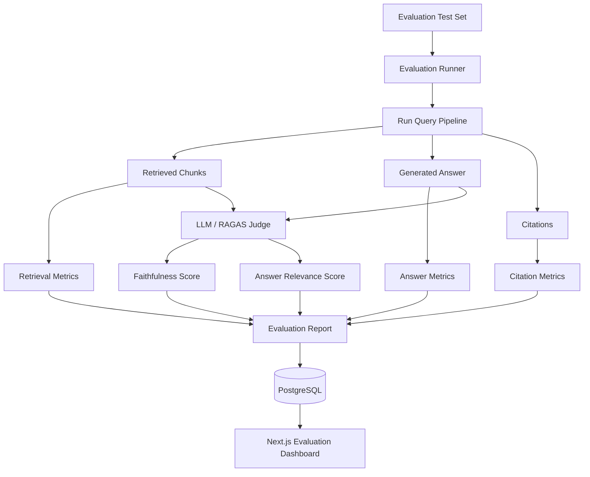
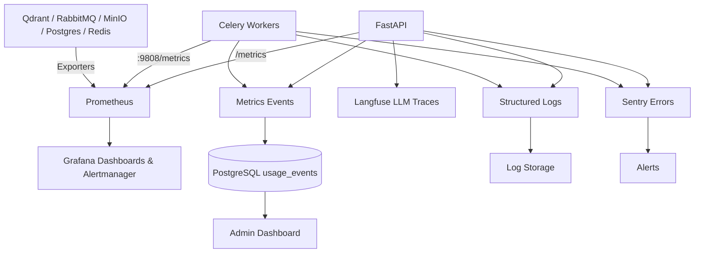

# 12 — Evaluation and Monitoring

## Why evaluation matters

A RAG system can fail in several ways:

1. Retrieval returns wrong chunks.
2. Retrieval returns incomplete context.
3. The LLM ignores context.
4. The answer is unsupported.
5. The citations are wrong.
6. The system answers when it should say "not found".
7. Latency or cost is too high.

Evaluation should test each part separately.

## Evaluation architecture



## Evaluation dataset format

```json
[
  {
    "question": "How many paid leave days are available?",
    "expected_answer": "20 paid leave days",
    "expected_document_id": "uuid",
    "expected_filename": "employee_policy.pdf",
    "expected_page_number": 4,
    "tags": ["hr", "leave"]
  }
]
```

## Metrics

### Retrieval hit rate

Checks whether expected document/page appears in top-k.

```text
hit = expected_source in retrieved_sources
```

### Context precision

Measures whether retrieved chunks are relevant.

### Context recall

Measures whether enough relevant context was retrieved.

### Faithfulness

Checks whether the generated answer is supported by retrieved context.

### Answer relevance

Checks whether the answer addresses the user question.

### Citation accuracy

Checks whether cited chunks support the answer.

### Refusal accuracy

Checks whether the system says "not found" when the answer is absent.

### Latency

Track:

```text
embedding latency
Qdrant retrieval latency
reranking latency
LLM latency
total latency
```

### Cost

Track:

```text
embedding tokens
LLM input tokens
LLM output tokens
estimated cost
```

## Custom evaluation example

```python
def retrieval_hit_rate(results, expected_document_id, expected_page_number):
    for item in results:
        if (
            item["document_id"] == expected_document_id
            and item["page_number"] == expected_page_number
        ):
            return 1.0
    return 0.0
```

## RAGAS evaluation

Use RAGAS for:

- Faithfulness.
- Answer relevancy.
- Context precision.
- Context recall.

Keep custom metrics too because production systems need business-specific checks.

## Evaluation dashboard

Show:

```text
Overall Score
Retrieval Hit Rate
Faithfulness
Citation Accuracy
Average Confidence
Average Latency
Average Cost
Failed Questions
Low-Confidence Questions
Regression Compared to Last Run
Prompt Version Impact
```

Prompt-version impact:

- Evaluation runs store the prompt template version resolved at queue time.
- Prompt template detail views list recent evaluation runs for each version.
- Regression review should compare current published prompt versions against previous published versions on a fixed evaluation set before rollout.

## Monitoring architecture



Observability layers in Rudix:

- **Structured logs (`structlog`)**: JSON/console request, worker, and domain event logs with automatic secret redaction.
- **Sentry**: Exception and performance trace capture across API, Celery workers, and frontend (`NEXT_PUBLIC_SENTRY_DSN`).
- **Langfuse**: Optional self-hosted LLM/RAG trace inspection with input/output redaction and sampling ([18_LANGFUSE_OBSERVABILITY.md](./18_LANGFUSE_OBSERVABILITY.md)).
- **PostgreSQL `usage_events` & `audit_logs`**: Tenant-isolated operational analytics exposed via `GET /api/v1/admin/observability` and `GET /api/v1/admin/provider-observability`.
- **Prometheus & Grafana**: Real-time time-series RED metrics, RAG stage latency histograms, Celery worker metrics, exporters, and 5 pre-provisioned Grafana dashboards ([25_PROMETHEUS_GRAFANA_OBSERVABILITY_PLAN.md](./25_PROMETHEUS_GRAFANA_OBSERVABILITY_PLAN.md) and [`infra/observability/README.md`](../infra/observability/README.md)). Zero-config defaults allow local startup via `make up-observability` without requiring manual variable configuration.

## Structured logging events

## Base structured log schema

All API and worker logs should follow the same base schema:

```json
{
  "event": "api.request | task.start | task.success | task.retry | task.failure | domain_event_name",
  "timestamp": "ISO-8601 UTC",
  "level": "debug|info|warning|error|critical",
  "logger": "api.access | api.exception | worker.tasks | events.*",
  "request_id": "optional request correlation id",
  "user_id": "optional user id",
  "organization_id": "optional organization id",
  "document_id": "optional document id",
  "job_id": "optional job/evaluation/task id",
  "endpoint": "optional HTTP path",
  "status_code": "optional HTTP or task status",
  "latency_ms": "optional request/task duration",
  "error": "optional short error name/message",
  "exception": "optional stack trace for exceptions"
}
```

Notes:

- `request_id` should be echoed as `X-Request-ID` in API responses.
- `latency_ms` is always emitted for API access logs.
- Secret values must be redacted (API keys, tokens, passwords, secrets).

### document_uploaded

```json
{
  "event": "document_uploaded",
  "document_id": "uuid",
  "organization_id": "uuid",
  "filename": "policy.pdf",
  "file_type": "pdf",
  "size_bytes": 1234567
}
```

### document_indexed

```json
{
  "event": "document_indexed",
  "document_id": "uuid",
  "organization_id": "uuid",
  "page_count": 24,
  "chunk_count": 92,
  "duration_ms": 18400
}
```

### document_processing_reaped

Emitted by the `documents.reap_stale` beat task as `document.processing.reaped` (re-queued),
`document.processing.reap_exhausted` (marked `failed` with `PROCESSING_STALLED`), or
`document.processing.reap_enqueue_failed` (broker error; retried after the next stale window).
No document text is logged.

```json
{
  "event": "document.processing.reaped",
  "document_id": "uuid",
  "organization_id": "uuid",
  "outcome": "requeued",
  "reap_count": 1
}
```

### query_answered

```json
{
  "event": "query_answered",
  "organization_id": "uuid",
  "chat_session_id": "uuid",
  "message_id": "uuid",
  "top_similarity": 0.91,
  "confidence_score": 0.87,
  "latency_ms": 1450,
  "model_name": "gpt-5.4-mini"
}
```

### evaluation_completed

```json
{
  "event": "evaluation_completed",
  "evaluation_run_id": "uuid",
  "retrieval_hit_rate": 0.86,
  "faithfulness": 0.82,
  "citation_accuracy": 0.79,
  "average_latency_ms": 1520
}
```

## Sentry alerts

Create alerts for:

- API error rate above threshold.
- Celery task failure spike.
- LLM API failures.
- Qdrant connection errors.
- MinIO upload failures.
- Database connection pool exhaustion.
- High latency.
- High cost.

## Frontend observability notes

- Frontend monitoring is opt-in via `NEXT_PUBLIC_SENTRY_DSN`.
- When enabled, the UI emits sanitized breadcrumbs for:
  - document upload/delete/re-index actions
  - chat question submissions
  - evaluation run requests
  - pipeline graph loads
  - admin data views
- Route-level rendering errors are captured with safe context, including request/trace IDs when available from backend error responses.
- Redaction rules remove secrets and high-risk content fields (tokens, passwords, prompt/question/answer/content text) before transport.
- If DSN is not configured, monitoring calls are no-op and do not affect user flows.

## Production SLOs

Suggested targets:

| Metric                    | Target            |
| ------------------------- | ----------------- |
| API availability          | 99.5%+            |
| Chat p95 latency          | < 5 seconds       |
| Document indexing success | > 98%             |
| Retrieval hit rate        | > 85% on eval set |
| Citation accuracy         | > 80%             |
| Failed task rate          | < 2%              |
| Not-found correctness     | > 90%             |

## Evaluation index cleanup

Chunking comparison runs re-ingest the corpus under `eval-<run hex10>-<n>` index
versions in the shared Qdrant collection and `document_chunks` table. Production
retrieval never serves these versions (see `docs/03_RAG_WORKFLOW.md`, Index version
filter), but they must still be removed:

- The evaluation worker cleans up each target's eval version in a `finally` block,
  so cleanup also runs when re-ingest or scoring fails partway. It deletes the
  target's Qdrant points and chunk rows for each corpus document. Live-index targets
  (`DOCUMENT_INDEX_VERSION`) are never cleaned up.
- Cleanup never fails the run. `metrics_summary["eval_index_cleanup"]` holds one entry
  per eval target: `index_version`, `documents_attempted`, `chunks_deleted`,
  `qdrant_failures` and `chunk_failures`, or `index_version` and `error` (exception
  class name) when the cleanup call itself failed.
- Logs: `evaluation.index_cleanup.completed` (counts only), and
  `evaluation.index_cleanup.qdrant_failed` / `evaluation.index_cleanup.chunks_failed`
  per document. Metric: `rudix_eval_index_cleanup_failures_total{store}` with
  `store` set to `qdrant` or `postgres`.
- 0.6.0 (R06-12): with `QDRANT_EVALUATION_COLLECTION` set, eval vectors are written to
  and deleted from that collection only, with the same organisation, document and index
  version filter; the production collection receives no eval writes. A missing
  evaluation collection counts as nothing to delete, not as a `qdrant` failure. Eval
  chunk rows stay in `document_chunks` and are cleaned up as before.

### Purging legacy eval versions

Runs from before 0.2.0, and runs whose cleanup failed, leave eval versions behind.
`backend/scripts/purge_eval_index_versions.py` reports and purges them:

```bash
cd backend
.venv/bin/python scripts/purge_eval_index_versions.py              # dry run (default)
.venv/bin/python scripts/purge_eval_index_versions.py --apply      # delete eval versions
.venv/bin/python scripts/purge_eval_index_versions.py --organization-id <uuid> --batch-size 256
```

- It prints counts per organization and index version for chunk rows and Qdrant
  points, never text.
- It skips eval versions that belong to a queued or running evaluation run.
- It never deletes non-eval versions. Non-eval versions outside the active set are
  reported as `inactive: hidden from retrieval`, and the script exits with code `2`
  when any exist. Otherwise it exits with `0`.
- With `QDRANT_EVALUATION_COLLECTION` set it scans that collection as well as
  `QDRANT_COLLECTION` (legacy eval points stay there until purged) and deletes each eval
  point from the collection it was found in. A missing evaluation collection is empty.

### Required pre-deploy check for 0.2.0

Run this on staging and on production before deploying 0.2.0. It cannot be run from
a development checkout:

1. `SELECT index_version, count(*) FROM document_chunks GROUP BY 1 ORDER BY 1;`
2. Run the purge script as a dry run.
3. If a non-eval version other than `DOCUMENT_INDEX_VERSION` is reported, add it to
   `DOCUMENT_ACTIVE_INDEX_VERSIONS` or reindex those documents before deploying.
   Otherwise their documents stop returning chunks.
4. Record the counts in the merge request.

## Load testing and performance baseline

The Locust harness in `ci/load/` (`R03-09`) drives five scenarios against the integration
stack with the LLM stub overlay: streaming chat over WebSocket, `POST /api/v1/chat`, the
paginated document list, upload-to-indexed ingestion, and the admin usage and observability
dashboards. `ci/load/README.md` gives the stack, the seeded account, the artificial LLM
latency (`STUB_LLM_LATENCY_MS`), and the exact command lines. Results go into
`docs/roadmap/V0_3_0_LOAD_BASELINE.md` through `ci/load/report.py`. That document is a
template marked "not yet measured" until a run is recorded.

Database metrics used by the baseline, exposed on `/metrics` when `METRICS_ENABLED=true`:

| Metric | Type | Labels | Meaning |
|---|---|---|---|
| `rudix_db_queries_per_request` | Histogram (buckets 1, 2, 5, 10, 20, 50, 100, 200) | `method`, `route` (template) | SQL statements executed while handling one HTTP request, including tasks the request spawned. |
| `rudix_db_pool_checked_out` | Gauge (read at scrape time) | none | Connections currently checked out of the API engine's pool. |
| `rudix_db_pool_size` | Gauge (read at scrape time) | none | Configured persistent pool size. |
| `rudix_db_pool_overflow` | Gauge (read at scrape time) | none | Current overflow (negative while below the pool size). |

Notes:

- Statement counting is on by default and can be turned off with
  `METRICS_DB_QUERY_COUNTING_ENABLED=false`. The listener only increments an in-memory
  counter; no SQL text or parameters are recorded.
- Statements outside an HTTP request (Celery tasks, startup, WebSocket sessions) are not
  counted.
- Pools without these statistics (`NullPool`, `StaticPool`) export no pool samples instead of
  failing the scrape.
- All values are per API process. With several workers or replicas, scrape and compare each.
- Suggested alerts once the baseline exists: `rudix_db_pool_checked_out` at or above
  `rudix_db_pool_size` plus the maximum overflow for several minutes (pool exhaustion), and
  p95 of `rudix_db_queries_per_request` for chat routes above the roadmap target.

### Pool wait, pool timeouts, and RLS soft denials (0.4.0)

| Metric | Type | Labels | Meaning |
|---|---|---|---|
| `rudix_db_pool_wait_seconds` | Histogram (0.5 ms to 30 s) | none | Time to check a connection out of the API engine's pool (`TimedAsyncAdaptedQueuePool`). |
| `rudix_db_pool_timeouts_total` | Counter | none | Checkouts that gave up after `DB_POOL_TIMEOUT` seconds (`sqlalchemy.exc.TimeoutError`). |
| `rudix_rls_soft_denials_total` | Counter | `table` | In `RLS_ENFORCEMENT=soft`, ORM statements and flushes on a strict RLS table with no tenant bound, which `strict` would deny. |
| `rudix_rls_resolved_tenant_bindings_total` | Counter | `path` (`agent_trace_share`, `auth_audit`, `bot_inbound`) | Tenants bound by unauthenticated paths from the token, user, or installation they resolved (0.5.0). |

- Alerts, group `rudix-db` in `infra/observability/prometheus/alerts.yml`:
  `RudixDbPoolTimeouts` (critical, any pool timeout in 5 minutes, for 5 minutes) and
  `RudixRlsSoftDenials` (warning, any soft denial per table within 1 hour, for 1 hour).
- Each soft denial also writes a structured `rls.soft_denial` log line (logger
  `events.rls`, fields `table` and `operation`), at most once per table per 60 s per
  process. No SQL text, parameters, or row data are logged.
- The per-transaction session-context statement (`/* rudix:session-context */`) is not
  counted in `rudix_db_queries_per_request`.
- Pool behaviour under load (wait p95 and timeouts at the load-test concurrency) is a
  manual step of the `R03-09` baseline; no measurement is recorded yet.

### Rate limiting and credential usage buffering (R04-07, R04-06)

| Metric | Labels | Meaning |
| --- | --- | --- |
| `rudix_rate_limit_decisions_total` | `scope`, `decision`, `failure_mode` | Existing: every limiter decision. |
| `rudix_rate_limit_org_limited_total` | `scope` | Requests rejected by the organisation aggregate limit (not the per-user limit). |
| `rudix_usage_touch_buffered_total` | `kind` | API-key / service-account usage touches buffered in Redis. |
| `rudix_usage_touch_flushed_total` | `kind` | Touches written to the database by `usage.touch.flush`. |
| `rudix_usage_touch_dropped_total` | `kind`, `reason` | Touches dropped because Redis was missing (`redis_unavailable`) or failed (`redis_error`). |

`kind` is `api_key`, `service_account_token`, or `service_account`.

- A sustained rise in `rudix_rate_limit_org_limited_total` means one organisation is near its
  aggregate limit (scope limit x `RATE_LIMIT_ORG_LIMIT_MULTIPLIER`); raise the multiplier or
  the scope limit rather than disabling the organisation limit.
- `buffered` and `flushed` should track each other over a few flush intervals. `flushed`
  counts unique credentials per flush, so it is lower than `buffered` when a key is used more
  than once per interval. If `flushed` stays at zero while `buffered` grows, beat or the
  worker is not running `usage.touch.flush`.
- Any non-zero `rudix_usage_touch_dropped_total` rate means `last_used_at` is stale for those
  credentials; it is a Redis availability signal, not a request failure.
- The flush task logs `usage_touch.flushed` (rows) and, on a database error,
  `usage_touch.flush_failed` (rows re-buffered, error type) before Celery retries it.

### Retention and partition maintenance (R04-09)

| Metric | Labels | Meaning |
| --- | --- | --- |
| `rudix_retention_rows_deleted_total` | `table` | Rows deleted by `maintenance.retention.purge` (daily, 03:15 UTC). |
| `rudix_partition_missing` | `table` | 1 when a partitioned table has no partition for next month, else 0. Set by `maintenance.partitions.ensure` (daily, 03:45 UTC). |

- With the default settings (every `RETENTION_<TABLE>_DAYS` unset), the counter stays at
  zero. A sudden jump after a configuration change is expected once and then flattens to the
  daily expiry rate.
- No table is partitioned in `0.4.0`, so `rudix_partition_missing` has no samples until an
  operator converts one (`docs/06_DATABASE_SCHEMA.md`, "Retention and partitioning").
  Alert `RudixPartitionMissing` (group `rudix-retention`, warning) fires when the gauge is
  1 for an hour. Inserts dated next month fail once that month starts, so create the
  partition before then.
- Both tasks log on `events.maintenance`:
  - `maintenance.retention.table_purged`: table, rows deleted, batches, organisations,
    whether the run was truncated;
  - `maintenance.retention.organization_purged`: table, organisation ID, rows, window;
  - `maintenance.retention.disabled`;
  - `maintenance.partitions.created`, `maintenance.partitions.dropped`, and
    `maintenance.partitions.ensure_failed` (table, error type).
- `truncated=true` on several days in a row means the backlog is larger than
  `RETENTION_DELETE_BATCH_SIZE` x `RETENTION_MAX_BATCHES_PER_RUN` per day. Raise one of the
  two, or let the backlog drain over several runs.

### Event-loop lag

The API runs a small background task (`LOOP_LAG_MONITOR_ENABLED`, default on; tick
`LOOP_LAG_MONITOR_INTERVAL_MS`, default 50) that measures how late it wakes up. A blocking
call on the event loop shows up as lag. It needs no labels.

| Metric | Type | Meaning |
|---|---|---|
| `rudix_event_loop_lag_seconds` | gauge | Worst lag in the current rolling 30-second window (resets each window, so one spike does not pin it). |
| `rudix_event_loop_lag_seconds_hist` | histogram | Lag of every monitor tick. |

- Sustained lag above roughly 100 ms means something is blocking the loop (a sync client
  call, CPU-heavy parsing). Object storage, Celery dispatch, and Qdrant search on request
  paths run through `asyncio.to_thread`; look for new sync calls first.
- `tests/test_event_loop_lag.py` is the regression probe for upload, download, retrieval,
  and enqueue.

### Application cache (R04-05)

| Metric | Labels | Meaning |
| --- | --- | --- |
| `rudix_cache_hits_total` | `namespace` | Values served from Redis (including in-process single-flight followers). |
| `rudix_cache_misses_total` | `namespace` | Values loaded from the database and written to Redis. |
| `rudix_cache_errors_total` | `namespace`, `operation` | Reads that fell back to the database. `operation` is `version`, `get`, `set`, `decode` (Redis error or timeout), `unavailable` (no Redis client), or `disabled` (`CACHE_ENABLED=false`). |
| `rudix_cache_invalidations_total` | `scope`, `result` | Post-commit version bumps. `scope` is `org` or `user`; `result` is `ok`, `error`, `unavailable`, `skipped` (sync session, no event loop), or `unresolved` (custom-role permission whose organisation could not be found). |

`namespace` is `auth_principal`, `permission_set`, or `feature_flags`.

- Hit ratio is `hits / (hits + misses)` per namespace. A warm authenticated request issues no
  auth statements; a low `auth_principal` hit ratio usually means frequent session refreshes or
  user-level writes (each bumps the user's version).
- Alert on a sustained rate of `rudix_cache_errors_total{operation!~"unavailable|disabled"}`:
  Redis is slow or failing and every request is reading the database again.
- Alert on any `rudix_cache_invalidations_total{result="error"}`: until the TTL passes, a
  revoked session, removed member, or changed permission may still be served from cache.
- Failures log `cache.fallback` and `cache.invalidation.failed` with namespace or scope and
  the error type; no values, tokens, or ids beyond the scope id are logged.

### Chat pipeline stages (R05-01)

`POST /api/v1/chat` and the chat WebSocket always run the staged chat pipeline (since 0.5.0 the
legacy bodies are gone and `CHAT_PIPELINE_V2` has no effect) and record one observation per stage run and per database session:

| Metric | Labels | Meaning |
|---|---|---|
| `rudix_chat_stage_seconds` | `stage` | Duration of one stage: `authorize`, `guard`, `resolve_config`, `shortcut`, `rewrite`, `direct_answers`, `retrieve`, `rerank_pack`, `generate`, `verify`, `persist`. |
| `rudix_chat_db_session_seconds` | `phase` | How long one pipeline database session was held: `read` (stages 1, 2, 4), `short` (one lookup in stages 5 to 9), `write` (stage 10). No session is open while a model generates (R05-02). |

- `retrieve`, `rerank_pack`, and `generate` are skipped for blocked, scope-inventory, and
  guidance answers, so their counts are lower than the `authorize` count.
- A stage that fails still records its duration; the request then ends with the same safe
  error code as before (`retrieval_failed`, `generation_failed`, `chat_persistence_failed`).
- Stage timeouts and a run deadline exist but are off. When a later release turns them on, a
  timed-out stage logs `query.stage.degraded` with the stage name and reason only.
- The stage logs carry ids, counts, flags, and models; no question, prompt, answer, or document
  text.
- `CHAT_PIPELINE_V2=false` is ignored since 0.5.0 (startup warning `chat.pipeline_v2_ignored`);
  every chat request records the stage metrics.

### Chat streaming and time to first token (R05-03)

The WebSocket and `POST /chat/query/stream` (SSE) stream the answer as it is generated.

| Metric | Labels | Meaning |
|---|---|---|
| `rudix_chat_ttft_seconds` | `transport` (`ws`, `sse`) | Pipeline start to the first answer text sent: the first `generation.delta` in `live` mode, the first verified delta in `buffered` mode, or `generation.final` when no delta was sent (blocked or no-evidence answers). One observation per answer; `POST /chat` does not record it. |
| `rudix_chat_stream_cancelled_total` | `transport` | Answers cancelled before completion (`chat.cancel`, SSE client disconnect). |

- Dashboard: Grafana `06 — Rudix Chat Pipeline`
  (`infra/observability/grafana/dashboards/06-rudix-chat-pipeline.json`) shows TTFT p50/p95 per
  transport, cancellations, `rudix_chat_stage_seconds` p95, `rudix_chat_stage_skipped_total`,
  `rudix_llm_breaker_state`, and `rudix_chat_tokens_total`. The skipped-stage panel stays empty
  until the budget metrics ship (R05-04).
- Alert: `RudixChatTimeToFirstTokenHigh` (group `rudix-chat-streaming` in
  `infra/observability/prometheus/alerts.yml`) fires when TTFT p95 stays above 2.5 s for
  10 minutes. The 2.5 s target is not measured in CI (no load environment); it is checked in
  the staging load baseline.
- Buffered answers (strict grounded verification, blocking AI-policy rules, tree search,
  `CHAT_STREAM_MODE=buffered`) wait for verification, so their TTFT is close to the full
  answer latency. Compare TTFT with `rudix_chat_stage_seconds{stage="verify"}` before tuning.
- A cancelled answer writes one `usage_events` row with `event_type =
  "chat.completion.cancelled"`: the tokens already spent (provider-reported usage, else chars / 4
  estimates with `metadata.usage_estimated = true`), no chat message, and no question counted.
  Usage dashboards that sum `chat.completion` rows do not include these; add the event type
  when reporting total spend.
- Logs: `chat.stream.cancelled` (transport, stream mode, ids) and
  `chat.stream.cancelled_usage_failed` (error type only) when the partial-usage write fails or
  times out; `chat.sse.stream_started` when an SSE stream passed stages 1-3. No question,
  prompt, answer, or document text is logged.

### Chat token ledger and context injection scan (R05-07, R05-09)

Every provider call of a chat run is recorded in a per-request token ledger. **Reported totals
change:** the `chat.completion` usage event's `input_tokens`, `output_tokens`, and `cost_usd`
are now the ledger totals, so they include the auxiliary calls (query rewriting, every rerank
batch, conflict detection, the grounded verifier, the refiner, and every tree-search
candidate) next to the query embeddings and the answer. Before 0.5.0 they counted the
embedding and the answer only. Dashboards and cost reports built on usage events show higher
numbers for runs with auxiliary stages on; the assistant message's token columns still hold
the embedding and answer tokens.

- `usage_events.metadata.token_ledger` lists one entry per call:
  `{stage, provider, model, prompt_tokens, completion_tokens, cached_tokens, cost_usd,
  estimated}`. Stages: `rewrite`, `retrieve` (query embeddings, one per retrieval query, sub-queries included),
  `rerank` (one per batch), `conflict`, `generate` (answer, guidance, and each tree-search
  candidate), `verifier`, `refiner`. No text is stored.
- Auxiliary costs use the configured LLM token prices (`OPENAI_LLM_*_COST_PER_MILLION_TOKENS_USD`;
  rerank uses `RERANK_*_COST_PER_MILLION_TOKENS_USD`); embedding entries carry no cost.
- The organisation's `tokens` quota (`QuotaType.tokens`) is incremented by the run's total
  tokens in the same transaction as the question count.
- A provider call that completed but returned unparseable output is still recorded; a call that
  timed out or failed before a response is not.

| Metric | Labels | Meaning |
|---|---|---|
| `rudix_chat_tokens_total` | `stage`, `kind` (`prompt`, `completion`, `cached`) | Tokens of every ledger entry, counted once the run is persisted. |
| `rudix_chat_context_injection_flagged_total` | `action` (`flag`, `downrank`, `drop`) | Retrieved chunks that matched a prompt-injection pattern after rerank. |

- `sum by (stage) (rate(rudix_chat_tokens_total[1h]))` shows which auxiliary stage drives cost.
- A rising `rudix_chat_context_injection_flagged_total` points at uploaded documents with
  instruction-like text; the log event `chat.context.injection_flagged` carries the action and
  counts, and the answer's trust metadata (`context_injection`) lists the chunk ids.

### Provider resilience and chat resume (R05-06, R05-13)

Every chat provider call passes a circuit breaker per provider and model and, when
`LLM_ORG_MAX_CONCURRENT_CALLS > 0`, one slot of the organisation's Redis semaphore.
WebSocket runs are buffered in Redis so a dropped socket can resume.

| Metric | Labels | Meaning |
|---|---|---|
| `rudix_llm_breaker_state` | `provider`, `model` | Breaker state: `0` closed, `1` half-open, `2` open (per API replica). |
| `rudix_llm_breaker_transitions_total` | `provider`, `model`, `state` | Transitions, by the state entered (`open`, `half_open`, `closed`). |
| `rudix_llm_org_concurrency_rejected_total` | none | Calls answered `provider_busy` because the organisation's limit stayed reached for `LLM_ORG_SEMAPHORE_WAIT_MS`. |
| `rudix_llm_org_semaphore_unavailable_total` | none | Calls admitted without a lease because Redis was missing or failing (fail open). |
| `rudix_llm_cached_prompt_tokens_total` | `provider`, `model` | Prompt tokens the provider reported as served from its prompt cache (OpenAI `prompt_tokens_details.cached_tokens`). |
| `rudix_chat_ws_resume_total` | `outcome` (`replayed`, `rebuilt`, `unavailable`, `redis_unavailable`) | `chat.resume` commands. |
| `rudix_chat_ws_drop_total` | `outcome` (`completed`, `cancelled`, `cancelled_no_grace`) | Runs whose socket dropped: finished in the grace window, cancelled when it ended, or cancelled at once (grace `0`, no Redis, or a failed buffer). |
| `rudix_chat_resume_buffer_errors_total` | none | Resume buffer writes that failed; the run continues unbuffered. |

- The breaker opens after `LLM_BREAKER_FAILURE_THRESHOLD` (5) transient failures (provider
  unreachable, 5xx, timeouts, stream gaps above `LLM_STREAM_IDLE_TIMEOUT_SECONDS`) within
  `LLM_BREAKER_WINDOW_SECONDS` (30), stays open `LLM_BREAKER_OPEN_SECONDS` (30), then lets
  `LLM_BREAKER_HALF_OPEN_PROBES` (1) calls test the provider. Validation errors, rate limits,
  and other 4xx answers never count. While it is open, the answer goes straight to the
  profile's fallback provider (no retry backoff; `fallback_reason = "BreakerOpenError"` in the
  trust metadata) or fails with `generation_failed`. Breaker state is per replica.
- Alerts (group `rudix-llm-resilience` in `infra/observability/prometheus/alerts.yml`):
  `RudixLlmBreakerOpen` when a breaker stays open for 5 minutes, and
  `RudixLlmOrgConcurrencyRejections` when organisations hit their concurrency limit.
- Prompt caching: no template is reordered for caching in 0.5.0; cached tokens are recorded as
  reported (ledger `cached_tokens`, `rudix_chat_tokens_total{kind="cached"}`, and the metric
  above). A provider that does not report them shows `0`.
- A rising `rudix_chat_ws_drop_total{outcome="cancelled"}` with few
  `rudix_chat_ws_resume_total{outcome="replayed"}` means clients do not resume within
  `CHAT_WS_RESUME_GRACE_SECONDS`. Many `unavailable` resumes point at expired buffers
  (`CHAT_RESUME_BUFFER_TTL_SECONDS`) or clients resuming the wrong message id.
- Logs: `llm.breaker.transition` (provider, model, states), `llm.org_semaphore.rejected`,
  `llm.org_semaphore.unavailable`, `chat.ws.resume` (outcome, replayed count),
  `chat.ws.dropped_run` (outcome), and `chat.resume.buffer_failed` (error type). No question,
  prompt, answer, or document text is logged.
- Staging checks (not covered in CI): the `requires_redis` lane runs the semaphore and resume
  Lua scripts against Redis 7 (`TEST_REDIS_URL=... make test-postgres`), and a resume across
  two API replicas.

### Chat caches, verified-answer shortcut, and stage budgets (R05-04, R05-05)

| Metric | Labels | Meaning |
|---|---|---|
| `rudix_chat_query_embedding_cache_total` | `result` (`hit`, `miss`) | Query-embedding lookups; a miss calls the embedding provider (also when Redis is down or `CACHE_ENABLED=false`). |
| `rudix_chat_verified_answer_shortcut_total` | `result` (`hit`, `no_match`, `citation_rejected`, `over_cap`) | Stage 4 evaluations when `CHAT_VERIFIED_ANSWER_SHORTCUT_ENABLED=true` (shadow mode: a hit is not returned yet). |
| `rudix_chat_stage_skipped_total` | `stage`, `reason` (`deadline`, `budget`, `error`) | Optional stages cut short by `CHAT_TOTAL_DEADLINE_MS` or a `CHAT_STAGE_BUDGET_*_MS`. |
| `rudix_cache_hits_total`, `rudix_cache_misses_total`, `rudix_cache_errors_total` | `namespace` | Existing R04-05 cache metrics, now also for `ai_policy`, `rag_profile`, `answer_prompt`, `model_profile`, `chat_tool_policy`, `quota_policy`, `verified_answer_candidates`, `query_embedding`. |

- Embedding hit rate: `sum(rate(rudix_chat_query_embedding_cache_total{result="hit"}[1h])) /
  sum(rate(rudix_chat_query_embedding_cache_total[1h]))`. A hit records a zero-token
  `retrieve` entry in the token ledger, so embedding cost falls with the hit rate.
- Configuration cache health: `rudix_cache_misses_total` by namespace should stay near the
  write rate of the underlying rows; a sustained rise in `rudix_cache_errors_total` means the
  chat path is reading PostgreSQL again (correct, but slower).
- Shadow-mode shortcut: `rudix_chat_verified_answer_shortcut_total{result="hit"}` is the share
  of questions a verified card could answer; `citation_rejected` means cards whose citations
  the asker could not read or cite, or that point at deleted or out-of-scope documents.
  `over_cap` means the organisation has more published cards than the cap and the shortcut is
  skipped. The log event `query.verified_answer_shortcut.evaluated` carries the result and the
  card id only.
- Budgets: any `rudix_chat_stage_skipped_total` increase means answers were produced with a
  degraded step; the answer's trust metadata lists the step in `stage_degradations` and the
  log event `query.stage.degraded` carries the stage, reason, and action (no text). Budgets
  are off by default (`0`); turn them on per environment and watch this counter before
  tightening them.
- Statement budget: a warm-cache grounded HTTP question sends 30 SQL statements (cold: 50),
  asserted in `tests/test_chat_query_count.py`. The `0.5.0` exit criterion of 12 is not met;
  the remaining statements are document authorisation reads and the final write.
- The p95 latency target is not measured by these tests.

### Ingestion stages (R06-01)

Document processing runs as stages (`extract`, `clean_detect`, `dlp`, `chunk`,
`graph_extract`, `embed`, `index`, `finalize`), each recorded in
`document_processing_stages` for the run (`run_id` = the claiming Celery task id).

| Metric | Labels | Meaning |
|---|---|---|
| `rudix_ingest_stage_seconds` | `stage`, `outcome` | Duration of one stage run. `outcome` is `completed`, `failed`, or `skipped` (the stage was already completed for this run, so a retry or redelivery did not repeat it). |

- A rising `skipped` count after worker restarts is expected: redelivered tasks resume at the
  first unfinished stage instead of re-reading the file, re-running OCR, or re-embedding.
- Log events `ingestion.stage.completed`, `ingestion.stage.failed` (with `error_code`), and
  `ingestion.stage.skipped` carry the stage, document, organization, run id, attempt, and
  duration only; no document text. The existing `document.pipeline.stage` events and the
  pipeline explorer stage names (`extract`, `detect_ocr`, `ocr`, `detect_language`, `dlp`,
  `index_cleanup`, `chunk`, `extract_entities`, `embed`, `index`) are unchanged.
- `STAGE_LEASE_HELD` (transient) means another task holds a fresh lease on the same stage of
  the same run; `CLAIM_SUPERSEDED` (permanent) means another task took the processing claim
  before `finalize`, which then does not write `indexed`.
- The metric is recorded only when `METRICS_ENABLED=true`. Per-stage latency is not measured
  by the tests; no latency target is set here.

### Ingestion chain, outbox, and worker tenant binding (R06-01 part 2)

With `INGEST_PIPELINE_MODE=chain` each stage is its own Celery task; graph extraction runs
after `finalize` on its own queue.

| Metric | Labels | Meaning |
|---|---|---|
| `rudix_ingest_stage_tasks_total` | `stage`, `outcome` | Stage task deliveries: `completed`, `skipped` (row already completed; the next stage is dispatched again), `superseded` (the claim moved), `lease_held` (another delivery holds a fresh lease), `rerun_producer` (a needed artifact was missing). |
| `rudix_outbox_messages_total` | `task`, `outcome` | Request-path dispatches: `published` (after commit), `deferred` (publish failed, row pending), `relayed` (published by `outbox.relay`), `failed` (gave up after `OUTBOX_MAX_ATTEMPTS`), `duplicate` (dedupe key existed). |
| `rudix_worker_tenant_mismatch_total` | `task` | Tasks stopped because the entity belongs to another organisation than the message named. Any non-zero value is investigated. |

- Logs: `ingestion.stage_task.<outcome>`, `ingestion.stage.dispatched`,
  `ingestion.stage.dispatch_failed`, `ingestion.graph_extract.failed` (with `error_code`),
  `outbox.publish_deferred`, `outbox.relay_completed`, `outbox.relay_gave_up`,
  `task.tenant_mismatch`, and `document.stage_artifacts.purged`. They carry ids, stage, run id,
  counts, and exception class names; never document text, task arguments, or broker URLs.
- A pipeline-explorer run spans all stage tasks of one run (its id is kept in the extract
  stage row's metrics); graph events are appended after `finalize`.
- Alert ideas: `deferred` outbox count rising while `relayed` stays flat (broker down);
  `superseded` or `lease_held` rising (duplicate publications or competing claims).
- No throughput or latency figure is recorded for the chain; the tests assert call counts.

### Vector writes, embedding reuse, and Qdrant clients (R06-02, R06-06, R06-07)

| Metric | Labels | Meaning |
|---|---|---|
| `rudix_embedding_cache_hits_total` | `outcome` | Embed-stage chunks whose vector was reused from the vector index (`hit`) or sent to the provider (`miss`). A reindex of unchanged documents is all `hit`; a hit ratio that drops to zero after a deploy means the lookup fails (log `ingestion.embedding_reuse_lookup_failed`) or the `chunk_hash` payload index is missing. |

- The `document.embedding` usage event counts only embedded chunks, so reindex cost falls
  with the hit ratio; tokens of reused chunks are not counted.
- The pipeline-explorer stage `index_cleanup` now runs after `index` (stale points of other
  runs are deleted after the upserts) and reports `point_count`. Error codes:
  `QDRANT_POINT_COUNT_MISMATCH` (transient: the document's point count differs from its
  embeddable chunks after cleanup), `QDRANT_CLEANUP_FAILED`, `QDRANT_CLEANUP_FILTER_INVALID`.
- Logs: `qdrant.async_client.created` (kind, timeout), `qdrant.collection.missing_on_write`
  (the write path bootstrapped a missing collection), `qdrant.collection.tuning_differs`
  (configured tuning differs from an existing collection; nothing is changed),
  `qdrant.bootstrap.completed` / `qdrant.bootstrap.failed`, `worker.qdrant_bootstrap_failed`.
- Recall: every tuning setting defaults to the server default and `QDRANT_STORE_PARENT_TEXT`
  stays `true`, so retrieval results on the evaluation set cannot change from these items
  unless an operator sets a value. Run the accuracy gate on a staging collection before
  setting any of them (`docs/27`, "Vector writes and memory").
- Memory: `tests/test_ingestion_memory_bounds.py` bounds the traced Python memory of the
  extract path (a 64 MiB TXT under 16 MiB, a 300-page PDF of about 2.8 million characters
  under 4 MiB); these are test bounds, not production measurements. No latency figure is
  recorded for the async clients or for parent-text resolution.

### Connector sync pages, rate limits, and caps (R06-11)

| Metric | Labels | Meaning |
|---|---|---|
| `rudix_connector_sync_pages_total` | `provider`, `mode` | Pages committed by connector sync runs (`full`, `incremental`). |
| `rudix_connector_sync_rate_limited_total` | `provider`, `outcome` | Provider rate limits: `inline` (slept up to `CONNECTOR_SYNC_MAX_INLINE_BACKOFF_SECONDS`, same page retried) or `requeued` (checkpoint kept, run re-enqueued with the Retry-After countdown). |
| `rudix_connector_sync_deferred_total` | `reason` | Runs held back or re-enqueued: `org_cap`, `connection_cap`, `lease_held`, `lease_lost`, `rate_limit`, `stale` (re-enqueued by `connectors.sync.reap`). |

- Sync run rows report progress: `pages_committed`, `checkpoint_at`, `heartbeat_at`, and the
  counters move with every page commit.
- Logs: `connector.sync.page_committed`, `connector.sync.rate_limited`,
  `connector.sync.retry_scheduled`, `connector.sync.cancelled`, `connector.sync.resumed`,
  `connector.sync.lease_lost`, `connector.sync.cap_deferred`, `connector.sync.requeued`,
  `connector.sync.stale_runs_requeued`, and `connector.sync.item.tenant_mismatch`. They carry
  run, organisation, and provider ids and counters, never item content or credentials.
- Alert ideas: `requeued` rate limits rising for one provider (quota too small or caps too
  high); `stale` deferrals rising (workers dying or the stale threshold below the page time);
  `lease_lost` above zero (stale threshold too low).
- Measured in tests (SQLite, fake provider, pages of 1,000): a cancel issued during the fetch
  of page k+1 stops the run within 50 items of that page with k pages committed. No
  production throughput figure is recorded; real provider rate limits are a staging check.

### Chunk tenant backfill, multilingual keyword search, batched graph writes (R06-09, R06-10)

| Metric | Labels | Meaning |
|---|---|---|
| `rudix_chunk_backfill_rows_total` | none | `document_chunks` rows given `organization_id`, `fts_config` and `fts_vector` by `documents.chunks.backfill_tenant` or the backfill script. It stops growing when the backfill is done. |
| `rudix_graph_write_batches_total` | `kind` (`entity`, `alias`, `evidence`, `relation`), `outcome` (`written`, `failed`) | Neo4j UNWIND write transactions. Per document, about `ceil(rows / GRAPH_WRITE_BATCH_SIZE)` per kind, not one per item. |

- Logs: `documents.chunks.backfill_tenant.progress` (batches, rows updated, finished),
  `documents.chunks.backfill_tenant.batch_failed` (driver error class only),
  `keyword_search.tenant_column_checked` (once per process in `auto` mode),
  `graph.batch_write.failed` (kind, organisation, batch index and size, error class). None
  of them carry document text or Cypher parameters.
- Recall: `tests/test_keyword_multilingual_pg.py` shows that German, Spanish and French
  fixture questions find their chunks with `KEYWORD_SEARCH_MULTILINGUAL=true` and not with
  English stemming. This is a test on a small fixture set, not a measured recall figure.
  The live accuracy gate on staging decides the flag flips (runbook 27, "Keyword search
  settings").
- Bounded ranking: keyword search ranks at most `KEYWORD_SEARCH_CANDIDATE_LIMIT` matches.
  Keyword p95 staying flat as `document_chunks` grows is a staging load check (R03-09). No
  latency figure is recorded here.
- Alert ideas: `rudix_graph_write_batches_total{outcome="failed"}` above zero (Neo4j
  unavailable or rejected writes); `rudix_chunk_backfill_rows_total` flat while the dry run
  still reports remaining rows (task not running or blocked by lock timeouts).

### Worker pools, queues, time limits, and dead letters (R06-03, R06-04, R06-05)

| Metric | Labels | Meaning |
|---|---|---|
| `rudix_celery_queue_wait_seconds` | `queue` | Histogram: seconds from publication (header `rudix_published_at`, publisher clock) or the ETA, whichever is later, to a worker receiving the task. Recorded on `task_received` in the worker main process. |
| `rudix_celery_queue_depth` | `queue` | Ready messages per task queue (and `rudix.dead_letter` in quorum mode) from a passive `queue_declare` by `worker-default` every `WORKER_QUEUE_SAMPLE_INTERVAL_SECONDS` (30). |
| `rudix_celery_queue_consumers` | `queue` | Consumers per queue from the same sample. |
| `rudix_dead_letter_messages_total` | `outcome` | Dead-letter consumer: `recorded`, `duplicate` (task id already recorded), `no_tenant`, `malformed`, `error` (database error; requeued). |
| `rudix_celery_task_time_limit_total` | `task`, `kind` | Tasks stopped by a time limit (`soft`, `hard`). |

- `queue` is a configured queue name or `other`; the delay prefix that Celery's native
  delayed delivery adds to routing keys is stripped. No task arguments or ids are labels.
- Worker metrics are served by the worker main process on `WORKER_METRICS_PORT` (9808) when
  `WORKER_METRICS_ENABLED=true`; Prometheus scrapes `worker:9808` and each `worker-<pool>:9808`.
  The queue metrics above and hard time limits are recorded in that process. Metrics recorded
  inside a prefork child (task counters and durations from `task_prerun` / `task_postrun`,
  soft time limits) are not visible to it: that limitation predates 0.6.0. Use `FailedJob`
  rows (`error_code` `task_soft_time_limit`) for soft limits.
- Alerts (group `rudix-workers` in `infra/observability/prometheus/alerts.yml`):
  `RudixDeadLetterQueueNotEmpty` (dead-letter depth above 0 for 10 minutes),
  `RudixCeleryQueueWaitHigh` (p95 wait above 300 s for 15 minutes),
  `RudixCeleryQueueDepthGrowing` (more than 100 ready and rising for 15 minutes),
  `RudixCeleryQueueWithoutConsumers`. Dashboard `07 — Rudix Worker Pools & Queues`.
- Logs: `worker.time_limit_exceeds_consumer_timeout` (start-up check),
  `dead_letter.recorded`, `dead_letter.duplicate`, `dead_letter.no_tenant`,
  `dead_letter.malformed`, `dead_letter.persist_failed`, `workers.queue_depth_unavailable`.
  They carry task name, task id, organisation, document id, queue, reason, and death count;
  never task arguments beyond those ids.
- The thresholds are starting points, not measured values; no queue wait or depth baseline has
  been recorded (the load test is a manual step in plan section 8).

### Vector index generations and reindex (R06-08)

- Metric `rudix_reindex_progress{generation}`: fraction of indexed documents (all
  organisations) a building generation holds, set by the build after each page. Metrics
  only; the admin API reports the caller's organisation.
- Logs: `vector_index.adopted`, `vector_index.generation.registered` (with `reason`, for
  example `startup_config_change`), `vector_index.embedding_model_differs` (startup warning),
  `vector_index.build.started` / `.progress` / `.completed`,
  `vector_index.generation.verified` (expected and actual points, `error_code`),
  `vector_index.alias.swapped`, `vector_index.alias.rolled_back`,
  `vector_index.generation.dropped`, `vector_index.dual_write_failed`,
  `vector_index.dual_write_incomplete`, `qdrant.collection.mismatch_deferred`,
  `vector_index.query.dimension_fallback`, `vector_index.generation_documents.forgotten`,
  `qdrant.collection.missing_on_delete`. They carry
  generation, model, counts, document and organisation ids; never document text.
- Usage events `document.embedding` with `metadata.reason` `vector_reindex` (build) or
  `vector_reindex_dual_write` (ingestion during a build) attribute the reindex cost per
  organisation.
- Watch after a swap: chat retrieval errors and latency for at least
  `VECTOR_INDEX_REGISTRY_CACHE_SECONDS`, and the accuracy gate; roll back if either regresses.
- No staging measurement has been recorded yet (plan section 8 item 4).

### Agent runs in workers and the run stream (R06-13)

| Metric | Labels | Meaning |
|---|---|---|
| `rudix_agent_run_tasks_total` | `task`, `outcome` | `agents.run.execute` / `agents.run.resume` deliveries by the status they left the run in (`completed`, `failed`, `cancelled`, `waiting_approval`) or why they did nothing (`lease_held`, `not_runnable`, `not_found`, `lease_lost`). |
| `rudix_agent_runs_reaped_total` | `outcome` | `agents.runs.reap`: `requeued` (expired lease, `resume_count + 1`) or `failed` (`worker_lost` after `AGENT_RUN_MAX_RESUMES`). |
| `rudix_agent_tool_calls_reused_total` | `tool` | Side-effect tool calls answered from their completed row (same idempotency key) instead of executed again after a resume. |
| `rudix_agent_stream_events_total` | `source`, `outcome` | Stream events: `redis`/`published` and `redis`/`publish_failed` on the runtime side, `redis`/`streamed` and `database`/`streamed` on the endpoint side. |
| `rudix_worker_tenant_mismatch_total` | `task` | Also counts agent tasks whose run belongs to another organisation. |

- Logs: `agent.run.queued`, `agent.worker.task_finished` (task, run id, organisation,
  outcome), `agent.worker.run_failed` (exception class only), `agent.reaper.requeued`,
  `agent.reaper.worker_lost`, `agent.tool_call.reused`, `agent.stream.publish_failed`,
  `agent.stream.redis_fallback`, `agent.run.stream_opened`. The runtime's existing
  `agent.runtime.*` and `agent.step.*` events are unchanged. No log carries the objective,
  question, tool arguments, or outputs.
- Watch: a rising `rudix_agent_runs_reaped_total{outcome="requeued"}` means workers die
  mid-run (time limits, OOM, deploys without a grace period); any `failed` means a run
  exhausted its resumes. A high `lease_held` rate means duplicate deliveries.
  `publish_failed` means streams fall back to database polling.
- These metrics are recorded inside the task, so the prefork-child limitation of the
  section above applies to the task counters: use the run rows (`status`, `resume_count`,
  `error_details.code`) as the source of truth.
- No measured baseline exists yet; a live worker restart and Redis pub/sub are staging
  checks (plan section 8).

### Evaluation isolation (R06-12)

| Metric | Labels | Meaning |
|---|---|---|
| `rudix_evaluation_questions_in_flight` | none | Questions inside the per-target bound `EVALUATION_MAX_CONCURRENT_QUESTIONS` right now (answer, citation and LLM judge calls included). |
| `rudix_eval_index_cleanup_failures_total` | `store` | Unchanged; with `QDRANT_EVALUATION_COLLECTION` set, `qdrant` failures refer to that collection. |

- `evaluations.run` routes to `CELERY_QUEUE_EVALUATIONS`, which only the `eval` worker
  pool consumes in staging and production (R06-04), so a run shares no worker with chat
  or ingestion queues.
- Questions of one target run concurrently up to the bound (default `1`, the previous
  sequential behaviour); results of the first target are written in question order, each
  in its own short session. A bound above 1 runs the synchronous Qdrant search in a worker
  thread. Raise the bound only as far as the LLM provider's rate limits allow.
- Logs: `evaluation.collection.ensured` (collection, vector size, distance),
  `evaluation.collection.missing_on_delete`, plus the existing `evaluation.question.*` and
  `evaluation.index_cleanup.*` events. No log carries question, answer, or chunk text.
- Watch: the gauge stays at or below `bound x eval worker processes`; a run whose
  re-ingest fails with `EvaluationCollectionMismatchError` means the evaluation
  collection or the active generation changed vector size (drop the evaluation
  collection; it is recreated on the next run).
- "No measurable change in chat or ingestion latency during a full evaluation run" is a
  staging load-test check; no measurement has been recorded yet.

### Bundle budgets (R07-03)

CI (`frontend` job, step "Check bundle budgets") runs `node scripts/check-bundle-budgets.mjs`
after the production build and fails when a route's first-load JavaScript exceeds its budget.

- What is measured: the chunks Next lists per route in
  `.next/diagnostics/route-bundle-stats.json`, `gzip -9` per chunk, summed. The report
  (route, raw bytes, gzip bytes, budget) is written to `.next/bundle-report.json` and
  uploaded as the `bundle-report` artifact. A missing stats file, a route without a budget
  or an over-budget route exits 1.
- Budgets live in `frontend/config/bundle-budgets.json`: `ceil(measured x 1.05)` KB per
  group (auth pages, marketing, app default) and per route for app routes above the default.
  The 150 KB marketing and 300 KB app targets are recorded there as goals; the measured gap
  is in `frontend/README.md`.
- How to update: after an intended size change, run the build, read the script output, and
  set the budget to `ceil(measured x 1.05)`. Never lower the headroom or raise a figure
  without a measurement to make a failing check pass.

### Frontend Web Vitals (R07-11)

First-party field measurement of LCP, INP, CLS, FCP and TTFB. No third-party service and no
outbound request: the browser posts to our own API.

- Switches (both default off): the backend `WEB_VITALS_INGEST_ENABLED` (the endpoint answers
  404 otherwise) and the frontend build flag `NEXT_PUBLIC_WEB_VITALS_ENABLED`. The reporter
  also needs the visitor's **analytics consent**; without it nothing is collected or sent.
- Client: `useReportWebVitals`, samples batched (at most 10) and flushed when the page becomes
  hidden; `route` is a pattern (`/[locale]/pricing`, `/documents/[id]`), never a URL or query.
- Endpoint: `POST /telemetry/web-vitals` (docs/07 "Frontend telemetry"), per-IP limit
  `WEB_VITALS_RATE_LIMIT_PER_MINUTE` (default 60).
- Metrics (same registry as `app/core/metrics.py`, defined in `app/core/metrics_frontend.py`):
  `rudix_web_vitals_value_ms{metric,route}` (histogram; LCP, INP, FCP, TTFB),
  `rudix_web_vitals_cls{route}` (histogram) and
  `rudix_web_vitals_samples_total{metric,outcome}` (`accepted`, `rejected`, `rate_limited`;
  `metric="all"` when the body could not be read). The `route` label keeps at most
  `WEB_VITALS_MAX_ROUTES` (default 200) distinct values per process; later routes are
  reported as `other`.
- Dashboard: `infra/observability/grafana/dashboards/web-vitals.json` (p75 per route for each
  metric, plus sample outcomes), picked up by the existing dashboards provisioning folder.
- Privacy: no database writes, no IP addresses or values in logs.
- No field data has been collected yet; targets (LCP 2500 ms, INP 200 ms, CLS 0.1, FCP
  1800 ms, TTFB 800 ms at p75) are the Core Web Vitals "good" thresholds, not measurements.

### Realtime event stream (R07-07)

| Metric | Labels | Meaning |
|---|---|---|
| `rudix_realtime_connections` | | Open `GET /events/stream` connections in this API process. |
| `rudix_realtime_events_published_total` | `type`, `outcome` | Events written to Redis: `published`, `failed` (Redis error), `unavailable` (no client), `skipped` (no async context at commit). |
| `rudix_realtime_events_delivered_total` | `type` | Events written to a client stream after the organisation and audience checks. |
| `rudix_realtime_reconnects_total` | | Streams opened with a `Last-Event-ID` header. |

- Logs: `realtime.stream.opened` / `realtime.stream.closed` (organisation, user, delivered
  count), `realtime.stream.unavailable`, `realtime.stream.redis_failed`,
  `realtime.publish_failed` (event type, organisation, outcome, error class). No payload or
  document data is logged.
- Watch: `failed` or `unavailable` publish outcomes mean clients miss hints and rely on
  the fallback polling interval (`NEXT_PUBLIC_REALTIME_FALLBACK_POLL_MS`). A reconnect rate
  much above one per `REALTIME_STREAM_MAX_SECONDS` per connection means a proxy closes
  streams early (check buffering and idle timeouts).
- Publisher metrics in Celery prefork children are not scraped (same limitation as the
  worker counters above).
- No measured baseline exists yet; the end-to-end check with Redis is a staging step.

### Read replica routing and migration safety (R08-04, R08-08)

| Metric | Labels | Meaning |
|---|---|---|
| `rudix_db_replica_lag_seconds` | | Last successful lag sample of `DATABASE_REPLICA_URL` (0 when caught up or on a primary). |
| `rudix_db_replica_routed_total` | `target` (`replica`, `primary`), `reason` (`ok`, `replica_unset`, `lag_exceeded`, `sample_failed`) | Reporting sessions by where they went and why. |

- Alerts (`infra/observability/prometheus/rules/database.yml`): `RudixDbReplicaLagHigh`
  (`max(rudix_db_replica_lag_seconds) > 30` for 5 m, warning) and `RudixDbReplicaFallbacks`
  (any `lag_exceeded` or `sample_failed` routing for 15 m, warning). A fallback is safe (the
  report reads the primary) but moves reporting load back to it.
- Logs: `db.replica.lag_sample_failed` (warning, error class only, or `unknown_lag` when the
  standby has not replayed a transaction yet) and `db.replica.fallback` (debug, reason and lag).
  No URL, query text, or row data is logged.
- Lag is sampled on demand by API processes that serve reports, at most once per
  `DB_REPLICA_LAG_CHECK_INTERVAL_SECONDS`; a process that serves no report never samples, so
  the gauge can be stale or absent between reports. Read `routed_total` together with it.
- Migration safety is a CI gate, not a metric: the "Check migration safety" step in
  `backend-alembic` fails a pull request whose migrations drop or rename what the base
  branch's models use, or take long locks on a large table without a reviewed marker.
- No measured baseline exists yet; replica lag under load and a failover drill are staging
  steps (plan section 9).

## Continuous evaluation

Run evaluations:

```text
On every major prompt change
On every retrieval setting change
On every chunking profile or chunking strategy change
On every embedding model change
Nightly on a fixed test set
Before production deployment
```

In CI this runs at two levels (R03-03):

| Level | Workflow | When | What it measures |
|---|---|---|---|
| PR smoke | `accuracy-smoke.yml` (`Accuracy smoke`) | Every PR touching chat, AI, RAG profile, prompt, evaluation, quality-gate code, `config.py`, the thresholds, or the smoke fixtures; every push to `main`; before `deploy-staging` | The pipeline at that commit: `pytest -m accuracy_smoke` drives the in-process `POST /api/v1/chat` route over pinned fixtures (`backend/tests/fixtures/accuracy_smoke/`) with deterministic fakes for embeddings, Qdrant, and the LLM. It checks retrieval hit rate, citation accuracy (every citation is in the retrieved set), refusal accuracy on not-found questions, not-found rate, and that an injected instruction inside a document is not followed, against the `smoke` thresholds in `ci/config/accuracy_eval_thresholds.yml` with the F149 `evaluate_gate` function. Needs no secrets. |
| Nightly live | `accuracy-eval.yml` | 02:00 UTC daily, or manual dispatch | Model quality on staging: `ci/scripts/accuracy_eval_runner.py` runs the published evaluation set (`ACCURACY_EVAL_SET_ID`) against the deployed API and applies the `nightly` thresholds, including faithfulness, answer relevance, latency, and cost. |
| Release gate | `release.yml` jobs `quality-gate-smoke` and `quality-gate` | Before `deploy-staging` | The smoke at the release commit, then the F149 gate (`quality-gate.yml`, `EVALUATION_RUN_ID=latest`) on the newest completed nightly run, rejected when older than `QUALITY_GATE_MAX_RUN_AGE_HOURS` (default 36). |

The smoke cannot detect a weaker model or prompt wording regressions that only a real model
shows; the nightly run is the signal for those. A smoke failure means the pipeline itself
changed behaviour (for example citation validation, organization filters, or not-found
handling).

## Regression policy

Do not deploy if:

- Retrieval hit rate drops more than 5%.
- Citation accuracy drops more than 5%.
- Faithfulness drops below threshold.
- A chunking comparison target fails a configured regression threshold for retrieval, citation accuracy, faithfulness, or not-found rate.
- A newly published prompt version underperforms the prior published version on the fixed eval set.
- Average latency doubles.
- Cost per answer increases unexpectedly.

## Feedback loop

Allow users to rate answers:

```text
👍 helpful
👎 not helpful
Wrong answer
Bad citation
Missing citation
Missing source
Outdated source
Hallucination risk
Conflict not detected
Should have said not found
Unclear answer
```

Store feedback in PostgreSQL, surface it in a reviewer queue, and use it to improve:

The F351 Answer Quality report combines trust telemetry with permission-checked answer records.
Reviewers can inspect confidence/citation trends and problematic answers, then open the existing
review task or convert linked bad-answer feedback into an evaluation case.

- Test questions.
- Prompts.
- Chunking.
- Retrieval filters.
- Reranking.

Reviewers can triage, assign, resolve, and convert accepted feedback into evaluation cases while redacted diagnostics keep sensitive context out of the broad review flow.
