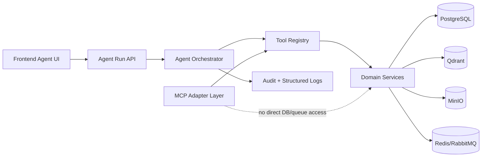
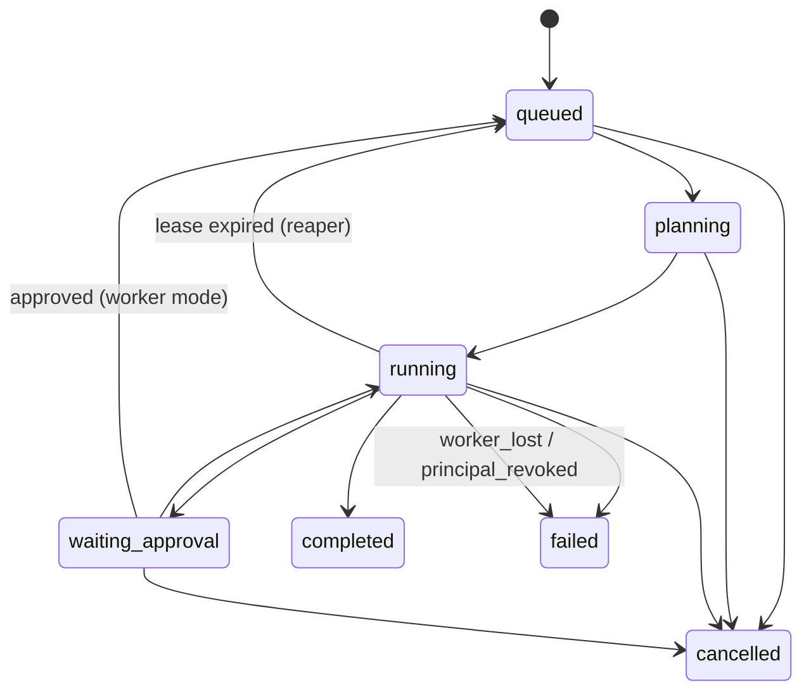

# 13. Agentic Architecture and Capability Model

## Objective

Define the Rudix agent runtime shape before exposing autonomous workflows:

- capability model and tool boundaries
- state model for agent runs and tool calls
- read-only vs side-effect policy
- budgets, redaction, and safe error behavior
- MCP separation while sharing reusable domain internals

This document describes architecture and guardrails. It does not require MCP at runtime for core API flows.

## Architecture Overview



## Core Concepts

### ToolSpec

`ToolSpec` defines:

- name, capability label, and description
- effect policy (`read_only` or `side_effect`)
- required roles
- organization scope requirement
- allowed surfaces (`api`, `mcp`)
- budget limits and redaction policy

### ToolCall

`ToolCall` includes:

- run ID and call ID
- tool name
- organization and user context
- arguments payload
- requested effect policy (optional)
- idempotency key (required for side-effect tools)

### ToolResult

`ToolResult` includes:

- success/failure outcome
- redacted output payload
- safe error object with code, message, request ID, retryability
- optional latency

## Capability Model

Initial capability map for existing Rudix internals:

| Capability                        | Candidate tool                                                    | Effect    | Surfaces |
| --------------------------------- | ----------------------------------------------------------------- | --------- | -------- |
| Document read                     | `documents.list`, `documents.get`, `documents.chunks.list`        | read_only | api, mcp |
| Document intelligence (read-only) | `search_documents`, `get_document_detail`, `list_document_chunks` | read_only | api, mcp |
| Grounded read-only reasoning      | `answer_from_context`, `summarize_document`, `compare_documents`  | read_only | api, mcp |

MCP public naming may expose aliases for client ergonomics while keeping the
same internal ToolSpec boundaries. Current MCP aliases:

- `ask_documents` -> `answer_from_context`
- `get_document_chunks` -> `list_document_chunks`
- `summarize` -> `summarize_document`
- `compare` -> `compare_documents`
  | Chat retrieval/answer | `chat.answer` | side_effect | api |
  | Evaluation execution | `evaluations.run` | side_effect | api |
  | Pipeline observability | `pipeline.runs.get` | read_only | api, mcp |
  | Document lifecycle mutation | `documents.reindex`, `documents.delete` | side_effect | api |

## Read-only vs Side-effect Policy

1. Read-only tools may be exposed on API and MCP surfaces.
2. Side-effect tools remain API-only by default.
3. Side-effect calls require:
   - idempotency key
   - explicit authorization check
   - org-scope check
4. Side-effect retries must respect safe retry semantics and mutation idempotency.

## State Model



Inline mode (`AGENT_RUN_EXECUTION=inline`, the default) moves through `planning` and
`running` inside `POST /agent/runs`. Worker mode (R06-13) starts at `queued`; a task takes
the run's lease and moves it to `running`. A run is `running` only while a task holds the
lease (`lease_owner`, `lease_expires_at`); on exit the lease is cleared and the run is
`completed`, `failed`, `cancelled`, or `waiting_approval`. An approval puts a waiting run
back to `queued`; the reaper puts a run whose lease expired back to `queued`
(`resume_count + 1`) or fails it with `worker_lost` after `AGENT_RUN_MAX_RESUMES`.

## Worker Execution (R06-13)

With `AGENT_RUN_EXECUTION=worker`:

1. `POST /agent/runs` validates the request and checks the `agent_runs` quota as inline mode
   does, creates the run as `queued` with `request_snapshot` (the validated
   `AgentRuntimeRequest`, plus user, organisation, and roles at submission for audit only),
   records the quota, writes an outbox row for `agents.run.execute` (dedupe key: the run id)
   in the same transaction, commits, publishes, and returns `201` with `status: queued`.
2. `agents.run.execute(run_id, organization_id)` (`app/workers/agent_tasks.py`, body in
   `app/application/agents/worker_execution.py`) binds the tenant, raises `tenant_mismatch`
   for another organisation's run, and takes the lease with one conditional `UPDATE`
   (`queued`, or `running` with an expired lease or the same task id as owner).
3. The principal is rebuilt from the database: active user, current membership and role in
   the run's organisation, and a role every planned tool's `required_roles` accepts.
   Otherwise the run fails with `principal_revoked`.
4. `AgentRuntime.execute_queued` plans the run (no planning step yet) or resumes it: the
   plan is read from the planning step, completed steps are replayed into the runtime state
   and never executed again, and the loop continues at the first sequence without a
   completed step, reusing a step row a previous task left running or waiting.
5. Every step commits and renews the lease three times: when its row is running, after the
   tool call returns, and when it ends. A side-effect tool's idempotency key
   (`{run_id}:{sequence}:{tool}`) is stable across resumes; before running a side-effect
   tool the executor looks up a `succeeded` call with the same key
   (`idx_agent_tool_calls_run_idem`) and returns its stored result instead, after the role,
   organisation, and payload-budget checks. A side effect therefore runs once even when the
   worker dies right after it.
6. Authorization (`required_roles`, `principal.organization_id == call.organization_id`),
   payload and output budgets, redaction, and safe errors stay inside the executor path,
   exactly as inline. The runtime budget spans the whole run (earlier tasks' step durations
   count). Unexpected exceptions fail the run with `internal_error`; raw exceptions never
   reach results.
7. Beat task `agents.runs.reap` (every 60 s, maintenance session, `FOR UPDATE SKIP LOCKED`)
   re-queues running runs whose lease expired and fails them with `worker_lost` after
   `AGENT_RUN_MAX_RESUMES` (3).

Runtime modules: `runtime.py` (facade: `execute`, `execute_queued`, `fail_queued`),
`runtime_context.py` (state, budgets), `runtime_plan.py` (plan, arguments, observation),
`runtime_outcome.py` (complete, fail, cancel, usage event, audits), `runtime_steps.py`
(the step loop), `runtime_start.py` (preparation and planning step), `runtime_resume.py`
(resume). Settings: `AGENT_RUN_EXECUTION`, `CELERY_QUEUE_AGENTS`, `AGENT_RUN_LEASE_SECONDS`,
`AGENT_RUN_MAX_RESUMES`, `AGENT_RUN_REAP_INTERVAL_SECONDS`, `AGENT_RUN_REAP_BATCH_SIZE`.

### Run stream

`GET /agent/runs/{run_id}/stream` sends Server-Sent Events in the 0.5.0 framing
(`id`/`event`/`data`): `agent.run.status`, `agent.step.started`, `agent.step.completed`,
`agent.run.waiting_approval`, and the terminal `agent.run.completed`, `agent.run.failed`,
`agent.run.cancelled`. The runtime (both modes) appends every event to a Redis list
(`AGENT_STREAM_BUFFER_TTL_SECONDS`) and publishes it on a channel keyed by organisation and
run; ids come from a per-run counter, so they increase across worker tasks. The endpoint
replays from `Last-Event-ID`, follows the channel, and ends after a terminal event. Without
Redis it polls `agent_runs` and `agent_steps` every `AGENT_STREAM_POLL_INTERVAL_MS`.
Payloads carry ids, statuses, tool names, counts, and safe error codes only (see
`docs/07_API_DESIGN.md`).

## Persistence and Trace Schema (F99)

Agent execution traces are persisted in organization-scoped tables:

- `agent_runs`
- `agent_steps`
- `agent_tool_calls`
- `agent_approvals`

Design constraints:

1. Every table carries `organization_id` and must be queried with org-scoped filters.
2. Status fields are constrained with explicit allowed values.
3. Inputs/outputs/errors are stored as sanitized JSON payloads only.
4. Idempotency keys are not stored in plaintext for tool calls (hashed at persistence boundary).
5. Indexes support common audit/ops reads:
   - organization + status
   - organization + user + created time
   - run + sequence/status

## Security and Threat Model

### Enforced Controls

- org isolation at tool-call authorization (`principal.organization_id == call.organization_id`)
- role checks per `ToolSpec.required_roles`
- no raw secret/token/document content in error/log payloads
- explicit redaction of sensitive keys and content-bearing fields

### Threats and Mitigations

| Threat                               | Mitigation                                                   |
| ------------------------------------ | ------------------------------------------------------------ |
| Cross-organization data access       | organization-scoped authorization gate before tool execution |
| Privilege escalation via tool misuse | role-gated `ToolSpec` checks                                 |
| Secret leakage in errors/logs        | metadata sanitization + explicit key redaction               |
| Unsafe replay of mutations           | required idempotency keys for side-effect tools              |
| Resource abuse                       | per-tool budgets (calls, payload sizes, timeout, retries)    |

## Budgets and Safe Errors

Per-tool budget controls:

- max calls per run
- max input bytes
- max output bytes
- timeout (ms)
- retry attempts

Validation and execution errors must return safe errors only:

- `validation_failed`
- `authorization_failed`
- `approval_required`
- `budget_exceeded`
- `tool_unavailable`
- `internal_error`

Safe errors may contain a request ID and sanitized details, but never secrets or raw protected content.

## Human Approval and Safety Guardrails (F105)

### Approval Flow

1. Tools marked `approval_required=true` cannot execute without an approved `AgentApproval` record.
2. If a required approval is missing, the executor creates a `pending` approval and returns a safe `approval_required` error.
3. Runtime transitions run/step to `waiting_approval` and exposes pending approval metadata through run detail.
4. Owners/admins decide pending approvals via:
   - `POST /api/v1/agent/runs/{run_id}/approvals/{approval_id}/decision`
   - body: `{ "status": "approved" | "rejected", "reason"?: "...", "decision_payload"?: { ... } }`
5. Approval request/decision events are audit logged:
   - `agent.approval.requested`
   - `agent.approval.approved`
   - `agent.approval.rejected`
6. Resume (R06-13): in worker mode, approving a `waiting_approval` run moves it back to
   `queued` and writes an outbox row for `agents.run.resume` (dedupe key: the approval id)
   in the decision's transaction. The resume task checks the approval is `approved`, adds it
   to the snapshot's `approval_ids` under its tool name, takes the lease, and continues the
   run from the waiting step; the executor's approval check then passes. Inline mode keeps
   the 0.5.0 behaviour (resubmit with `request.approval_ids`). Rejected and expired
   approvals fail the run in both modes.

### Prompt-Injection Defenses

Runtime applies a heuristic request guard before planning/execution:

- blocks known instruction-override patterns in objective/question/query
- returns safe `prompt_injection_blocked` runtime error without echoing raw malicious prompt text

### Document-Sourced Instruction Blocking

When observing document search output, runtime only consumes validated UUID document IDs and indexed status for downstream selection.
Instruction-like document payload text is treated as untrusted signal and never used as executable tool directives.

## MCP Separation Model

Worker execution (R06-13) changes no `ToolSpec.surfaces` and no MCP adapter: the MCP tool
list is the same before and after (`tests/test_agent_runtime_split_compat.py`), and
side-effect tools stay API-only. MCP tool calls run without a database session, so the
idempotency reuse of side-effect calls never applies to them.

Diagrams for standard MCP host/client/server components, Rudix module mapping,
tool/resource/prompt sequences, and deployment modes are in
[15_MCP_SERVER_DEPLOYMENT_MODE.md](./15_MCP_SERVER_DEPLOYMENT_MODE.md)
(reference: [MCP Architecture and Components](https://chatgpt.com/share/6a117df8-0808-83eb-9e15-78dff162d648)).

MCP is an adapter surface, not the core execution boundary:

1. Core agent contracts (`ToolSpec`, `ToolCall`, `ToolResult`) live in backend domain code.
2. API runtime and MCP adapters both call the same domain services and policy checks.
3. MCP tools do not bypass authz, org isolation, budget checks, or redaction.
4. MCP exposure is configured per-tool via `ToolSpec.surfaces`.

### MCP Prompt Template Layer (F111)

MCP prompt templates are a separate surface that provides reusable,
provider-neutral workflow instructions for common grounded tasks:

- grounded Q&A
- summarization
- comparison
- obligations/action-item extraction
- evidence lookup

Prompt templates are not executable tools by themselves. They:

1. accept validated, typed parameters (query/document_ids/style/format)
2. require MCP authentication, organization context, capability checks, and rate limits
3. guide clients to call safe read-only MCP tools/resources
4. avoid exposing tokens, raw protected document text, or secret values

This keeps prompt ergonomics high while preserving the same security and policy
boundaries used for MCP tool execution.

## Internal Execution Contract (F100)

Rudix uses one internal tool layer for both agent runtime and MCP adapters:

1. `ToolRegistry` is the allowlist boundary. Unknown tools are rejected as unavailable.
2. `AgentToolExecutor` is the execution boundary and enforces:
   - per-tool authorization and org isolation
   - approval requirement for tools marked `approval_required=true`
   - call budget limits (`max_calls_per_run`, payload size, timeout)
   - structured `ToolResult` success/failure output
3. Execution wrappers include timeout handling, safe error mapping, and audit events.
4. Side-effect tools must include idempotency keys; selected side-effect tools can additionally require approval IDs.
5. Persisted tool-call traces store sanitized payloads and hashed idempotency keys only.

### External MCP client connector (F112)

Rudix can optionally register approved tools from external MCP servers into the
same internal `ToolRegistry` used by agent runtime:

1. Server registry is environment-driven (`MCP_EXTERNAL_SERVERS`) and disabled by default.
2. Only `allow_tools` entries are exposed; non-allowlisted remote tools are ignored.
3. Tool policy is explicit:
   - names in `read_only_tools` map to `read_only`
   - all other allowlisted tools map to `side_effect`
4. Side-effect external tools require approval by default
   (`approval_required_for_side_effect=true`).
5. External discovery schema drift fails safely:
   - broken servers are skipped
   - agent runtime continues with internal tools only
6. External call traces are logged as sanitized operational events
   (`agent.external_mcp.*`) without raw tokens or protected text.

### Admin governance control plane (F113)

Rudix exposes an organization-scoped admin control plane for agent/MCP policy:

1. `GET /api/v1/admin/governance` returns:
   - effective org policy (agentic mode, MCP exposure, allowlisted tools, budgets)
   - external MCP server metadata (secret references only)
   - MCP endpoint status snapshot from deployment settings
   - policy warnings and tool catalog metadata
2. `PATCH /api/v1/admin/governance` updates policy under `owner|admin` guardrails.
3. Side-effect tools require explicit warning acknowledgment in update requests.
4. All policy mutations emit sanitized audit events:
   - `action=admin.governance.policy.updated`
   - no raw credentials/tokens in metadata.
5. Policy APIs are organization-scoped and follow safe 403/404 boundaries for unauthorized/cross-org access.

## Planner/Executor Loop (F102)

`AgentRuntime` implements a persisted plan-act-observe loop:

1. Resolve the active organization `agent_planning` prompt template version.
2. Create `agent_runs` row in `planning` state with runtime budgets and `prompt_template_version_id`.
3. Build a typed tool plan (`PlannedToolSelection`) from objective and mode.
4. Persist planning step and transition run to `running`.
5. For each planned step:
   - enforce runtime and budget constraints (steps/runtime/tool calls/tokens/cost)
   - check cancellation signal and persisted cancellation status
   - execute tool via `AgentToolExecutor`
   - persist step outcome (`completed` or `failed`) with sanitized outputs/metrics
   - accumulate usage/cost from structured tool debug usage fields
6. Complete run with final outcome (answer + citations + confidence) or fail/cancel with safe error payload.

This loop reuses the same org authorization, redaction, and audit boundaries as the tool executor.
In worker mode the same loop runs in `agents.run.execute`, committing after every step and
resuming after the last completed one (see Worker Execution).

## Observability, Audit, and Metrics (F106)

Agentic execution emits three organization-scoped usage event types:

- `agent.runtime`
- `agent.tool_call`
- `agent.approval`

Runtime and executor persist only sanitized operational metadata:

- run/step/tool/approval status
- step and tool-call counts
- token and cost totals
- confidence score/category
- safe error code
- request correlation ID

Raw prompt text, document body, tokens/credentials, and full answer text are not written into usage/audit payloads.

### Admin diagnostics

Owners/admins can query:

- `GET /api/v1/admin/agent/diagnostics`

The response includes:

- run lifecycle counters (`completed`, `failed`, `waiting_approval`, `cancelled`)
- tool-call success/failure metrics
- approval requested/approved/rejected metrics
- total tokens, total cost, and average confidence
- error-code breakdown (`errors_by_code`)
- grouped agent audit action counts (`audit_actions`)

Diagnostics are organization-scoped and reuse admin role guards.

## Configuration Example

```env
FEATURE_ENABLE_AGENTS=false
AGENT_MAX_STEPS=12
AGENT_MAX_PARALLEL_TOOL_CALLS=4
AGENT_TOOL_MAX_CALLS_PER_RUN=30
AGENT_TOOL_TIMEOUT_MS=8000
AGENT_TOOL_MAX_INPUT_BYTES=32768
AGENT_TOOL_MAX_OUTPUT_BYTES=65536
AGENT_TOOL_MAX_RETRY_ATTEMPTS=1
AGENT_PROMPT_INJECTION_GUARD_ENABLED=true
AGENT_DOCUMENT_INSTRUCTION_GUARD_ENABLED=true
FEATURE_ENABLE_EXTERNAL_MCP_CONNECTORS=false
MCP_EXTERNAL_SERVERS=[]
```

## Testing Expectations

Minimum automated coverage:

1. successful tool-call contract validation and redacted success output
2. validation failure (mismatched tool spec or missing idempotency key)
3. authorization failure (role check and cross-org isolation)
4. safe error redaction behavior for nested sensitive payloads
