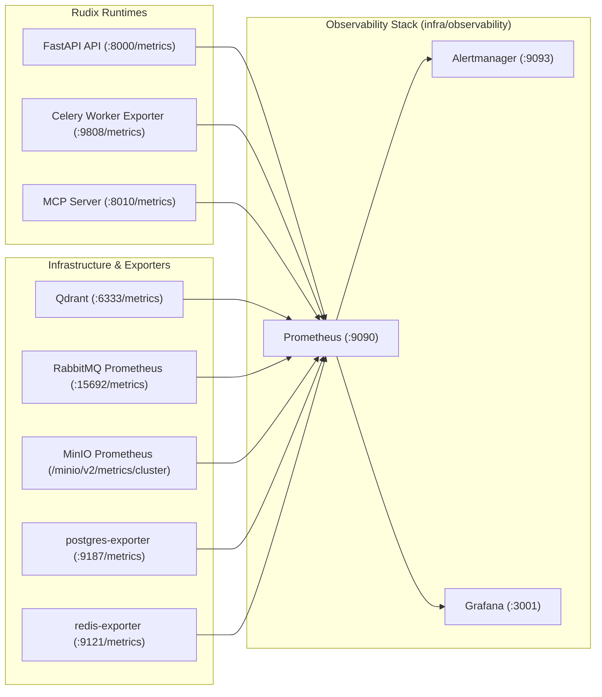

# 25 — Prometheus and Grafana Observability Plan

## Metadata

- `Owner`: `Rudix Platform & Observability Team`
- `Status`: `Implemented (development overlay); staging and production rollout planned`
- `Last Updated`: `2026-11-26`
- `Related Docs`: [01_ARCHITECTURE_OVERVIEW.md](./01_ARCHITECTURE_OVERVIEW.md), [10_DEPLOYMENT_DOCKER.md](./10_DEPLOYMENT_DOCKER.md), [11_SECURITY_AND_PRODUCTION_CHECKLIST.md](./11_SECURITY_AND_PRODUCTION_CHECKLIST.md), [12_EVALUATION_AND_MONITORING.md](./12_EVALUATION_AND_MONITORING.md), [18_LANGFUSE_OBSERVABILITY.md](./18_LANGFUSE_OBSERVABILITY.md)

> [!NOTE]
> **Implementation Status:** Implemented for the development overlay (`make up-observability`): Prometheus, Alertmanager, Grafana (5 pre-provisioned dashboards), the Postgres and Redis exporters, the `/metrics` endpoint, Celery worker metrics hooks, the `METRICS_*` settings in `.env.example` and `app/core/config.py`, CI dashboard JSON validation, and the release `/metrics` smoke check. **Planned:** Prometheus and Grafana services in the staging and production Compose files and deployment, and scrape authentication over untrusted networks.

---

## 1. Purpose

Define a production-grade, multi-tenant-safe Prometheus and Grafana observability stack for Rudix that complements existing structured logging, Sentry error tracking, Langfuse LLM tracing, and PostgreSQL usage analytics.

Prometheus and Grafana address real-time time-series operational telemetry:

- Sub-minute RED (Rate, Errors, Duration) metrics for FastAPI HTTP and MCP endpoints.
- Stage-by-stage RAG query and document ingestion latency histograms, token rates, confidence distributions, and fallback/not-found counters.
- Celery worker task throughput, retry spikes, failure rates, and RabbitMQ queue depth/consumer lag.
- Infrastructure saturation and health across PostgreSQL, Qdrant, Redis, RabbitMQ, MinIO, ClamAV, and optional Neo4j / local LLM runtimes.
- Automated SLO burn-rate alerting and provisioned Grafana dashboards as code.

---

## 2. Scope

### In Scope

- Backend Prometheus instrumentation (`prometheus-client`) for FastAPI (`api`), Celery (`worker`), and standalone MCP (`mcp`).
- Native and exporter-based scrape targets for infrastructure dependencies (`qdrant`, `rabbitmq`, `minio`, `postgres`, `redis`).
- Isolated or profile-driven Docker Compose stack (`infra/observability/docker-compose.yml` or `--profile monitoring`).
- Provisioned Grafana data sources, dashboards-as-code, and Prometheus alerting rules mapped to Rudix production SLOs.
- Cardinality, multi-tenant privacy, and endpoint authentication controls.

### Out of Scope

- Replacing PostgreSQL `usage_events` or `audit_logs` for per-organization billing, quota enforcement, or compliance audit trails.
- Replacing Langfuse for full prompt/response span inspection or Sentry for stack-trace debugging.
- High-cardinality per-document or per-user time-series slicing in Prometheus.

---

## 3. Assumptions and Constraints

1. **Optional runtime dependency**: Like Langfuse and Sentry, Prometheus metrics collection MUST be controlled by environment variables (`METRICS_ENABLED=false` by default or opt-in per environment) and MUST degrade to a zero-overhead no-op when disabled.
2. **Strict label cardinality**: Prometheus labels MUST NEVER include unbounded identifiers (`request_id`, `user_id`, `document_id`, `chunk_id`, `session_id`, `message_id`, or raw URL paths with UUIDs). FastAPI route templates (for example `/api/v1/documents/{document_id}`) MUST be used instead of raw paths.
3. **Tenant label policy**: `organization_id` MUST NOT be attached to high-frequency Prometheus histograms by default to avoid cardinality explosion in multi-tenant deployments. Per-organization analytics remain in PostgreSQL (`GET /api/v1/admin/observability`).
4. **Multi-process worker safety**: Celery prefork workers require either `PROMETHEUS_MULTIPROC_DIR` shared tmpfs aggregation, a dedicated Celery exporter sidecar (`celery-exporter`), or a worker HTTP metrics server per container.
5. **Backward compatibility**: Adding `/metrics` or `infra/observability` MUST NOT alter existing `/api/v1/health`, `/api/v1/ready`, or `/api/v1/admin/observability` contracts.

---

## 4. Design or Procedure

### 4.1 Architecture Topology



### 4.2 Metric Taxonomy and Naming Conventions

All application metrics MUST use the `rudix_` namespace and base units (`_seconds`, `_bytes`, `_total`, `_ratio`).

#### A. FastAPI HTTP & Auth/Rate-Limit Metrics

| Metric Name | Type | Labels | Description |
|---|---|---|---|
| `rudix_http_requests_total` | Counter | `method`, `route`, `status_code` | Total HTTP requests by normalized route template |
| `rudix_http_request_duration_seconds` | Histogram | `method`, `route` | End-to-end HTTP latency (`0.01, 0.05, 0.1, 0.25, 0.5, 1, 2.5, 5, 10, 30`) |
| `rudix_http_requests_in_progress` | Gauge | `method`, `route` | Concurrent in-flight HTTP requests |
| `rudix_rate_limit_decisions_total` | Counter | `scope`, `decision`, `failure_mode` | Redis rate-limit outcomes (`allowed`, `rejected`, `redis_error`) |
| `rudix_auth_verifications_total` | Counter | `provider`, `outcome` | Auth token verification outcomes (`success`, `expired`, `invalid`) |
| `rudix_authz_decisions_total` | Counter | `resource_type`, `action`, `decision`, `deny_reason` | Authorization policy decisions including `tenant_boundary` |

#### B. RAG Query, Retrieval, and LLM Metrics

| Metric Name | Type | Labels | Description |
|---|---|---|---|
| `rudix_rag_query_duration_seconds` | Histogram | `scope_mode`, `status` | Total RAG chat query execution latency |
| `rudix_rag_stage_duration_seconds` | Histogram | `stage`, `provider` | Per-stage latency (`embed`, `retrieve`, `rerank`, `conflict_check`, `llm`, `citations`) |
| `rudix_rag_answers_total` | Counter | `scope_mode`, `confidence_category`, `not_found`, `fallback_used` | Completed RAG answers by grounding outcome |
| `rudix_rag_confidence_score` | Histogram | `scope_mode` | Distribution of answer confidence scores (`0.1` to `1.0` buckets) |
| `rudix_rag_citation_validation_failures_total` | Counter | `reason` | Responses where cited chunk IDs failed validation |
| `rudix_retrieval_branch_failures_total` | Counter | `branch`, `error` | Retrieval branch attempts that failed or timed out and were degraded to partial results |
| `rudix_eval_index_cleanup_failures_total` | Counter | `store` | Per-document evaluation index cleanup steps that failed (`qdrant` or `postgres`); the run still completes |
| `rudix_llm_requests_total` | Counter | `provider`, `model`, `operation`, `status` | LLM and embedding provider calls (`chat`, `embed`, `rerank`) |
| `rudix_llm_tokens_total` | Counter | `provider`, `model`, `direction` | Token consumption (`input`, `output`, `embedding`) |
| `rudix_llm_estimated_cost_usd_total` | Counter | `provider`, `model` | Cumulative estimated USD spend |
| `rudix_llm_retries_total` | Counter | `provider`, `model`, `reason` | Provider retry events (`timeout`, `rate_limit`, `5xx`) |

#### C. Document Ingestion & Chunking Pipeline Metrics

| Metric Name | Type | Labels | Description |
|---|---|---|---|
| `rudix_document_uploads_total` | Counter | `file_type`, `status`, `malware_scan_result` | Upload validation and ClamAV scan outcomes |
| `rudix_document_indexing_jobs_total` | Counter | `task_type`, `file_type`, `status` | Ingestion/reindex/delete job outcomes |
| `rudix_documents_reaped_total` | Counter | `outcome` | Stale processing documents re-queued or failed by the reaper (`requeued`, `failed`, `enqueue_error`) |
| `rudix_document_indexing_duration_seconds` | Histogram | `stage`, `file_type` | Duration by stage (`extract`, `ocr`, `chunk`, `embed`, `qdrant_upsert`) |
| `rudix_document_chunks_generated` | Histogram | `strategy`, `file_type` | Chunks produced per document |
| `rudix_ocr_pages_processed_total` | Counter | `language`, `status` | OCR page processing counts and timeouts |

#### D. Celery Worker, Agentic Runtime, Connectors, and Bots

| Metric Name | Type | Labels | Description |
|---|---|---|---|
| `rudix_celery_tasks_total` | Counter | `task_name`, `queue`, `status` | Worker task executions (`started`, `succeeded`, `retried`, `failed`) |
| `rudix_celery_task_duration_seconds` | Histogram | `task_name`, `queue` | Worker task execution time |
| `rudix_agent_runs_total` | Counter | `status` | Agentic workflow runs |
| `rudix_agent_tool_calls_total` | Counter | `tool_name`, `surface`, `effect`, `status` | Agent and MCP tool invocations (`api` vs `mcp`) |
| `rudix_connector_sync_runs_total` | Counter | `provider_key`, `status` | External connector sync outcomes |
| `rudix_bot_asks_total` | Counter | `provider`, `outcome` | Slack and Microsoft Teams ask outcomes |
| `rudix_dependency_readiness` | Gauge | `dependency` | Readiness probe state (`1` healthy, `0` degraded) |

### 4.3 Infrastructure Scrape Targets

1. **Qdrant** (`qdrant:6333/metrics`): Native Prometheus endpoint exposing vector count, search latency, HNSW indexing status, and memory/disk metrics.
2. **RabbitMQ** (`rabbitmq:15692/metrics`): Enable the built-in `rabbitmq_prometheus` plugin to track per-queue depth (`documents.processing`, `documents.deletion`, `documents.reindex`, `evaluations`, `connectors.sync`, `email`), unacknowledged messages, and consumer count.
3. **MinIO** (`minio:9000/minio/v2/metrics/cluster`): Native Prometheus endpoint for storage capacity, bucket object counts, and S3 API latency.
4. **PostgreSQL** (`postgres-exporter:9187/metrics`): Tracks active/idle SQLAlchemy pool connections, transaction rates, deadlocks, slow queries, and table sizes.
5. **Redis** (`redis-exporter:9121/metrics`): Tracks memory usage, keyspace hit/miss ratio, evicted keys, and connected clients.
6. **Optional Profiles**:
   - `vllm:8000/metrics` and `litellm:4000/metrics` when local LLM profiles are active.
   - `neo4j` metrics when enterprise graph is enabled.

### 4.4 Configuration Variables

Defined in `.env.example` and `backend/app/core/config.py`:

```env
# Prometheus & Grafana Observability
METRICS_ENABLED=false
METRICS_PATH=/metrics
METRICS_REQUIRE_AUTH=false
METRICS_BEARER_TOKEN=
WORKER_METRICS_ENABLED=false
WORKER_METRICS_PORT=9808

PROMETHEUS_PORT=9090
PROMETHEUS_RETENTION_TIME=15d
GRAFANA_PORT=3001
GRAFANA_ADMIN_USER=admin
# WARNING: change before non-local use — never commit real passwords
GRAFANA_ADMIN_PASSWORD=change-me-in-production
```

### 4.5 Grafana Dashboard Suite

Provisioned as JSON under `infra/observability/grafana/dashboards/`:

1. **`01-rudix-executive-slo.json` (Executive & SLO Overview)**:
   - API availability (99.5% SLO), Chat p95 latency (< 5s SLO), Indexing success rate (> 98% SLO), Failed task rate (< 2% SLO), active alerts, and dependency readiness matrix.
2. **`02-rudix-rag-llm-performance.json` (RAG & LLM Pipeline)**:
   - Stage latency waterfall (`embed` -> `retrieve` -> `rerank` -> `llm` -> `citations`), confidence distribution, not-found vs grounded ratio, citation validation failures, token throughput, and estimated USD cost rate by model/provider.
3. **`03-rudix-ingestion-workers.json` (Document Ingestion & Celery Queues)**:
   - RabbitMQ queue depth per routing key, Celery task rate/retries/failures, extraction/OCR/chunking stage durations, and ClamAV scan latency/rejections.
4. **`04-rudix-data-stores.json` (Infrastructure & Storage)**:
   - PostgreSQL connections & query rate, Qdrant vector search p95 & point counts, Redis memory & cache hit ratio, and MinIO bucket capacity.
5. **`05-rudix-security-governance.json` (Security, Rate Limits & Agentic Guardrails)**:
   - Rate-limit rejections (`429`), auth verification failures, cross-tenant `tenant_boundary` denials, malware scan detections, and MCP/agent tool budget rejections.

### 4.6 Configuration Defaults and Pipeline Variables

The observability stack provides zero-config defaults for local development while supporting strict authentication and retention controls in staging and production.

#### Default Values Reference

| Component | Variable | Default Value | Description & Production Override |
|---|---|---|---|
| **API** | `METRICS_ENABLED` | `false` | Set to `true` to enable `/metrics` endpoint. |
| | `METRICS_PATH` | `/metrics` | Normalized scrape endpoint route. |
| | `METRICS_REQUIRE_AUTH` | `false` | When `false`, scraping requires no token. Set to `true` in production if scraped over untrusted networks. |
| | `METRICS_BEARER_TOKEN` | `None` | Secret bearer token required when `METRICS_REQUIRE_AUTH=true`. |
| **Workers** | `WORKER_METRICS_ENABLED` | `false` | Starts dedicated Prometheus HTTP server on Celery workers. |
| | `WORKER_METRICS_PORT` | `9808` | HTTP listener port on worker container. |
| **Prometheus** | `PROMETHEUS_PORT` | `9090` | Host port for Prometheus web UI and API. |
| | `PROMETHEUS_RETENTION_TIME` | `15d` | TSDB retention period (`30d` or `90d` in production). |
| | `PROMETHEUS_RETENTION_SIZE` | `10GB` | TSDB maximum disk usage cap. |
| **Alertmanager** | `ALERTMANAGER_PORT` | `9093` | Host port for Alertmanager UI and webhooks. |
| **Grafana** | `GRAFANA_PORT` | `3001` | Host port for Grafana dashboards. |
| | `GRAFANA_ADMIN_USER` | `admin` | Initial admin username. |
| | `GRAFANA_ADMIN_PASSWORD` | `change-me-in-production` | **Must override** in non-local environments. |
| **Exporters** | `POSTGRES_USER` / `POSTGRES_PASSWORD` | `postgres` / `postgres` | Credentials matching local PostgreSQL container. |
| | `POSTGRES_DB` | `rag_app` | Target database for connection pool metrics. |
| | `REDIS_ADDR` | `redis://redis:6379` | Host and port for Redis exporter. |

#### CI/CD Pipeline Integration

- **`.github/workflows/ci.yml`**:
  - Automatically triggers on changes to `infra/**`.
  - Runs JSON schema validation on all 5 Grafana dashboards.
  - Runs `ci/scripts/validate_env_examples.sh` to ensure `METRICS_ENABLED` is maintained across `.env.example`.
- **`.github/workflows/release.yml`**:
  - Sets `METRICS_ENABLED=true` and `METRICS_PATH=/metrics` in `.env.ci.integration`.
  - Smoke tests `/metrics` verifying that standard counters (`rudix_http_requests_total`) are exposed before promoting a release.
- **Pipeline Deployment Variables (GitHub Secrets)**:
  - `STAGING_ENV_FILE` / `PRODUCTION_ENV_FILE`: Append `METRICS_ENABLED=true`, `WORKER_METRICS_ENABLED=true`, and if auth-gated: `METRICS_REQUIRE_AUTH=true` and `METRICS_BEARER_TOKEN=<secret>`.

### 4.7 Phased Implementation

Phases 1-4 are completed and verified for the development overlay:
1. **Phase 1 — Backend Metrics Core & `/metrics` Endpoint** (Completed, development overlay)
2. **Phase 2 — Domain & Worker Instrumentation** (Completed, development overlay)
3. **Phase 3 — Compose Stack, Exporters, Dashboards & Alerts** (Completed, development overlay)
4. **Phase 4 — Verification & CI Validation** (Completed, development overlay)
5. **Phase 5 — Staging and production rollout** (Planned)

---

## 5. Failure Modes and Recovery

| Failure Mode | Impact | Recovery / Mitigation |
|---|---|---|
| Prometheus container down or disk full | Historical metrics gap; **zero impact** on Rudix API or workers (pull model) | Restart Prometheus; enforce `--storage.tsdb.retention.time=15d` and `--storage.tsdb.retention.size=10GB`. |
| High-cardinality label introduced | Prometheus memory spike | Unit test allowlist on metric label keys; drop offending label via Prometheus `metric_relabel_configs`. |
| Worker metrics port collision in multi-worker host | Worker startup warning if port is bound | Catch `OSError` in worker metrics server startup so Celery worker continues processing tasks even if metrics port fails to bind. |

---

## 6. Security Considerations

1. **No PII, secrets, or document content**: Metric names and labels MUST NEVER contain prompts, questions, answers, filenames, emails, tokens, or raw error messages.
2. **No high-cardinality or enumerable tenant UUIDs**: Do not expose `user_id`, `document_id`, `chunk_id`, or `request_id` in Prometheus labels.
3. **Protected scrape endpoints**:
   - In production, `/metrics`, `:9090` (Prometheus), `:9187` (Postgres exporter), `:9121` (Redis exporter), and `:9808` (Worker metrics) MUST stay on the internal Docker/VPC network and MUST NOT be exposed on public ingress.
   - When scraping crosses network boundaries, set `METRICS_REQUIRE_AUTH=true` and configure `METRICS_BEARER_TOKEN` in Prometheus `authorization` scrape config.
4. **Grafana hardening**:
   - Disable anonymous access (`GF_AUTH_ANONYMOUS_ENABLED=false`).
   - Require strong `GRAFANA_ADMIN_PASSWORD` in `.env` (never commit real secrets).
   - Place Grafana behind TLS reverse proxy or VPN/SSO in staging and production.

---

## 7. Observability and Operations

### SLO Alert Rules (`infra/observability/prometheus/alerts.yml`)

| Alert Name | Expression / Condition | Window | Severity |
|---|---|---|---|
| `RudixApiHighErrorRate` | `sum(rate(rudix_http_requests_total{status_code=~"5.."}[5m])) / sum(rate(rudix_http_requests_total[5m])) > 0.005` | `5m` | `critical` |
| `RudixChatP95LatencyHigh` | `histogram_quantile(0.95, sum(rate(rudix_rag_query_duration_seconds_bucket[5m])) by (le)) > 5.0` | `10m` | `warning` |
| `RudixDocumentIndexingFailureRateHigh` | `sum(rate(rudix_document_indexing_jobs_total{status="failed"}[15m])) / sum(rate(rudix_document_indexing_jobs_total[15m])) > 0.02` | `15m` | `critical` |
| `RudixCeleryQueueBacklog` | `rabbitmq_queue_messages_ready{queue=~"documents\\..*|evaluations"} > 100` | `10m` | `warning` |
| `RudixLlmProviderErrorSpike` | `sum(rate(rudix_llm_requests_total{status="error"}[5m])) by (provider) / sum(rate(rudix_llm_requests_total[5m])) by (provider) > 0.05` | `5m` | `warning` |
| `RudixDependencyUnhealthy` | `rudix_dependency_readiness == 0` | `2m` | `critical` |

---

## 8. Open Questions

1. **Standalone vs Compose Profile**: Should Prometheus + Grafana live in `infra/observability/docker-compose.yml` (matching `infra/langfuse/docker-compose.yml`) or as a `--profile observability` block in root `docker-compose.yml`?
   - *Recommendation*: Use `infra/observability/docker-compose.yml` with root `Makefile` helpers (`make up-observability`) so exporters and dashboards remain modular and do not bloat the root `docker-compose.yml`.
2. **Celery Worker Metrics Strategy**: Should worker metrics use an in-process HTTP server per worker container (`WORKER_METRICS_PORT=9808`) or a standalone `danihodovic/celery-exporter` container listening to Celery events?
   - *Recommendation*: Support both — an in-process Prometheus registry for custom RAG ingestion stage histograms (`rudix_document_indexing_duration_seconds`) plus RabbitMQ native queue metrics.

---

## 9. Change Notes

- `2026-11-08`: Initial architecture and implementation plan created for Prometheus and Grafana observability integration.
- `2026-11-26`: Aligned status wording: implemented as a development overlay; staging and production rollout planned (R02-14).
