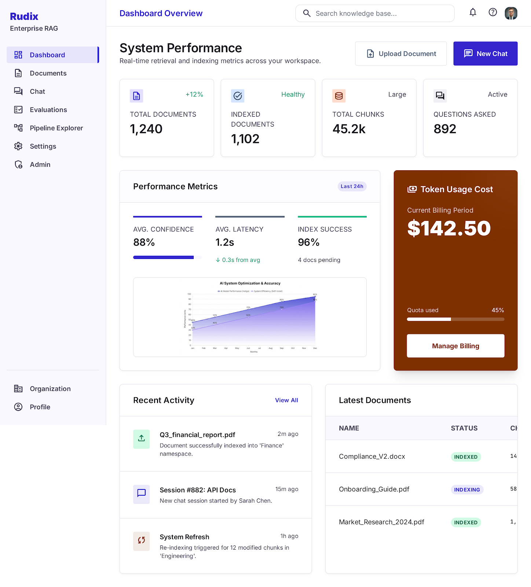

# Frontend

Next.js frontend for Rudix. The current implementation includes an authenticated application shell, login session flows (accounts are created by admins; there is no self-registration), the Documents workspace at `/documents`, the Graph Explorer at `/graph`, and the Pipeline Explorer at `/rag-pipeline`.

## Stack

- Next.js App Router
- React + TypeScript
- Tailwind CSS v4
- React Flow (`@xyflow/react`)
- TanStack Query
- React Hook Form + Zod
- Vitest + Testing Library
- Playwright

## Implemented Pages

- Public marketing routes (outside the authenticated app shell):
  - `/` landing page
  - `/product`
  - `/solutions`
  - `/security`
- `/pricing` (configurable/contact-placeholder packaging)
- `/contact` (validated contact/demo form)
- `/demo` (alias redirect to `/contact`)
- `/status` public service-status page backed by the public status API and linked from the footer/help menu
- `/changelog`
- `/login` credential-based sign-in form with auth-provider entry points
- `/signup` compatibility redirect to `/login` (self-registration is disabled; admins invite users)
- `/organization-onboarding` authenticated workspace setup flow (workspace, domain allowlist, access defaults, invites)
- `/onboarding` compatibility redirect to `/organization-onboarding`
- `/forbidden` unauthorized route destination
- `/403` alias route for forbidden destination
- Protected product pages inside the shared shell:
  - `/dashboard`
  - `/documents`
  - `/graph`
  - `/graph/entities/[entityId]`
  - `/chat`
    - module map (`src/components/chat/`): `ChatPage.tsx` is the route shell (and re-exports `toTurnResponseFromHistoryMessage`); `ChatSidebar` (session list, search, rename/delete), `ChatHeader`, `ChatThread` > `ChatTurnItem` (+ `ChatCitationChips`, `ChatTurnActions`) and `StreamingMessage` (in-progress turn), `ChatComposerPane` > `ChatComposer` (+ `ChatComposerCommands` settings popover), `EvidenceAside` (`CitationDetails`, `KnowledgeHub`, `AgentRunTimeline`, `RetrievalDebug`), `ScopeControls` (+ `ScopeConnectorSection`), `TrustPanelModal`, `DeleteSessionModal` and `ChatFeedbackModals`
    - hooks (`chat/hooks/`): `useChatSession` (sessions query, selection, `?session_id` URL sync, history, mutations), `useChatSettings` (persisted per organisation and user), `useChatScope` + `useChatSourceQueries` + `useContextModal`, `useChatStream` (one interface over `useChatWebSocket` or the HTTP mutation, chosen by `NEXT_PUBLIC_CHAT_WEBSOCKET_ENABLED`), `useChatSubmit`, `useChatFeedback`, `useChatOverlays`, `useCitationPanel`, `useAgentRunTimeline`
    - pure helpers: `chat-types.ts`, `chat-format.ts`, `chat-citations.ts`, `chat-turns.ts`, `chat-connectors.ts`, `chat-session-utils.ts`
    - `AnswerTrustPanel` keeps its props and composes the sections in `chat/trust-panel/` (confidence, sources, retrieval diagnostics, model, GraphRAG, policy, conflicts, verification, planner/critic, tool orchestration); the answer-explanation dialog loads it with `React.lazy` and a `Suspense` fallback
    - streaming render (R05-11): `generation.delta` text goes into a ref-backed store (`src/lib/chat/streaming-text-store.ts`) that notifies at most once per animation frame (16 ms timer without `requestAnimationFrame`); `StreamingMessage` is its only subscriber (`useSyncExternalStore`), so a token re-renders nothing else. `generation.replace` replaces all streamed text, `generation.final` sets the authoritative text; until then the text is provisional (`data-stream-state="provisional"`, no citation markers) and `chat.completed` still produces the finished turn. `useChatWebSocket().partialAnswer` is a live getter over the store
    - `ChatTurnItem` is `React.memo` with primitive props and one stable handlers object (`useChatTurnHandlers`); threads with more than `NEXT_PUBLIC_CHAT_VIRTUALIZE_MIN_TURNS` turns (default `50`) are virtualised with `@tanstack/react-virtual` (`ChatTurnRows`, rows measured with `measureElement`)
    - history loads newest page first (`GET /chat/sessions/{id}/messages?order=desc`, `NEXT_PUBLIC_CHAT_HISTORY_PAGE_SIZE` messages, default `100`, max `500`); scrolling to the top (or "Load earlier messages") loads the next older page by cursor and keeps the scroll position (`chat-history.ts`, `useChatHistoryPages`, `useThreadScroll`). The view follows new content only while the user is at the bottom, and never smooth-scrolls per token
    - reconnect (R05-13): after an unexpected close during a run, `ChatWSClient` reconnects with exponential backoff and full jitter (500 ms base, 15 s cap, 8 attempts; `reconnect` option), a fresh ticket per attempt, and sends `chat.resume` with the `message_id` and last `stream_sequence`; the hook discards events whose `(message_id, stream_sequence)` it already applied and any second terminal event. Close codes `4401`, `4403`, `4503` and `1008` are not retried. The composer shows "Reconnecting..." meanwhile; `resume_unavailable`, `provider_busy` and `connection_lost` have translated messages (`chat-ws-errors.ts`)
    - `useChatSettings` stores under `rudix.chat.settings.v1:<organizationId>:<userId>` from the auth session; the old global `rudix.chat.settings.v1` key is never read and is deleted on first read (it may belong to another user of the browser)
  - `/evaluations`
  - `/reports` with role-aware report navigation and shared global filters
  - `/rag-pipeline` Pipeline Explorer
  - `/settings`
  - `/admin` (owner/admin roles only)
  - `/admin/security-center` (owner/admin roles only)
  - `/admin/governance` (owner/admin roles only)
  - `/admin/vector-index` (owner/admin roles only): read-only vector index status — active embedding model, a running rebuild's progress for your organisation (polls only while building), legacy-mode notice; data from `GET /admin/vector-index/status` (`src/lib/api/vector-index.ts`)

### Shared Shell and Protection

- Reusable authenticated shell with:
  - responsive sidebar and mobile drawer navigation
  - top bar with route context, notifications, help, and profile menus
  - content container shared by all product pages
- Route metadata and role-aware navigation actions for all product routes.
- Protected-route behavior:
  - unauthenticated users are redirected to `/login?next=...`
  - unauthorized users are redirected to `/forbidden`
- Forbidden state behavior:
  - reusable `ForbiddenState` component for inline and full-page authorization failures
  - includes optional support action via environment configuration
  - displays safe trace/request ID values when available from backend responses
- Top bar behavior:
  - profile menu shows safe user and organization context with settings + sign-out actions
  - help menu links to configured docs/support/shortcuts/README resources
  - notifications menu consumes optional backend feed and shows loading, empty, and unavailable states
  - global search command menu (`Cmd/Ctrl + K`) provides:
    - quick page navigation (Dashboard, Documents, Chat, Evaluations, Pipeline Explorer, Settings, Admin when permitted)
    - document search by filename/status from organization-scoped document list data
    - recent chat session shortcuts
    - permission-aware route filtering and helpful empty states
  - menu actions are permission-aware (e.g., admin links only for owner/admin roles)
- Login behavior:
  - validates credentials using React Hook Form + Zod
  - redirects already authenticated users away from `/login`
  - redirects successful sign-in to requested protected route (`next`) or `/dashboard`
  - supports environment-driven SSO and forgot-password links when configured
- Account access behavior:
  - there is no self-registration; workspace administrators invite users (team invitations, SCIM, or SSO)
  - `/signup` redirects to `/login` so old links keep working
  - the login page shows a "ask your workspace administrator to invite you" hint instead of a create-account link
  - public CTAs (hero, plan cards, final CTA bands) lead to the demo/contact form, never to signup
- Organization onboarding behavior:
  - requires authenticated session and redirects unauthenticated users to `/login?next=/organization-onboarding`
  - redirects already-onboarded sessions to `/dashboard`
  - validates workspace name, optional domain allowlist, default access settings, and invite emails/roles
  - supports draft save/resume through backend endpoints when configured, with local fallback
  - completes onboarding by creating/updating organization context and routing to `/dashboard`
- Documents page behavior:
  - upload dropzone for `pdf`, `txt`, and `docx` files with permission-aware controls
  - status-aware document table (filename, type, status, page count, chunk count, created timestamp)
  - async delete and re-index actions with role-based enablement
  - polling while documents are in transitional states (`uploaded`, `processing`, `deleting`)
  - detail and chunk preview inspector with loading/empty/error states
- Dashboard page behavior:
  - KPI cards for total documents, indexed documents, total chunks, questions asked, average confidence, average latency, indexing success, and estimated cost (admin/owner only)
  - data sourced from typed document, chat, and admin usage clients with fallback handling where backend metrics are unavailable
  - admin-only usage window selector (7d / 30d / 90d) for `/admin/usage` aggregation when enabled
  - explicit loading/error states with retry actions for each KPI card
  - empty state with document/chat call-to-actions when no activity exists
- Reports area behavior:
  - `/reports/answer-quality` is reviewer/admin/owner-only and provides confidence/citation trends,
    warning and feedback patterns, a detailed answer table, and a permission-safe inspection drawer
    linked to existing feedback review and evaluation-case workflows
  - `/reports` provides the shared report shell; section routes include Answer Quality, Source Health, Usage & Adoption, Permissions & Access, Feedback & Issues, and Knowledge Gaps
  - every report route resolves to a dedicated responsive dashboard: personal/workspace Overview, Answer Quality, Source Health, Usage & Adoption, Permissions & Access, Feedback & Issues, and Knowledge Gaps
  - detailed report dashboards use the typed organization-scoped usage, query/trust analytics, failed-job, permission-conflict, feedback-review, and knowledge-gap API clients; URL-backed date/model filters are applied to backend requests and unavailable role-restricted sources render an explicit partial-data state
  - owners/admins receive a workspace health overview with eight linked KPIs, answer/adoption/source/feedback/access charts, and prioritized recommended actions; empty workspaces guide users to upload a source or ask a question
  - members/viewers receive personal sections; reviewers also receive Source Health and Knowledge Gaps; owners/admins receive every section
  - date, workspace, team, user, collection, connector, language, model/provider, and confidence filters are URL-backed and preserved while navigating between sections
  - overview KPI, chart, and recommended-action links preserve the active global filter context when opening detailed reports
  - reusable primitives live in `src/components/reports/report-ui.tsx`: `ReportHeader`, `KpiCard`, `ChartCard`, `ReportDataTable`, `DetailDrawer`, `StatusBadge`, `RecommendedActionCard`, and `PartialDataState`
  - report screens reuse the shared loading, empty, error, and forbidden state components under `src/components/states`; report data must remain role- and organization-scoped when endpoints are connected
- Product analytics behavior:
  - privacy-aware consent-gated tracking for activation and feature usage
  - optional Matomo script loading when `NEXT_PUBLIC_ANALYTICS_ENABLED=true` and Matomo env vars are configured
  - admin-safe summary cards for activation funnel and feature usage without raw document text or prompt data
- Chat page behavior:
  - supports one-shot RAG mode and explicit agentic mode toggle for plan-act-observe execution
  - agentic mode calls `/agent/runs` with typed payloads and renders final cited answer in-thread
  - context panel includes safe agent timeline (status, budgets, stop reason, and step durations)
  - step-level raw payloads are intentionally hidden from UI to avoid sensitive data exposure
  - answer language selector supports `en`, `de`, `es`, `fr`, plus auto and match-question modes
  - contextual help links surface multilingual guidance from the chat composer, profile language setting, and document language/OCR sections
- Evaluations page behavior:
  - modular dashboard layout with header/actions, KPI cards, run filters, run list, run detail, and case-inspection sections
  - primary CTA for starting a run and secondary CTA for evaluation set creation (owner/admin visibility)
  - run filters for status, dataset, owner, date range, search query, and sort order
  - run detail section with run metrics, baseline-comparison placeholder, failed-case focus, citation/source links when available, and pipeline deep-linking
  - test-case section with dataset search, test-case filters/sort, and permission-aware add-case flow
  - resilient fallback rendering for missing backend fields (for example comparison deltas, cost/owner fields, or citation payloads)
  - explicit loading, empty, unavailable-backend, error, and forbidden states with safe request-id rendering
- Settings page behavior:
  - four tabs: Profile, Organization, Security, and Billing — navigated via `?tab=<id>` query param, defaulting to `profile`
  - Profile tab: display name and email from `/me`, personal preferences from `/me/preferences`, sign-out-all-devices, and account deletion; each action shows an unavailable state when its endpoint is not configured
  - Profile language setting updates the browser locale and links to multilingual help content
  - Organization tab: org profile and workspace defaults from `/organization` and `/organization/settings`, ingestion config from `/organization/ingestion`, team member management from `/team/members*`, chunking profile catalog (admin-only, preview stats without raw chunk text), and danger-zone actions when endpoint URLs are configured
  - Security tab: active sessions from `/security/sessions` with per-session revoke actions; login policy from `/security/login-policy` (owner/admin); security posture from `/security/posture`; recent audit events from `/security/audit-events` (owner/admin); role capability summary
  - Billing tab: plan info, usage, quotas, invoices, and billing contact from `/billing/*`; portal redirect for card/subscription management; restricted to billing admins and owners
  - each section renders a clear unavailable state when its backend endpoint URL is not configured or returns `501` — tabs remain navigable while backend stubs are in place
  - local fallback for preferences only: when `NEXT_PUBLIC_SETTINGS_PREFERENCES_LOCAL_FALLBACK=true`, personal preferences persist to `localStorage` under key `rudix.settings.preferences.v1` when the remote endpoint is absent or fails; no tokens, session data, or backend-derived private content are stored locally
  - role-based access: all roles can view and edit their own Profile; Organization workspace defaults and team management require admin or owner; Security login policy and audit events require owner or admin; Billing requires billing_admin or owner permissions (`billing:view` / `billing:manage`); danger-zone actions (transfer, archive, delete org) require owner
  - sensitive-value redaction: access tokens are never rendered; refresh sessions are backend-managed via HttpOnly cookies and are shown only as a cookie/status indicator; billing card numbers and CVVs are never displayed; raw chunk text, raw prompts, and retrieved document content are never shown in settings views; backend error strings are not rendered verbatim
- Document detail behavior:
  - overview panel shows safe chunk diagnostics including applied strategy, OCR flag, language, token distribution, reason codes, and profile-aware re-index controls
  - chunk preview search matches preview text plus safe metadata (`section_path`, page, language, offsets) and keeps full chunk text permission-gated
  - document language and OCR panels expose admin overrides plus multilingual help links for troubleshooting
- Admin page behavior:
  - usage summary cards for events, tokens, cost, confidence, and latency
  - usage trend table sourced from `/admin/usage` with date-range filters
  - audit explorer sourced from `/admin/audit-logs` with actor/action/entity/organization/document/collection/IP/session/result/severity filters
  - authenticated export from `/admin/audit-logs/export` in CSV and JSON formats with sanitized metadata only
  - workspace portability page at `/admin/portability` for requesting sanitized export jobs, validating import artifacts before processing, downloading artifacts, and reviewing job warnings/errors
  - owner/admin-only access with forbidden-state fallback when authorization changes
  - quick links to documents, chat, evaluations, and pipeline explorer
- Admin security center behavior:
  - consolidated security posture summary for auth/session status, role visibility, domain restrictions, retention posture, and audit health
  - deep links for audit logs, team settings, retention controls, billing/plan controls, and optional API key/webhook controls when configured
  - unresolved warning and recommendation panels with safe operational language (no compliance over-claims)
  - owner/admin-only access with forbidden-state fallback when authorization changes
- Admin governance page behavior:
  - organization-scoped policy controls for agentic mode, MCP exposure, tool allowlists, and runtime budgets
  - external MCP server policy form with side-effect warning acknowledgment flow
  - MCP endpoint status panel showing configured transport, auth, and rate-limit posture
  - typed API client integration with `/admin/governance` and explicit loading/empty/error/forbidden states
- Pipeline Explorer remains fully functional within the shared shell:
  - run loading from backend API
  - run type and document filters
  - node status visualization
  - node detail side panel
  - loading/error and permission-aware states
- Public marketing foundation:
  - reusable marketing header, mobile navigation, footer, and CTA components
  - header keeps four items (Product, Solutions, Security, Pricing) plus Login and Request Demo, and marks the current section with `aria-current="page"` (sub-pages such as `/solutions/hr` highlight Solutions)
  - footer groups Product, Solutions, and Company & Support, plus a legal row linking every `/legal/*` page; signed-in app links stay out of the footer
  - centralized public link resolution with environment-driven overrides
  - shared public SEO metadata helper (title, description, canonical, hreflang, Open Graph, social cards)
  - SEO titles in `public.seo.*` are stored without the brand; the root layout template appends ` | Rudix` to `<title>`, and the helper adds it once to Open Graph/Twitter titles
  - locale-aware public metadata for `en`, `de`, `es`, `fr`, `ar`, and `fa`
  - sitemap and robots generation for localized public routes
  - skip-to-content link and semantic landmarks for accessibility
  - typed public changelog source data in `src/lib/public-site/changelog.ts`
  - release notes should be curated from release tags and milestones, then stripped of private issue details before publication
- Public site redesign (minimal modern):
  - design source: Stitch project "Rudix Public Site Redesign"
  - shared `site-*` color tokens in `src/app/globals.css` (`.rudix-public`), used as Tailwind classes such as `bg-site-surface` and `text-site-ink-muted`
  - `PublicMarketingLayout` takes `theme="light" | "system"`; `system` follows the OS dark preference. All public marketing, solution, contact, status, changelog, and legal routes use `system`; auth pages (login, signup, accept-invite, SSO callback, organization onboarding, forbidden) set `.rudix-public` with `data-public-theme="system"` on their own root
  - shared building blocks live in `src/components/public/site/*`: `primitives` (tokens-aware icon, section, heading, buttons), `SiteBlocks` (breadcrumb, split hero, icon cards, source chips, query list, step grid, CTA panel), `SiteMocks` (illustrative chat and source mocks), and the crawlable `<details>` `SiteFaq`
  - page sections live in `src/components/public/{landing,product,pricing,security}/*`; solution pages compose the shared blocks with their existing `public.<solution>.*` messages
  - legal pages share `LegalPageLayout` (sticky table of contents, review notice)
  - copy lives in `public.*` messages for every locale; product mocks are built from UI rather than screenshots and must never show invented metrics, statistics, or certification claims

### Persian and Arabic font (Pelak)

- Persian (`fa`) and Arabic (`ar`) use **Pelak** (Fontiran) as the primary typeface, with the bundled Vazirmatn as fallback (`src/app/globals.css`).
- Pelak is a commercial font. Its files are **not committed** (the repository is public); `public/fonts/pelak/*` is git-ignored except `.gitkeep`.
- To enable it, place the licensed TTF files in `public/fonts/pelak/` with these names: `Pelak-Thin.ttf`, `Pelak-light.ttf`, `Pelak-Regular.ttf`, `Pelak-Medium.ttf`, `Pelak-SemiBold.ttf`, `Pelak-Bold.ttf`, `Pelak-ExtraBold.ttf`, `Pelak-Black.ttf`. The Docker build copies `public/` as-is, so CI/CD must provide the files from a private source (for example a secret artifact or private bucket) before `docker build`.
- Serving Pelak on a website requires a Fontiran web license. Without the files, `fa`/`ar` pages fall back to Vazirmatn automatically.
- `src/proxy.ts` excludes `/fonts/` from locale routing so font requests are not redirected.

### Localized public SEO conventions

- Use `buildLocalizedPublicMetadata()` for public pages so canonical URLs, Open Graph locale tags, and hreflang alternates stay aligned.
- Add new public pages to `src/lib/public-site/sitemap.ts` so they are emitted for every supported locale.
- Keep localized SEO copy in `src/i18n/messages/*.json` under `public.seo`.
- Prefer locale-prefixed public URLs in metadata and sitemap output, with `x-default` reserved for the default locale.
- When adding new public routes, check the layout for long German and French copy before shipping.

### Right-to-left locale conventions

- Locale direction is resolved by `src/i18n/direction.ts` and applied to the root
  `<html>` element. Add a locale to `SUPPORTED_LOCALES` only after its complete message
  catalog is present. Arabic and Persian are available through
  `src/i18n/messages/ar.json` and `src/i18n/messages/fa.json`; RTL detection also
  supports Hebrew, Urdu, and
  related RTL language tags, including region variants such as `ar-SA` and `fa-IR`.
- Prefer Tailwind logical utilities (`ms`/`me`, `ps`/`pe`, `start`/`end`,
  `border-s`/`border-e`, and `text-start`/`text-end`) for layout. Avoid physical
  left/right utilities unless the content is intrinsically directional.
- Add `rtl-mirror` only to semantic direction controls such as back/forward arrows and
  chevrons. Do not mirror logos, status icons, media controls, or neutral symbols.
- Wrap user-generated titles, source names, citations, and messages with `BidiText` (or
  use `dir="auto"`). Wrap URLs, emails, code, file paths, API keys, IDs, dates, and
  technical numbers with `TechnicalText`; code elements are LTR by default.
- Test every new shared component under both `<div dir="ltr">` and `<div dir="rtl">`.
  Keyboard order must follow DOM order; do not reverse DOM order solely for appearance.
  Add Playwright screenshots for public navigation, the app shell, chat, reports, and
  any new drawer or modal in both directions.

### Rendering and locales (R07-01, R07-02)

- There are two root layouts and no `src/app/layout.tsx`. Both render
  `src/components/layout/RootDocument.tsx` (`<html lang dir>`, fonts, the single
  `NextIntlClientProvider`, query, and consent providers) and export `ROOT_METADATA`
  (`src/lib/root-metadata.ts`).
  - `src/app/[locale]/layout.tsx` (public site): `generateStaticParams()` returns the six
    `SUPPORTED_LOCALES` and `dynamicParams = false`, so every public page is prerendered
    once per locale at `next build` and served from the cache
    (`Cache-Control: s-maxage=31536000`). It ships only `PUBLIC_NAMESPACES`.
  - `src/app/(app)/layout.tsx` (signed-in app): the locale stays in the `NEXT_LOCALE`
    cookie (`src/i18n/request.ts`), pages render per request, and it ships
    `APP_NAMESPACES`.
  - Navigating between the two groups (for example from `/en/login` to `/dashboard`) is a
    full page load, not a client-side transition.
  - Unmatched URLs render `src/app/global-not-found.tsx` (`experimental.globalNotFound`
    in `next.config.ts`) with `NotFoundPage`, status 404 and `noindex`, in the URL-prefix
    or cookie locale. `[locale]/not-found.tsx` and `(app)/not-found.tsx` handle
    `notFound()` inside each group; `[locale]/error.tsx` and `(app)/error.tsx` re-export
    `src/components/errors/RouteErrorFallback.tsx`.
- Rule: every server page and layout under `src/app/[locale]` calls
  `useRequestLocale(params)` (or `await setRequestLocaleFromParams(params)` in an async
  page) from `src/i18n/request-locale.ts` before any next-intl server API, and nothing
  under `[locale]` reads `cookies()` or `headers()`. Client pages (login, accept-invite,
  SSO callback, onboarding, organization onboarding) are covered by the layout.
- Dynamic exceptions: `/[locale]/status` (`force-dynamic`, live data), `/[locale]/forbidden`
  and `/[locale]/403` (read `searchParams`).
- Public pages are rendered at build time, so their `NEXT_PUBLIC_*` values (and the
  startup-check banner) come from the build environment; signed-in routes still check the
  runtime environment on each request.
- Message namespaces (`src/i18n/namespaces.ts`): nested providers do not merge messages,
  so each root layout passes `pickMessages(messages, namespaces)` from
  `src/i18n/messages.ts`.
  - `PUBLIC_NAMESPACES`: `auth`, `cookieConsent`, `errors`, `languageSwitcher`, `public`
    (every namespace used by files reachable from `app/[locale]` pages and
    `RootDocument`).
  - `APP_NAMESPACES`: every namespace, including `public`, because
    `(app)/not-found.tsx` renders `NotFoundPage` inside the public layout.
  - A package that adds a top-level namespace adds it to `PUBLIC_NAMESPACES`,
    `APP_NAMESPACES`, or both in the same commit; `src/i18n/namespaces.test.ts` fails
    otherwise, and `src/i18n/public-namespaces.test.tsx` renders every public page with
    only the public namespaces and fails on a missing message.
- Checks: `node scripts/check-prerendered-routes.mjs` (CI step "Check prerendered public
  routes", after `next build`) requires every path in `config/static-public-routes.json`
  (the sitemap minus `/status`, kept equal by
  `src/lib/public-site/static-public-routes.test.ts`) for all six locales in
  `.next/prerender-manifest.json`. `e2e/public-static-parity.spec.ts` compares title,
  description, robots, canonical, hreflang, Open Graph, Twitter, JSON-LD,
  `<html lang dir>` and hashes of the `<main>` text and structure against
  `e2e/fixtures/public-parity-baseline.json`, recorded before this change and never
  re-recorded in `0.7.0`, and fails on any `MISSING_MESSAGE` console message.
- Measured with a staging build (`NEXT_PUBLIC_DEPLOYMENT_ENV=staging`, staging API and
  app URLs) and `next start -p 3911`:

  | Measure                       | Before (develop `3b4705a1`)                               | After                 |
  | ----------------------------- | --------------------------------------------------------- | --------------------- |
  | Prerendered routes            | 4 (`/_global-error`, icon, robots, sitemap)               | 190, incl. 144 public |
  | `/en` HTML bytes              | 364,788 (327,323 when the server has no env)              | 148,177               |
  | `/en` HTML bytes, `gzip -9`   | 95,525                                                    | 39,212                |
  | `/de/product` HTML bytes      | 405,040 (359,061 without env)                             | 171,727               |
  | `/en/pricing` `Cache-Control` | `private, no-cache, no-store, max-age=0, must-revalidate` | `s-maxage=31536000`   |
  | `/en/pricing` hreflang `Link` | seven alternates                                          | unchanged             |

  Before, a server started without the `NEXT_PUBLIC_*` env rendered the startup-check
  banner on public pages; the 327,323 and 359,061 figures are that case.
  `robots.txt`, `llms.txt` and `icon.svg` are byte-identical; `sitemap.xml` is identical
  except `<lastmod>` (the build time).

### Token storage and route gate (R07-09)

- The access token is kept only in memory (`src/lib/auth/session-store.ts`, read through
  `useAuthSession`, which uses `useSyncExternalStore`). Nothing token-bearing is written to
  `localStorage`. A reload or a new tab calls the refresh endpoint with the HttpOnly refresh
  cookie (`credentials: "include"`) and is signed out on `401`, so set
  `NEXT_PUBLIC_AUTH_REFRESH_URL` in every deployment; without it a reload signs the user out.
- `src/lib/auth-session.ts` keeps its exported names: `readSessionFromStorage()` returns the
  in-memory session, `writeSessionToStorage()` writes memory, `clearSessionStorage()` clears
  memory and the legacy keys.
- Compatibility: a session stored by 0.6.x in `localStorage["rudix.session.v1"]` is loaded
  once into memory (`NEXT_PUBLIC_AUTH_LEGACY_SESSION_READ`, default on) and removed after the
  first successful refresh or authenticated response, so signed-in users stay signed in across
  the deploy. Removed in 0.8.0. Playwright specs still seed that key.
- The dev-only local fallback (`NEXT_PUBLIC_AUTH_LOCAL_FALLBACK=true` or
  `NEXT_PUBLIC_AUTH_DEFAULT_ACCESS_TOKEN`) has no refresh cookie and keeps a tab-scoped copy
  in `sessionStorage["rudix.session.dev.v1"]`.
- Refreshes across tabs are serial: the token-free lease `rudix.auth.refresh.lock.v1` is held
  during each refresh, and a waiting tab runs its own refresh after the holder releases
  (never reusing a rotated refresh token). Sign-out still reaches other tabs through the
  auth-boundary storage event.
- The SSO callback page moves the token from the query into memory and replaces the URL.
- Route gate: with `RUDIX_ROUTE_GATE=enforce` (server env, default `off`), `src/proxy.ts`
  redirects an app-route request without the `RUDIX_SESSION_HINT_COOKIE_NAME` cookie
  (default `rudix_session_hint`, set by the backend when
  `APP_AUTH_SESSION_HINT_COOKIE_ENABLED=true`) with `307` to
  `/{locale}/login?next=...` before the shell renders. It never reads roles or claims; role
  checks stay in `ProtectedAppLayout` and the backend. Enable the backend hint for one
  refresh-token lifetime before enforcing the gate (docs/11 `## Authentication`).
- `AUTHENTICATED_APP_ROUTE_SEGMENTS` now includes `knowledge`; a test derives the segment list
  from `src/app/(app)` so new app routes cannot be missed. `robots.txt` now disallows
  `/knowledge`.
- E2E: the `chromium-route-gate` project runs `e2e/route-gate.spec.ts` against a third dev
  server (`PLAYWRIGHT_GATE_FRONTEND_PORT`, default 3103, dist dir `.next-e2e-gate`).

### Generated API client (R07-05)

`npm run api:check-handwritten` (`scripts/check-api-handwritten-types.mjs`, run in CI directly after `api:check`) scans `src/lib/api/*.ts` and fails on an exported type or interface whose name ends in `Response`, `Item`, `Record`, `Summary`, `Detail`, `Entry`, `Result`, `Payload` or `Request` unless its declaration references `Schemas[`, `components[` or `operations[` (directly or through a local alias of the schema).

The check is name-based. A response type with another name (for example `SecuritySession`, an alias of `SessionItem`) must still be derived from the schema; otherwise a backend rename does not fail `npm run typecheck`.

If an endpoint has no typed 2xx schema in the OpenAPI export, or the type is a client-only view model, add its name to `config/api-handwritten-allowlist.json` with a one-line reason. Keep the list as short as possible: give the backend route a Pydantic `response_model` instead whenever the frontend consumes the body. The agent trace, metadata filter-documents and revoke-all routes were typed this way in R07-05 (see `docs/07_API_DESIGN.md`).

See `## API type generation` for the regeneration workflow and the type helpers.

### Component size (R07-10 part 2)

Large components are split behaviour-preservingly: the original module path keeps
its exports, and the extracted pieces live in sibling folders (each file under 500
lines). Query keys moved into `queryKeys` in `src/lib/api/query.ts` (after
`// anchor: D`) and return the same arrays as the former literals.

Split in this part (every resulting file is under 500 lines; the original module
path keeps its exports):

- `components/connectors/ConnectorSetupPage.tsx` -> `components/connectors/setup/`
  (config helpers, wizard steps, scope-risk analysis, permission review step, and
  one setup guide per provider).
- `components/admin/AdminPermissionsPage.tsx` -> `components/admin/permissions/`
  (role matrix, resource access, conflicts, conflict drawer, access debugger tabs).
- `components/settings/OrganizationSettingsTab.tsx` -> `components/settings/organization/`
  (profile, workspace defaults, ingestion defaults and danger-zone sections plus
  shared helpers).
- `components/settings/SecuritySettingsTab.tsx` -> `components/settings/security/`
  (one component per card plus shared helpers).
- `components/settings/BillingSettingsTab.tsx` -> `components/settings/billing/`
  (plan card, usage, quotas, invoices, contact and portal sections).
- `components/user/UserProfilePage.tsx` -> `components/user/profile/`
  (`useUserProfileController` hook plus identity, preferences, RAG defaults,
  dialogs, action bar, account actions and toast views).
- `components/admin/AdminFeedbackReviewPage.tsx` -> `components/admin/feedback-review/`
  (controller hook, summary, filters, results, overlays, detail panel, convert modal).
- `components/admin/AdminTeamPage.tsx` -> `components/admin/team/`
  (controller hook, members and invitations sections, dialogs, role editor).
- `components/admin/AdminMCPPage.tsx` -> `components/admin/mcp/`
  (status card, capability and tag editors, trust controls, policy form, panels).
- `components/admin/AdminAuditLogsPage.tsx` -> `components/admin/audit-logs/`
  (controller hook, summary, filters, results table, event drawer).
- `components/admin/AdminServiceAccountsPage.tsx` -> `components/admin/service-accounts/`
  (account form, token form, tokens panel, cards, created-token banner).
- `components/admin/AdminAIResponsePolicyPage.tsx` -> `components/admin/ai-response-policy/`
  (policy form, preview panel, shared labels and helpers).

Where a page held one large component, the state and mutations moved into a
`useXxxController` hook and the JSX into view components that receive the
controller, so behaviour, markup, classes and message keys are unchanged.

Still over 500 lines in `src` after this part (62 files, excluding tests; owned by
other packages or not in scope for `0.7.0`):

- `components/admin/`: `AdminSecurityCenterPage`, `AdminSourceHealthPage`,
  `AdminQueryAnalyticsPage`, `AdminWebhooksPage`, `AdminStatusPage`,
  `AdminGovernancePage`, `AdminLandingPage`, `AdminMonitoringPage`, `AdminQuotasPage`,
  `AdminAccessDebuggerPage`, `AdminUsagePage`, `AdminPermissionsAccessPage`,
  `AdminFailedJobsPage`, `AdminSSOPage`, `AdminRolesPage`, `AdminPage`, `AdminSCIMPage`,
  `AdminSafetyEvalPage`, `AdminApiKeysPage`, `AdminUsageAdoptionPage`,
  `AdminModelProfilesPage`, `AdminModelProviderPage`, `AdminGraphObservabilityPage`,
  `AdminTaxonomyPage`, `AdminObservabilityPage`.
- `components/settings/`: `RagProfilesSection`, `ChunkingProfilesSection`,
  `PromptTemplatesSection`.
- `components/connectors/`: `ConnectorConnectionDetailPage`, `ConnectorsPage`.
- `components/documents/`: `DocumentDetailPage`, `DocumentsPage`,
  `DocumentsUploadModal`, `DocumentMetadataPanel`.
- `components/evaluations/`: `EvaluationsPage`, `evaluation-ui`, `dataset-builder`,
  `ab-test-panel`, `evaluation-view-model`, `run-comparison`, `evaluation-run-detail`,
  `quality-gate-panel`, `evaluation-dialogs`, `model-profile-comparison`.
- Other components: `collections/CollectionsPage`, `workspace/AgentWorkspacePage`,
  `workspace/AgentTraceReplayPage`, `dashboard/DashboardPage`, `layout/AppShell`,
  `chat/DocumentPreviewModal`, `chat/SourceScopeSelector`, `pipeline/RagPipelinePage`,
  `graph/GraphExplorerPage`, `graph/GraphEntityDetailPage`,
  `reports/ReportReferenceDashboards`.
- Non-component modules: `lib/api/request.ts`, `lib/api/documents.ts`,
  `lib/api/query.ts`, `lib/api/evaluations.ts`, `lib/public-site/solutions.ts`,
  `test/msw/fixtures.ts`, `app/[locale]/(public)/organization-onboarding/page.tsx`.

### Bundle budgets (R07-03)

CI fails when a route's first-load JavaScript grows past its budget.

- Measured: `node scripts/check-bundle-budgets.mjs` after `npm run build` sums the chunks
  listed per route in `.next/diagnostics/route-bundle-stats.json`, compressed with
  `gzip -9` (one chunk at a time, then summed). It prints route, raw KB, gzip KB, budget
  and group, writes `.next/bundle-report.json`, and exits 1 on an over-budget route, a
  route without a budget, or a missing stats file (so a Next.js upgrade cannot disable it
  silently). Unit tests: `scripts/bundle-budgets-lib.test.mjs`.
- Budgets: `config/bundle-budgets.json` (groups for auth pages, marketing and the app
  default, plus per-route entries for app routes above the default). Every figure is
  `ceil(measured x 1.05)` KB from a build on this commit. Update them only from a fresh
  build's output; never lower the headroom or raise a figure to make a failing check pass.
- Spec targets are goals, not gates: 150 KB marketing and 300 KB app routes. The measured
  gap after this change: marketing 228.1 KB at most (78 KB above), app routes 308.7 KB
  for the ordinary ones (9 KB above) and 344.1 KB for `/chat` (the largest).
- Lazy modules (same module path and export name; the module is a `next/dynamic`
  wrapper over a `*Content.tsx` or `*Charts.tsx` sibling): `DocumentPreviewModal`,
  `TrustPanelModal`, the recharts blocks of the seven report and admin dashboards, the
  `@xyflow/react` canvas of the pipeline explorer (`PipelineFlowCanvas.tsx`), and the
  Organization, Security and Billing settings tabs.
- First-load JS (gzip KB) on this commit before and after, routes that changed by more than
  0.8 KB (the other 93 routes moved by 0.4 KB or less; marketing pages stay at 223-227):

  | Route                         | Before | After | Change |
  | ----------------------------- | ------ | ----- | ------ |
  | `/reports`, `/reports/[...]`  | 419.5  | 305.8 | -113.7 |
  | `/admin/source-health`        | 398.7  | 296.8 | -101.9 |
  | `/admin/permissions-access`   | 397.5  | 295.4 | -102.1 |
  | `/admin/usage-adoption`       | 396.5  | 294.3 | -102.2 |
  | `/rag-pipeline`               | 349.1  | 295.1 | -54.0  |
  | `/settings`                   | 339.8  | 311.7 | -28.1  |
  | `/admin/verified-answers`     | 299.3  | 294.6 | -4.7   |
  | `/knowledge`                  | 297.7  | 293.6 | -4.1   |
  | `/documents/[documentId]`     | 314.7  | 311.1 | -3.6   |
  | `/chat/answer-shared/[token]` | 295.9  | 292.7 | -3.2   |
  | `/chat/shared/[token]`        | 295.7  | 293.1 | -2.6   |
  | `/chat`                       | 342.9  | 344.1 | +1.2   |

  `/chat` grew by the `next/dynamic` loader: its trust panel and citation preview now load
  on first open, but the answer panel inside the old modal was already a lazy import.

- `experimental.optimizePackageImports`: nothing added. `lucide-react` and `recharts` are
  already optimised by default; a build with `zod`, `@tanstack/react-query`,
  `react-hook-form`, `@xyflow/react`, `next-intl`, `clsx` and `tailwind-merge` added
  produced identical sizes on every route.
- Removed unused dependencies `zustand`, `motion`, `@tanstack/react-table` and
  `class-variance-authority` (no imports in `src`) and five unreferenced default SVGs from
  `public/`. `eslint-config-next` already equals `next` (16.4.6).

### Pagination and large lists (R07-06, R07-10)

No list silently stops at one page: each shows a count ("Showing 20 of 45") or a
"Load more" button, and pickers search on the server.

- `src/lib/pagination/useInfiniteList.ts` wraps `useInfiniteQuery` for list endpoints.
  The next page comes from `next_cursor` when the response has one (once a list is
  cursor-paged, a missing cursor ends it); otherwise from `offset + limit < total`.
  It returns the flattened `items`, the first reported `total`, `hasMore`,
  `isLoadingMore` and `loadMore`. `useDebouncedValue` (300 ms) debounces search input.
- `src/components/pagination/LoadMoreFooter.tsx` renders the count, the button and a
  polite live region ("Loading more…"); `PickerSearchInput.tsx` is the search box of
  server-searched pickers. Strings live in `common.pagination` in all six catalogues.
- Documents table: `sort_by=created_at` (the default) loads keyset cursor pages with
  `include_total=true` on the first page and appends them with "Load more"; other sorts
  keep offset pages with page navigation. Above `NEXT_PUBLIC_TABLE_VIRTUALIZE_MIN_ROWS`
  rows (default 200) the body is virtualised with `@tanstack/react-virtual`, keeping
  real `<tr>` rows in document order with `aria-rowcount`/`aria-rowindex` and a sticky
  header. The list keeps its 4 s polling while documents are processing.
- Collection selectors (upload modal, assign dialog, chat scope menu and context modal,
  agent workspace) use `useCollectionSearchList` (server `name_query`, pages of 50).
  The collection policy member picker sends `search` to `GET /team/members`. Selections
  outside the loaded rows are kept.
- Collections page: offset pages of 20 with a count and "Load more"; collection
  documents in pages of 10. Membership diffs (document picker, chat collection scope)
  read every page through `fetchAllCollectionDocuments` instead of one 200-row request.
- Counts that used to scan 200 rows now read `total` of one-row pages: onboarding
  (documents and indexed documents) and the security center (members, admins, owners).
  The dashboard keeps its `NEXT_PUBLIC_DASHBOARD_MAX_DOCUMENT_ROWS` cap for summing chunk
  counts and says "Based on the first N of M documents" when it applies.
- Chat citation preview loads the cited chunk with the `chunk_id` filter of
  `GET /documents/{document_id}/chunks`.
- R07-10 part 1: `DocumentDetailPage.tsx`, `DocumentsPage.tsx` and `CollectionsPage.tsx`
  are route shells over `components/documents/detail/`, `components/documents/list/`
  and sibling modules in `components/collections/` (state hooks, tables, panels,
  dialogs), every file under 500 lines, with the original exports kept
  (`AssignCollectionsDialog` is still exported from `CollectionsPage`). Their ad-hoc
  query keys moved into `queryKeys` after `// anchor: C` and return the same arrays.
- Remaining `limit: 200` in `src`: `components/evaluations/dataset-builder.tsx` (owned by
  another package) and the `collectionViews.allDocuments` cache key. The chat
  `NEXT_PUBLIC_CHAT_MAX_INDEXED_DOCS` request is a validation cache with its `total`, not
  a displayed list.

### Translation coverage (R07-12)

User-facing text in `src/components/chat`, `src/components/evaluations` and
`src/components/states` comes from `next-intl` messages in all six locales
(en, de, es, fr, ar, fa). ESLint enforces it: in those directories the
`no-restricted-syntax` rule is an error for literal JSX text and for literal
`aria-label`, `title`, `placeholder` and `alt` attributes (tests, `tests/`
folders and the files owned by other work packages are excluded: the
scope selector files, `DocumentPreviewModal*`, `TrustPanelModal*`). Icon-font
glyph names such as `open_in_new` (lowercase snake case) are not flagged. That
exemption also lets a lone lowercase word through (for example `run` or `of`),
so check those by hand in review; any other non-UI literal needs an
`eslint-disable-next-line` with a reason. Case-list cache: the dataset builder
and the evaluations page share `queryKeys.evaluations.setQuestions(setId)`;
invalidate it without params so every page size of the set refreshes.

- Keys live in the existing namespaces: `chat.trustPanel.*`, `chat.feedback.*`,
  `chat.share.*`, `chat.activity.*`, `evaluations.<panel>.*` and the new
  top-level `states` namespace (also in `PUBLIC_NAMESPACES`, because
  `ForbiddenState` renders on the public `/forbidden` page).
- English values equal the previous literals, so existing tests assert the same
  text. Plurals use ICU (`{count, plural, one {...} other {...}}`); rich text
  uses tags (`<strong>`, `<code>`). `src/i18n/message-keys.test.ts` checks key
  parity; `src/i18n/message-placeholders.test.ts` checks that every translation
  keeps the English placeholders and tags.
- Pure helpers (`trust-badges.ts`, `trust-format.ts`, `trust-warnings.ts`,
  `agreementLevelLabel`) take a translator argument instead of returning
  English strings.
- Dataset builder: the case list pages by offset (`DATASET_CASES_PAGE_SIZE`, 50) with a count and a "Load more" button.
- Browsers: set `PLAYWRIGHT_EXTRA_BROWSERS=true` (CI does) to add Firefox and
  WebKit projects that run the smoke, public SEO and responsive specs. Install
  them once with `npx playwright install firefox webkit`.
  Some sandboxed macOS environments cannot launch Firefox or WebKit; CI is the
  reference for those two projects.

What remains untranslated: admin, connectors, settings and verified-answers
screens (deferred), public marketing and legal pages (owner decision), the scope
selector and document preview files (other packages), server-supplied text
(comparison messages from `evaluation-view-model.ts`, release-gate
recommendations, backend error messages), the percentage placeholder `N/A` in
`trust-format.ts` (`pct`, `score`), and language names from
`EVAL_LANGUAGE_OPTIONS`. In the trust panel, preselecting a category in the
report dialog matches warning text against English keywords, so it only works
for English warnings.

Automated accessibility checks (`@axe-core/playwright`) are deferred: the
package is not approved as a dependency.

### Assets, error boundaries and Web Vitals (R07-04, R07-08, R07-11)

- **Icons and fonts are self-hosted.** Material Symbols Outlined is a subset served from
  `public/fonts/material-symbols/material-symbols-outlined.woff2` (21,436 bytes for 234
  names; the former stylesheet loaded the whole static font, 324,816 bytes, from Google).
  `@font-face` and `.material-symbols-outlined` live in `src/app/globals.css`; the page
  makes no request to `fonts.googleapis.com` or `fonts.gstatic.com` and the CSP allows
  neither.
  - `config/material-symbols.json` lists the names. `npm run icons:check` fails when `src`
    uses a name not listed. Names are found in `name=`/`icon=`/`icon:` props, in the text of
    elements with class `material-symbols-outlined`, and in `return "x"` inside helpers
    whose name contains `Icon` (such as `getFileIcon`); names that only appear in other maps
    are added to the list by hand (the script keeps existing entries).
  - To regenerate after adding a name: run `node scripts/material-symbols-subset.mjs`, then
    request `https://fonts.googleapis.com/css2?family=Material+Symbols+Outlined&icon_names=<comma list>&display=block`
    with a browser User-Agent and save the `.woff2` it points to over the file above. Request
    **no axes**: the former stylesheet served the static default instance (FILL 0, weight
    400, grade 0, optical size 24), so `font-variation-settings: 'FILL' 1` has no visible
    effect and must keep having none; a variable subset would fill those icons and change
    shapes through optical sizing.
- **Brand mark.** `public/brand/rudix-mark.svg` is 303,577 bytes before and 16,093 after
  (embedded PNG resampled from 441x589 to 78x104; the largest rendered size is 32 px high on
  the SSO callback page, so 104 px covers it at 3x);
  `src/app/icon.svg` and `favicon.svg` went from 303,577 to 11,541 bytes (64x85). Paths,
  `width`, `height` and `viewBox` are unchanged. `next.config.ts` sets
  `images.formats` to AVIF and WebP.
- **Route error boundaries.** `src/components/errors/RouteErrorFallback.tsx` (translated,
  `errors.routeBoundary.*`) has a `page` variant (full screen, public routes) and a `segment`
  variant (inline card inside the app shell). `error.tsx` and `loading.tsx` exist for
  `chat`, `documents`, `collections`, `admin`, `settings` and `reports`, so an error in one
  page leaves the sidebar and header usable; `app/(app)/error.tsx` uses the segment variant
  too (it renders inside the shell), and `app/[locale]/error.tsx` the page variant.
  `src/app/global-error.tsx` replaces the root
  layout when that itself fails and uses `src/i18n/global-error-messages.ts` (all six
  locales, chosen from `<html lang>` or the `NEXT_LOCALE` cookie). `/admin/error-probe`
  throws on purpose when `NEXT_PUBLIC_E2E_ERROR_PROBE=true` (Playwright only; staging and
  production builds refuse the variable) and is a 404 otherwise.
- **Web Vitals (first-party, off by default).** With `NEXT_PUBLIC_WEB_VITALS_ENABLED=true`
  **and** analytics consent, `WebVitalsReporter` batches LCP, INP, CLS, FCP and TTFB (route
  patterns only) and posts them to `${NEXT_PUBLIC_API_URL}/telemetry/web-vitals`, which also
  needs `WEB_VITALS_INGEST_ENABLED=true` on the API. Nothing is sent otherwise.
- **Sentry** uses the envelope endpoint (`/api/<project>/envelope/`) instead of the legacy
  store endpoint; same DSN, sampling and redaction, no SDK.
- Environment variables: `NEXT_PUBLIC_WEB_VITALS_ENABLED` (default `false`),
  `NEXT_PUBLIC_E2E_ERROR_PROBE` (test only; never set in staging or production).

### Realtime updates (R07-07)

- `RealtimeProvider` (`src/lib/realtime/`, mounted once by `AppShell`) reads
  `GET /events/stream` with `fetch` and the bearer header when
  `NEXT_PUBLIC_REALTIME_ENABLED=true` (default `false`). Events invalidate TanStack Query
  keys (`invalidation.ts`, merged within 250 ms); the page then refetches through the
  normal API. `useRealtime()` returns `disabled`, `connecting`, `connected` or
  `unavailable` from a module store, so it works outside the provider too.
- Reconnects use full-jitter backoff (500 ms base, 30 s cap) with `Last-Event-ID`; a `401`
  refreshes the token once; `404`/`503` mark the stream unavailable and retry after five
  minutes; `429` backs off. A tab hidden for 60 s closes the stream and refetches every
  mapped key once when visible again.
- `useRealtimeAwareInterval(base, { covered })` (`polling.ts`) replaces every network
  polling interval: `false` in a hidden tab, `false` while connected, at least
  `NEXT_PUBLIC_REALTIME_FALLBACK_POLL_MS` (default 15000) while enabled but disconnected,
  and `base` with realtime off. Data no event describes (health checks, evaluation and
  safety-eval progress, vector index, portability jobs, sync item counts, agent step
  progress) passes `covered: false` and keeps `base` while visible. Every polling query
  sets `refetchIntervalInBackground: false`; `refetchOnWindowFocus` refreshes on return.
- The chat agent run timeline follows `GET /agent/runs/{run_id}/stream` while the run is
  not terminal (realtime flag on) and polls only when the stream is unavailable or ends.
- Tests: `src/lib/realtime/*.test.ts(x)` (parser, backoff, provider with an MSW streaming
  body: no list or status requests over 30 s while connected, a status event refetches
  within 2 s), `useAgentRunTimeline.sse.test.tsx`, and `e2e/realtime-fallback.spec.ts`
  (hidden tab stops polling).

## Dashboard Design Sample



This image remains the visual reference for `/dashboard`.

Dashboard behavior and structure:

- Left navigation shell shared with all authenticated pages.
- Top bar with global search, alerts/help icons, and user profile access.
- System performance summary with primary CTAs (`Upload Document`, `New Chat`).
- KPI cards for total documents, indexed documents, total chunks, and questions asked.
- Performance panel showing confidence, latency, and index success trends.
- Billing/usage card with quota progress and billing action.
- Operational tables for recent activity and latest documents with status badges.

Implementation notes:

- Keep the same visual language as `/rag-pipeline` (spacing, color scale, card treatment).
- Use typed API clients and show explicit loading, empty, and error states.
- API errors are parsed by `src/lib/api/errors.ts`: `normalizeBackendError` reads the backend envelope (`error.code`, `error.message`, `error.request_id`, `error.details`) first, then falls back to the legacy `detail` alias and older shapes. `error.details` is preferred for validation lists.
- Preserve permission-aware behavior for organization-scoped data.

## Settings Dashboard

The `/settings` page provides four tab-scoped management surfaces with progressive backend rollout. Tabs remain fully navigable while some endpoint groups are still unavailable — each section shows a clear unavailable state for any endpoint that is missing or returns `501`.

### Tabs and URL navigation

| Tab          | `?tab=` value  | Default                                         |
| ------------ | -------------- | ----------------------------------------------- |
| Profile      | `profile`      | yes (fallback when `?tab` is absent or invalid) |
| Organization | `organization` | —                                               |
| Security     | `security`     | —                                               |
| Billing      | `billing`      | —                                               |

### Backend endpoints

Set `NEXT_PUBLIC_FEATURE_UNAVAILABLE_BACKEND_ENDPOINTS=false` only after all endpoints for a given tab are live and tested.

**Profile tab** — `src/lib/api/profile.ts`

| Env var                                  | Default path       | Methods       | Notes                      |
| ---------------------------------------- | ------------------ | ------------- | -------------------------- |
| `NEXT_PUBLIC_PROFILE_ME_URL`             | `/me`              | `GET` `PATCH` | User profile read/update   |
| `NEXT_PUBLIC_PROFILE_PREFERENCES_URL`    | `/me/preferences`  | `GET` `PATCH` | Personal preferences       |
| `NEXT_PUBLIC_PROFILE_SIGN_OUT_ALL_URL`   | `/me/sign-out-all` | `POST`        | Revoke all other sessions  |
| `NEXT_PUBLIC_PROFILE_DELETE_ACCOUNT_URL` | `/me`              | `DELETE`      | Permanent account deletion |

**Security tab** — `src/lib/api/security.ts`

| Env var                                        | Default path                    | Methods        | Notes                             |
| ---------------------------------------------- | ------------------------------- | -------------- | --------------------------------- |
| `NEXT_PUBLIC_SECURITY_SESSIONS_URL`            | `/security/sessions`            | `GET`          | List active sessions              |
| `NEXT_PUBLIC_SECURITY_REVOKE_SESSION_URL`      | `/security/sessions`            | `DELETE /{id}` | Revoke one session                |
| `NEXT_PUBLIC_SECURITY_REVOKE_ALL_SESSIONS_URL` | `/security/sessions/revoke-all` | `POST`         | Revoke all other sessions         |
| `NEXT_PUBLIC_SECURITY_LOGIN_POLICY_URL`        | `/security/login-policy`        | `GET` `PATCH`  | Login policy (owner/admin)        |
| `NEXT_PUBLIC_SECURITY_POSTURE_URL`             | `/security/posture`             | `GET`          | Security posture summary          |
| `NEXT_PUBLIC_SECURITY_AUDIT_URL`               | `/security/audit-events`        | `GET`          | Recent audit events (owner/admin) |
| `NEXT_PUBLIC_SECURITY_CHANGE_PASSWORD_URL`     | _(empty)_                       | link           | Optional password-change link     |
| `NEXT_PUBLIC_SECURITY_AUDIT_EXPORT_URL`        | _(empty)_                       | link           | Optional audit export download    |

**Organization tab** — `src/lib/api/organization.ts`, `src/lib/api/team.ts`

| Env var                                            | Default path                    | Methods       | Notes                       |
| -------------------------------------------------- | ------------------------------- | ------------- | --------------------------- |
| `NEXT_PUBLIC_ORGANIZATION_PROFILE_URL`             | `/organization`                 | `GET` `PATCH` | Org profile read/update     |
| `NEXT_PUBLIC_ORGANIZATION_SETTINGS_URL`            | `/organization/settings`        | `GET` `PATCH` | Workspace defaults (admin+) |
| `NEXT_PUBLIC_ORGANIZATION_INGESTION_URL`           | `/organization/ingestion`       | `GET` `PATCH` | Ingestion config (admin+)   |
| `NEXT_PUBLIC_TEAM_MEMBERS_LIST_URL`                | `/team/members`                 | `GET`         | List team members (admin+)  |
| `NEXT_PUBLIC_TEAM_MEMBERS_INVITE_URL`              | `/team/members/invite`          | `POST`        | Invite member (admin+)      |
| `NEXT_PUBLIC_TEAM_MEMBER_ROLE_UPDATE_URL_TEMPLATE` | `/team/members/{memberId}/role` | `PATCH`       | Update role (admin+)        |
| `NEXT_PUBLIC_TEAM_MEMBER_REMOVE_URL_TEMPLATE`      | `/team/members/{memberId}`      | `DELETE`      | Remove member (admin+)      |
| `NEXT_PUBLIC_ORGANIZATION_TRANSFER_OWNERSHIP_URL`  | _(empty)_                       | `POST`        | Transfer ownership (owner)  |
| `NEXT_PUBLIC_ORGANIZATION_ARCHIVE_URL`             | _(empty)_                       | `POST`        | Archive org (owner)         |
| `NEXT_PUBLIC_ORGANIZATION_EXPORT_URL`              | _(empty)_                       | `GET`         | Export org data (owner)     |
| `NEXT_PUBLIC_ORGANIZATION_DELETE_URL`              | _(empty)_                       | `DELETE`      | Delete org (owner)          |

**Billing tab** — `src/lib/api/billing.ts`

| Env var                                  | Default path              | Methods | Notes                                        |
| ---------------------------------------- | ------------------------- | ------- | -------------------------------------------- |
| `NEXT_PUBLIC_BILLING_PLAN_URL`           | `/billing/plan`           | `GET`   | Plan info (billing_admin/owner)              |
| `NEXT_PUBLIC_BILLING_USAGE_URL`          | `/billing/usage`          | `GET`   | Usage metrics (billing_admin/owner)          |
| `NEXT_PUBLIC_BILLING_QUOTAS_URL`         | `/billing/quotas`         | `GET`   | Quota status (billing_admin/owner)           |
| `NEXT_PUBLIC_BILLING_INVOICES_URL`       | `/billing/invoices`       | `GET`   | Invoice list (billing_admin/owner)           |
| `NEXT_PUBLIC_BILLING_CONTACT_URL`        | `/billing/contact`        | `GET`   | Billing contact read (billing_admin/owner)   |
| `NEXT_PUBLIC_BILLING_CONTACT_UPDATE_URL` | `/billing/contact`        | `PATCH` | Billing contact update (billing_admin/owner) |
| `NEXT_PUBLIC_BILLING_PORTAL_SESSION_URL` | `/billing/portal-session` | `POST`  | Create billing portal session                |

### Role and permission matrix

| Capability                                               | owner | admin | member    | viewer    |
| -------------------------------------------------------- | ----- | ----- | --------- | --------- |
| Profile — view/edit own profile and preferences          | yes   | yes   | yes       | yes       |
| Profile — sign out all devices                           | yes   | yes   | yes       | yes       |
| Profile — delete account                                 | yes   | yes   | yes       | yes       |
| Organization — view org profile                          | yes   | yes   | read-only | read-only |
| Organization — edit workspace defaults                   | yes   | yes   | no        | no        |
| Organization — team invite / role / remove               | yes   | yes   | no        | no        |
| Organization — danger zone (transfer / archive / delete) | yes   | no    | no        | no        |
| Security — view / revoke own sessions                    | yes   | yes   | yes       | yes       |
| Security — login policy (view/edit)                      | yes   | yes   | read-only | read-only |
| Security — security posture                              | yes   | yes   | no        | no        |
| Security — audit events                                  | yes   | yes   | no        | no        |
| Billing — view                                           | yes   | yes   | no        | no        |
| Billing — manage subscription/contact                    | yes   | yes   | no        | no        |

### Sensitive-value redaction

- **Auth tokens**: access tokens are never rendered. Refresh sessions are backend-managed via HttpOnly cookies, and the UI only shows a cookie/status indicator.
- **Passwords**: never exposed; password-change actions use the configurable external link `NEXT_PUBLIC_SECURITY_CHANGE_PASSWORD_URL`.
- **Billing card data**: card numbers, CVVs, and expiry dates are never displayed — subscription and card management always redirect to an external billing portal session.
- **API keys and signing secrets**: never shown in any settings view.
- **Raw chunk text, prompts, and retrieved document content**: chunking profile sections display stats only (token counts, strategy, reason codes) — never raw text.
- **Backend error messages**: never rendered verbatim; only safe request/trace IDs from `ApiClientError` payloads are exposed.
- Audit export transmits sanitized metadata only — no raw document text or prompt content.

### Local fallback for preferences

Only safe personal UI preferences are stored locally. No tokens, session data, or backend-derived private content are ever saved to local storage.

When `NEXT_PUBLIC_SETTINGS_PREFERENCES_LOCAL_FALLBACK=true` (default in non-production and when explicitly set):

1. Preferences are written to `localStorage` key `rudix.settings.preferences.v1` on every save.
2. On load: remote endpoint is tried first; local storage is used as fallback; factory defaults apply when both are absent.
3. Set `NEXT_PUBLIC_SETTINGS_PREFERENCES_LOCAL_FALLBACK=false` in production to remove the local fallback and make remote failures throw.

Fields covered: `defaultTopK`, `confidenceThreshold`, `rerankEnabled`, `developerMode`, `answerDetailLevel`, `showConfidenceScore`, `expandCitations`, and all `notifications.*` booleans. The RAG profile settings tab also exposes rerank provider/model, timeout, batch size, candidate limits, and fallback behavior controls.

Profile, Organization, Security, and Billing tabs do **not** use local fallback — they show unavailable states when backend endpoints are missing.

### Rollout notes

The settings tabs support progressive rollout. Leave any endpoint URL empty to show an unavailable state for that section, or point it at a live backend endpoint when ready:

1. Set the relevant `NEXT_PUBLIC_<GROUP>_*_URL` env vars to point at real backend endpoints.
2. Leave any endpoint URL empty when the backend is not yet implemented — the UI shows an unavailable state instead of an error.
3. Set `NEXT_PUBLIC_FEATURE_UNAVAILABLE_BACKEND_ENDPOINTS=false` only after a tab's full endpoint set is live and tested.

The settings E2E spec (`e2e/settings.spec.ts`) verifies unavailable-state behavior, token-flag redaction, and permission-aware tab access against stubs — no real backend is required.

### Testing Settings locally

```bash
# 1. Start the dev server — all tabs load; backend sections show unavailable state
npm run dev
# Navigate to http://localhost:3000/settings

# 2. Unit tests: API clients and Zod schemas
npm run test -- src/lib/api/settings.test.ts src/lib/schemas/settings.test.ts

# 3. Component tests: all four tab components and supporting sections
npm run test -- src/components/settings/

# 4. MSW contract tests: 501 stubs and 422 validation-error contracts
npm run test -- src/test/msw/settings-contracts.msw.test.ts

# 5. E2E smoke tests: auth redirect, tab nav, redaction, role-gating, save/discard
npm run test:e2e -- e2e/settings.spec.ts
```

## Setup

### 1. Install dependencies

```bash
cd frontend
npm install
```

### 2. Configure environment

Create a local env file:

```bash
cp .env.example .env.local
```

Required values:

```env
NEXT_PUBLIC_DEPLOYMENT_ENV=development
NEXT_PUBLIC_API_URL=http://localhost:8000/api/v1
NEXT_PUBLIC_APP_URL=http://localhost:3000
NEXT_PUBLIC_QUERY_STALE_TIME_MS=10000
NEXT_PUBLIC_QUERY_RETRY_COUNT=1
NEXT_PUBLIC_DASHBOARD_MAX_DOCUMENT_ROWS=1000
NEXT_PUBLIC_DASHBOARD_MAX_CHAT_SESSION_ROWS=1000
NEXT_PUBLIC_DASHBOARD_ENABLE_ADMIN_USAGE=false
NEXT_PUBLIC_CHAT_MAX_INDEXED_DOCS=200
NEXT_PUBLIC_REALTIME_ENABLED=false
NEXT_PUBLIC_REALTIME_FALLBACK_POLL_MS=15000
NEXT_PUBLIC_TABLE_VIRTUALIZE_MIN_ROWS=200
NEXT_PUBLIC_CHAT_SESSION_LIST_LIMIT=10
NEXT_PUBLIC_CHAT_TOP_K_MIN=1
NEXT_PUBLIC_CHAT_TOP_K_MAX=20
NEXT_PUBLIC_CHAT_TOP_K_DEFAULT=5
NEXT_PUBLIC_CHAT_AGENTIC_ENABLED=true
NEXT_PUBLIC_CHAT_AGENTIC_DEFAULT=false
NEXT_PUBLIC_AGENT_RUN_POLL_INTERVAL_MS=3000
NEXT_PUBLIC_MAX_UPLOAD_SIZE_MB=25
NEXT_PUBLIC_EVALUATION_TOP_K_DEFAULT=5
NEXT_PUBLIC_EVALUATION_LOW_SCORE_THRESHOLD=0.5
NEXT_PUBLIC_AUTH_PROVIDER=app
NEXT_PUBLIC_FEATURE_DEVELOPER_MODE=false
NEXT_PUBLIC_FEATURE_EXPORTS_ENABLED=true
NEXT_PUBLIC_FEATURE_UNAVAILABLE_BACKEND_ENDPOINTS=true
NEXT_PUBLIC_ANALYTICS_ENABLED=true
NEXT_PUBLIC_MATOMO_URL=http://localhost:8081
NEXT_PUBLIC_MATOMO_SITE_ID=1
NEXT_PUBLIC_AUTH_LOGIN_URL=
NEXT_PUBLIC_AUTH_SSO_URL=
NEXT_PUBLIC_AUTH_FORGOT_PASSWORD_URL=
NEXT_PUBLIC_AUTH_LOCAL_FALLBACK=true
NEXT_PUBLIC_AUTH_DEFAULT_ACCESS_TOKEN=
NEXT_PUBLIC_AUTH_DEFAULT_REFRESH_TOKEN=
NEXT_PUBLIC_AUTH_REFRESH_URL=
# Read a 0.6.x localStorage session once (removed in 0.8.0)
NEXT_PUBLIC_AUTH_LEGACY_SESSION_READ=true
# Server env, read per request by src/proxy.ts: off | enforce
RUDIX_ROUTE_GATE=off
RUDIX_SESSION_HINT_COOKIE_NAME=rudix_session_hint
# Development-only: NEXT_PUBLIC_AUTH_LOCAL_FALLBACK, NEXT_PUBLIC_AUTH_LOCAL_PASSWORD,
# NEXT_PUBLIC_AUTH_SIGNUP_LOCAL_FALLBACK, NEXT_PUBLIC_AUTH_SIGNUP_LOCAL_PASSWORD,
# NEXT_PUBLIC_AUTH_DEFAULT_ACCESS_TOKEN and NEXT_PUBLIC_AUTH_DEFAULT_REFRESH_TOKEN
# are baked into the browser bundle. `next build` fails when any is set to
# `true` / non-empty with NEXT_PUBLIC_DEPLOYMENT_ENV=staging or production.
NEXT_PUBLIC_AUTH_LOGOUT_URL=
NEXT_PUBLIC_AUTH_REFRESH_SKEW_SECONDS=60
NEXT_PUBLIC_TEAM_MEMBERS_LIST_URL=/team/members
NEXT_PUBLIC_TEAM_MEMBERS_INVITE_URL=/team/members/invite
NEXT_PUBLIC_TEAM_MEMBER_ROLE_UPDATE_URL_TEMPLATE=/team/members/{memberId}/role
NEXT_PUBLIC_TEAM_MEMBER_REMOVE_URL_TEMPLATE=/team/members/{memberId}
NEXT_PUBLIC_SETTINGS_PREFERENCES_LOAD_URL=
NEXT_PUBLIC_SETTINGS_PREFERENCES_SAVE_URL=
NEXT_PUBLIC_SETTINGS_PREFERENCES_LOCAL_FALLBACK=true
NEXT_PUBLIC_SETTINGS_BILLING_URL=
NEXT_PUBLIC_TOPBAR_NOTIFICATIONS_URL=
NEXT_PUBLIC_HELP_DOCS_URL=
NEXT_PUBLIC_HELP_SUPPORT_URL=
NEXT_PUBLIC_HELP_SHORTCUTS_URL=
NEXT_PUBLIC_HELP_README_URL=
NEXT_PUBLIC_PUBLIC_SITE_URL=http://localhost:3000
NEXT_PUBLIC_PUBLIC_APP_URL=
NEXT_PUBLIC_PUBLIC_PRODUCT_URL=
NEXT_PUBLIC_PUBLIC_SOLUTIONS_URL=
NEXT_PUBLIC_PUBLIC_SECURITY_URL=
NEXT_PUBLIC_PUBLIC_PRICING_URL=
NEXT_PUBLIC_PUBLIC_DOCS_URL=
NEXT_PUBLIC_PUBLIC_DEMO_URL=
NEXT_PUBLIC_PUBLIC_CONTACT_URL=
NEXT_PUBLIC_PUBLIC_SECURITY_CONTACT_URL=
NEXT_PUBLIC_PUBLIC_STATUS_URL=
NEXT_PUBLIC_PUBLIC_LOGIN_URL=
NEXT_PUBLIC_CONTACT_SUBMIT_API_URL=
NEXT_PUBLIC_CONTACT_SUBMIT_MAILTO=
NEXT_PUBLIC_CONTACT_SUBMIT_EXTERNAL_URL=
NEXT_PUBLIC_CONTACT_SCHEDULER_URL=
NEXT_PUBLIC_CONTACT_CAPTCHA_PROVIDER=
NEXT_PUBLIC_CONTACT_CAPTCHA_SITE_KEY=
NEXT_PUBLIC_ADMIN_MONITORING_URL=
NEXT_PUBLIC_SENTRY_DSN=
NEXT_PUBLIC_SENTRY_RELEASE=
NEXT_PUBLIC_SENTRY_ENVIRONMENT=
NEXT_PUBLIC_SENTRY_ERROR_SAMPLE_RATE=1
NEXT_PUBLIC_ADMIN_USAGE_EXPORT_URL=
NEXT_PUBLIC_ADMIN_HEALTH_REFRESH_INTERVAL_MS=
NEXT_PUBLIC_ORGANIZATION_ONBOARDING_RESUME_URL=
NEXT_PUBLIC_ORGANIZATION_ONBOARDING_SAVE_URL=
NEXT_PUBLIC_ORGANIZATION_ONBOARDING_COMPLETE_URL=
NEXT_PUBLIC_ORGANIZATION_ONBOARDING_LOCAL_FALLBACK=true
NEXT_PUBLIC_SUPPORT_URL=
NEXT_PUBLIC_SUPPORT_EMAIL=
```

`NEXT_PUBLIC_API_URL` and `NEXT_PUBLIC_APP_URL` are required and validated at startup/build time.
Set `NEXT_PUBLIC_DEPLOYMENT_ENV=staging` or `production` for deployed builds; those environments require
HTTPS public URLs and reject `localhost`/loopback API or app URLs. Missing, invalid, or unsafe values stop
production builds and render a safe startup error in runtime environments.

Use these exact public frontend values for Rudix-hosted deployments:

| Environment | `NEXT_PUBLIC_APP_URL`          | `NEXT_PUBLIC_API_URL`                     |
| ----------- | ------------------------------ | ----------------------------------------- |
| Staging     | `https://staging.getrudix.com` | `https://api-staging.getrudix.com/api/v1` |
| Production  | `https://getrudix.com`         | `https://api.getrudix.com/api/v1`         |

Because these values are bundled by Next.js during `npm run build`, updating the container environment
after the image is built will not change the API target. Rebuild the frontend image after changing any
`NEXT_PUBLIC_*` value. As a safety net, browser runtime config on `staging.getrudix.com` and
`getrudix.com` replaces a stale loopback API URL with the matching public HTTPS API endpoint, but this
does not replace setting the correct build-time environment.

Do not place private secrets (API keys, service tokens, signing secrets) in any `NEXT_PUBLIC_*` variable.  
Only non-sensitive values intended for browser exposure should use the `NEXT_PUBLIC_` prefix.

If `NEXT_PUBLIC_AUTH_PROVIDER=app` and `NEXT_PUBLIC_AUTH_LOGIN_URL` is empty, set `NEXT_PUBLIC_AUTH_DEFAULT_ACCESS_TOKEN` to a valid backend app token. The backend manages refresh sessions through HttpOnly cookies, so the frontend no longer stores or sends refresh tokens in browser storage.
If refresh/logout endpoints are available, set `NEXT_PUBLIC_AUTH_REFRESH_URL` and `NEXT_PUBLIC_AUTH_LOGOUT_URL`; otherwise refresh can still use `/auth/token/refresh` with the cookie-backed session.
Set `NEXT_PUBLIC_FEATURE_DEVELOPER_MODE=true` to default the Settings preference toggle to developer mode.
Set `NEXT_PUBLIC_CHAT_FEEDBACK_ENABLED=true` to show chat feedback controls.
Set `NEXT_PUBLIC_FEATURE_EXPORTS_ENABLED=false` to hide CSV export actions globally, even when export URLs are configured.
Set `NEXT_PUBLIC_FEATURE_UNAVAILABLE_BACKEND_ENDPOINTS=false` to require full backend endpoint coverage before any Settings tab action is enabled; keep `true` (the default) while backend stubs are in place.
Team-management endpoints default to `/team/members*` on the same API base; keep these values unless your deployment uses custom routes.
Settings endpoint URLs default to the paths shown in `.env.example`; configure each URL to point at your backend or leave empty to show an unavailable state for that section (see [Settings Dashboard](#settings-dashboard) for the full endpoint table).
Set `NEXT_PUBLIC_SETTINGS_PREFERENCES_LOAD_URL` and `NEXT_PUBLIC_SETTINGS_PREFERENCES_SAVE_URL` to persist personal preferences remotely; leave both empty to use local storage only.
Set `NEXT_PUBLIC_SETTINGS_PREFERENCES_LOCAL_FALLBACK=false` in production to make remote preference failures throw instead of falling back to local storage.
Set `NEXT_PUBLIC_SETTINGS_BILLING_URL` to override the billing portal deep link shown in the Organization tab's admin action area.
Set `NEXT_PUBLIC_SECURITY_CHANGE_PASSWORD_URL` to show a change-password link in the Security tab (useful for external identity provider or password manager flows).
Set `NEXT_PUBLIC_SECURITY_AUDIT_EXPORT_URL` to enable the audit event export download in the Security tab.
Set `NEXT_PUBLIC_ADMIN_MONITORING_URL` to enable the Admin Monitoring card and deep link.
Set `NEXT_PUBLIC_SENTRY_DSN` to enable frontend observability event capture (breadcrumbs + sanitized exceptions). Leave it empty to keep monitoring disabled.
Set `NEXT_PUBLIC_SENTRY_ERROR_SAMPLE_RATE` to control client-side error sampling (`0` to disable transport, `1` for full sampling).
Set `NEXT_PUBLIC_ADMIN_USAGE_EXPORT_URL` to enable CSV export from Admin Usage.
Set `NEXT_PUBLIC_ADMIN_HEALTH_REFRESH_INTERVAL_MS` (milliseconds) to auto-refresh `/admin/system-health`; leave empty or `0` to disable.
Set `NEXT_PUBLIC_CHAT_AGENTIC_ENABLED=false` to hide agentic-mode execution in chat.
Set `NEXT_PUBLIC_CHAT_AGENTIC_DEFAULT=true` to start chat in agentic mode by default.
Set `NEXT_PUBLIC_AGENT_RUN_POLL_INTERVAL_MS` to control timeline polling for non-terminal agent run statuses.
Set `NEXT_PUBLIC_PUBLIC_*` URLs to override public marketing navigation and CTA destinations.
Set `NEXT_PUBLIC_PUBLIC_SECURITY_CONTACT_URL` to route security-review CTAs to a dedicated contact endpoint or mailbox.
By default, the `/contact` form posts to `${NEXT_PUBLIC_API_URL}/contact`.
Set `NEXT_PUBLIC_CONTACT_SUBMIT_API_URL` only when you need to override that endpoint.
Set `NEXT_PUBLIC_CONTACT_SUBMIT_MAILTO` to use a `mailto:` fallback when no API endpoint is configured.
Set `NEXT_PUBLIC_CONTACT_SUBMIT_EXTERNAL_URL` to route form submissions to a CRM/scheduling page when needed.
Set `NEXT_PUBLIC_CONTACT_SCHEDULER_URL` to show a secondary direct scheduling CTA on the contact page.
Set `NEXT_PUBLIC_CONTACT_CAPTCHA_PROVIDER` and `NEXT_PUBLIC_CONTACT_CAPTCHA_SITE_KEY` to enable CAPTCHA placeholder inputs for provider integration.

### 3. Start dev server

```bash
npm run dev
```

Open `http://localhost:3000`.

### Security headers

`next.config.ts` applies security headers to every route from `config/security-headers.mjs`: `nosniff`, `Referrer-Policy`, `Permissions-Policy`, `X-Frame-Options: DENY`, HSTS in staging/production, and a `Content-Security-Policy-Report-Only` header by default. Set `NEXT_PUBLIC_CSP_ENFORCE=true` (default `false`) to send the same policy as an enforced `Content-Security-Policy` header instead; flip it after a clean report-only period. Analytics, Sentry, API, and contact-submit (`NEXT_PUBLIC_CONTACT_SUBMIT_API_URL`, a `fetch` target) origins are added to the policy only when their `NEXT_PUBLIC_*` variables are set. The external submit and scheduler URLs are navigations and are not listed. When `NEXT_PUBLIC_CONTACT_CAPTCHA_PROVIDER` is `turnstile`, `hcaptcha`, or `recaptcha` (case-insensitive), that provider's script, frame, and connect hosts are allowed (and styles for hCaptcha); `frame-src` is `'none'` otherwise. Unknown providers add nothing. Fonts and icons are self-hosted, so the policy allows no Google Fonts hosts (R07-04). Set `NEXT_PUBLIC_CSP_REPORT_URI` to send violation reports to a collector. The `config/` directory is copied into the runtime image because `next.config.ts` imports it at `next start`. See `docs/11_SECURITY_AND_PRODUCTION_CHECKLIST.md`.

## Scripts

| Command                     | Description                                                          |
| --------------------------- | -------------------------------------------------------------------- |
| `npm run dev`               | Start dev server                                                     |
| `npm run build`             | Build production bundle                                              |
| `npm run start`             | Run production server                                                |
| `npm run typecheck`         | TypeScript checks                                                    |
| `npm run lint`              | ESLint                                                               |
| `npm run test`              | Vitest tests                                                         |
| `npm run test:watch`        | Vitest watch mode                                                    |
| `npm run test:e2e`          | Playwright tests                                                     |
| `npm run api:generate`      | Regenerate TypeScript types from committed `openapi.json`            |
| `npm run api:check`         | Fail if generated types are stale (used in CI)                       |
| `npm run api:update-schema` | Fetch fresh `openapi.json` from running backend and regenerate types |

## API type generation

Frontend API types in `src/lib/api/generated/schema.d.ts` are generated from the backend's OpenAPI schema using [`openapi-typescript`](https://github.com/openapi-ts/openapi-typescript).

**Regenerate from committed schema** (no backend needed):

```bash
npm run api:generate
```

**Refresh schema from the backend code** (no running services; needs `make -C ../backend install`):

```bash
npm run api:update-schema
```

This exports the full schema with `backend/.venv/bin/python scripts/export_openapi.py`, formats `openapi.json` with Prettier, and regenerates `schema.d.ts`. `openapi.json` is the full export (every route), not a curated subset.

**Check for stale types** (runs automatically in CI via `make check-all` and the `OpenAPI contract` workflow, which also runs `export_openapi.py --check ../frontend/openapi.json` to catch a backend change without a regenerated schema):

```bash
npm run api:check
```

Every client module in `src/lib/api` derives its response, item and request types from the generated schema (R07-05); the only exceptions are the infrastructure modules (`request.ts`, `session.ts`, `auth.ts`, `errors.ts`, `query.ts`, `index.ts`) and the few allowlisted view models described in `### Generated API client (R07-05)`:

```ts
import type { components } from "@/lib/api/generated/schema";
import type { Served } from "@/lib/api/schema-helpers";
type Schemas = components["schemas"];

export type DocumentListResponse = Schemas["DocumentListResponse"];
export type ApiKey = Served<Schemas["ApiKeyResponse"]>;
```

When you add or change a Pydantic model on the backend, run `npm run api:update-schema` and commit both `openapi.json` and the updated `schema.d.ts`. A renamed or removed response field then fails `npm run typecheck` in every component that reads it.

The type-only helpers live in `src/lib/api/schema-helpers.ts`:

- `Served<T>` marks every field of a response type as present (FastAPI serialises defaults), recursively. Use it for response types only. Do not use it for routes that set `response_model_exclude_unset` (the agent trace routes), where optional keys can be absent.
- `Overlay<Generated, FrontendFields>` replaces fields with the frontend's own declaration, for example a status the schema types as `string` but the UI narrows to a union.
- `WithOptional<Generated, Keys>` keeps server-defaulted fields optional in request bodies and in fixtures.
- `WithRequired<Generated, Keys>` keeps list fields the server always sends required.

`src/lib/api/generated/schema.test.ts` checks that every other field still matches the generated schema.

## Testing

### Coverage

```bash
npm run test:coverage   # vitest run --coverage; prints a summary, fails below the thresholds
```

`vitest.config.ts` configures V8 coverage over `src/**`, excluding generated API types, test files and helpers (`src/test/**`, `__tests__/`, `tests/`, `*.test.*`, `*.spec.*`), e2e folders, stories, and `.d.ts` files. Reports: `text-summary` on the console and `coverage/coverage-summary.json` (git-ignored). `coverage.thresholds` holds the measured figures rounded down to one decimal (when set: lines 64.8, functions 58.0, branches 57.6, statements 63.8). The `frontend` CI job runs `npm run test:coverage`, so a drop below a threshold fails CI. Raise the thresholds when coverage rises. Never lower them without a reason in the merge request.

Shared test harness and fixtures:

- `src/test/render.tsx`
  - `createTestQueryClient()` and `renderWithProviders()` for reusable TanStack Query + auth session setup.
- `src/test/navigation.ts`
  - reusable Next.js App Router mocks (`useRouter`, `usePathname`, `useSearchParams`) for component tests.
- `src/test/msw/fixtures.ts`
  - stable API fixture payloads for documents, chat, evaluations, pipeline, health, and admin usage.
- `src/test/msw/handlers.ts`
  - reusable MSW handlers built from the shared fixtures.
- `src/test/msw/server.ts`
  - `createMockApiServer()` utility for test-local MSW server lifecycle.

Playwright smoke coverage:

- `playwright.config.ts` runs the app with test-safe auth defaults.
- `e2e/smoke.spec.ts` covers:
  - login + protected-route redirect flow
  - dashboard load
  - documents load
  - chat load
- e2e API calls are intercepted in-browser, so tests do not require a running backend.
- Defaults:
  - `PLAYWRIGHT_FRONTEND_PORT=3101`
  - uses system Chrome channel by default for local runs
  - automatically uses bundled Playwright Chromium in CI
  - set `PLAYWRIGHT_USE_BUNDLED_BROWSER=true` to use Playwright-managed browser binaries instead
  - set `PLAYWRIGHT_FRONTEND_PORT` to a free port if another local app is already bound

CI-ready commands:

```bash
npm run typecheck
npm run lint
npm run test
npm run test:e2e
```

### Integration E2E

`npm run test:e2e:integration` runs `e2e-integration/critical-path.spec.ts` with
`playwright.integration.config.ts` against the real backend: it logs in, uploads
`e2e-integration/fixtures/rudix-e2e.txt`, waits until the document shows `indexed` (up to
120 s), asks about the fact in chat, and checks that the answer cites `rudix-e2e.txt`. No API is
mocked. The model is the deterministic, test-only stub in `ci/stubs/llm_stub.py`. Without
`RUDIX_E2E_INTEGRATION=1` the suite is reported as skipped and no web server starts. The default
`npm run test:e2e` (testDir `./e2e`) does not pick these files up.

Run it locally (from the repository root; uses ports 8000 and 3200):

```bash
# 1. Write .env.ci.integration with the keys from the e2e-integration.yml step
#    "Create integration env file" (CORS_ORIGINS=http://127.0.0.1:3200).
docker build --target api -t rudix-local-api:e2e backend
docker build --target worker -t rudix-local-worker:e2e backend
COMPOSE="docker compose -f deploy/compose/docker-compose.integration.yml \
  -f deploy/compose/docker-compose.integration-stub.yml --env-file .env.ci.integration"
$COMPOSE up -d
$COMPOSE run --rm migrate
$COMPOSE run --rm --no-deps -e BOOTSTRAP_ADMIN_EMAIL=e2e@example.com \
  -e BOOTSTRAP_ADMIN_PASSWORD='<choose one>' api python scripts/bootstrap_admin.py

# 2. Build and start the frontend on :3200, then run the suite.
cd frontend
RUDIX_E2E_INTEGRATION=1 RUDIX_E2E_EMAIL=e2e@example.com RUDIX_E2E_PASSWORD='<same>' \
  npm run test:e2e:integration

# 3. Tear down.
cd .. && $COMPOSE down -v
```

| Variable                                | Default                        | Purpose                                     |
| --------------------------------------- | ------------------------------ | ------------------------------------------- |
| `RUDIX_E2E_INTEGRATION`                 | unset                          | `1` runs the suite; anything else skips it  |
| `RUDIX_E2E_EMAIL`, `RUDIX_E2E_PASSWORD` | none                           | real login for the bootstrapped admin       |
| `RUDIX_E2E_APP_URL`                     | `http://127.0.0.1:3200`        | frontend base URL                           |
| `RUDIX_E2E_API_URL`                     | `http://localhost:8000/api/v1` | `NEXT_PUBLIC_API_URL` for the build         |
| `RUDIX_E2E_SKIP_WEBSERVER`              | unset                          | set to reuse a frontend you already started |

The config runs `npm run build && npm run start -- -p 3200` with `NEXT_PUBLIC_AUTH_PROVIDER=app`
and every dev-only auth fallback variable empty or `false`, so a local `.env.local` cannot
switch the fallback on. `next start` prints a warning about `output: "standalone"` and then
serves the build normally. The run overwrites `.next`. On failure, the report attaches
`request-ids.json` with the `X-Request-ID` of failed API calls and any request IDs shown in the
UI. It never records bodies or tokens. The overlay sets `MALWARE_SCAN_ENABLED=false`, because the
integration stack has no ClamAV. CI runs the same flow in `.github/workflows/e2e-integration.yml`.

## Responsive / Supported Viewports

Rudix targets the following viewport baseline:

| Tier         | Width          | Example device                            |
| ------------ | -------------- | ----------------------------------------- |
| Mobile       | 375 px and up  | iPhone SE / 13 mini                       |
| Tablet       | 768 px and up  | iPad portrait                             |
| Desktop      | 1024 px and up | Laptop                                    |
| Wide desktop | 1280 px and up | Full AppShell with sidebar + chat history |

Key responsive behaviours:

- **Mobile (< 640 px)**: the global search bar collapses to a search icon; the desktop sidebar is replaced by a "Menu" drawer; the onboarding checklist is clamped to the screen width.
- **Tablet (< 1024 px)**: the desktop sidebar is hidden; the search bar is shown.
- **Chat page**: the session-history sidebar is only rendered at ≥ 1280 px (`xl:`); session controls (new chat, search) are always in the chat header.
- **Tables**: all data tables are wrapped in `overflow-x-auto` so they scroll horizontally rather than clipping on narrow screens.
- **Public pages**: marketing/landing pages are responsive from 375 px upward using standard `sm:` / `md:` / `lg:` Tailwind breakpoints.

WebSocket chat specs (`e2e/chat-ws-*.spec.ts`) run in the `chromium-chat-ws` Playwright project against a second dev server on `PLAYWRIGHT_WS_FRONTEND_PORT` (default `3102`) started with `NEXT_PUBLIC_CHAT_WEBSOCKET_ENABLED=true` and `NEXT_DIST_DIR=.next-e2e-ws` (NEXT_PUBLIC values are inlined at compile time); every other spec runs unchanged in the `chromium` project. `e2e/chat-ws-resume.spec.ts` serves the socket with `page.routeWebSocket`, drops it mid-stream and checks the resume.

Responsive Playwright tests are in `e2e/responsive.spec.ts` and cover mobile, tablet, and desktop viewports for the main shell, chat, and public landing page.

## Notes

- `@radix-ui/react-dialog` and `@radix-ui/react-slot` were removed because they are not used in the current code.
- Typed frontend API clients are in `src/lib/api/*`. Request/response types are derived from the generated schema at `src/lib/api/generated/schema.d.ts`.
- Shared request handling includes bearer token and organization header injection from local session (when available), normalized API errors, and safe retry behavior for transient query failures.
- Shared UI state primitives are in `src/components/states/*` (`LoadingState`, `EmptyState`, `ErrorState`, `ForbiddenState`, `RateLimitState`, `RetryAction`) with safe trace/request ID rendering.
- TanStack Query defaults and mutation invalidation helpers are in `src/lib/api/query.ts`.
- Pipeline fallback graph/data remain in `src/lib/pipeline.ts`.

### Chat WebSocket authentication

- On every connect, `ChatWSClient` awaits `getAuthParam()` and opens `/chat/ws?ticket=…`.
  `resolveChatWsAuthParam()` in `src/lib/chat-ws-auth.ts` calls `createChatWsTicket()`
  (`POST /chat/ws-ticket`), which sends `X-Organization-Id`, so the ticket is bound to the
  active workspace. Tickets are single use and are never cached; a reconnect fetches a new one.
- Ticket only (0.5.0, R05-13): the legacy `?token=` fallback is removed. Every ticket failure,
  including a backend without the ticket endpoint (`404`/`405`), `503`, `429` or a network error,
  puts the client in the error state and the chat page shows
  `chat.page.wsErrors.wsTicketUnavailable`.
- Commands sent while the ticket is being fetched are queued and flushed when the socket opens.
